# ZCode Native Android Client — Master Architecture

| | |
|---|---|
| **Document** | `architectural.md` — single source of truth / master blueprint |
| **Version** | 1.0.1 (Red-Team Pass 2 hardening) |
| **Last Updated** | 2026-09-27 |
| **Architecture Status** | **Phase 0 (Discovery & Architecture) — COMPLETE; hardened by Red-Team Pass 2 (v1.0.1, 2026-09-27). Phase 1 (Protocol Spike) — ✅ COMPLETE (PASS WITH KNOWN LIMITATIONS, 2026-09-28 14-06-34 BST; gate: `docs/adr/phase-1-gate.md`).** All protocol findings verified against ZCode source `v3.14.3` (commit `29628c9`, cloned 2026-09-27) and the shipping desktop app `v3.14.3`, plus live production-relay probes of 2026-09-28 (see gate document and `docs/protocol/relay-control-plane.md`). **Phase 2 (Transport & Protocol Core) — ✅ COMPLETE (PASS WITH KNOWN LIMITATIONS, 2026-09-28 15-36-32 BST; gate: `docs/adr/phase-2-gate.md`).** **Phase 3 (Auth & Secure Pairing) — ✅ COMPLETE (PASS WITH KNOWN LIMITATIONS, 2026-09-28 17-52-46 BST; gate: `docs/adr/phase-3-gate.md`).** **Phase 4 (Domain/Data Layer) — ✅ COMPLETE (PASS WITH KNOWN LIMITATIONS, 2026-09-28 19-04-14 BST; gate: `docs/adr/phase-4-gate.md`; schema v1 frozen; ADR-008 revisit trigger measured NOT tripped — first-touch ≈ 38 ms on device).** **Phase 5 (State & Recovery Architecture) — ✅ COMPLETE (PASS WITH KNOWN LIMITATIONS, 2026-09-28 20-30-53 BST; gate: `docs/adr/phase-5-gate.md`; §15 matrix S1–S17 green 17/17 on MockZCode; §51.4 second freeze condition satisfied; invariant coverage: `docs/invariant-coverage.md`).** **Phase 6 (Tasks & Conversation, read/stream) — ✅ COMPLETE (PASS WITH KNOWN LIMITATIONS, 2026-09-29 02-16-31 BST; gate: `docs/adr/phase-6-gate.md`; first native UI shell per the ui-ux package: task list, conversation read/stream with coalesced live deltas, connection center, settings; ADR-015/016; transport hardening: clean-close classification + §28.5 single-flight recovery).** Phase 7 (Commands & Permissions) — ✅ COMPLETE (PASS WITH KNOWN LIMITATIONS, 2026-10-01 01-40-00 BST; gate: `docs/adr/phase-7-gate.md`; the safe write path — composer/drafts, outbox send, approvals inbox, user-input answers, stop/cancel/queue — over the verified §9 session-state plane; Q11 resolved). **Phase 8 (Notifications & Background) — ✅ COMPLETE (PASS WITH KNOWN LIMITATIONS, 2026-10-02 18-20-00 BST; gate: `docs/adr/phase-8-gate.md`; the §24 NotificationBroker/channels/deep links in the new `core:notifications` module, §25.2 FGS spike → ADR-017, §25.3 WorkManager probe, §29 battery report; U20/U21 green; physical-device battery + OEM legs not executed — documented).** |
| **Prepared for** | Implementation agents building the project phase-by-phase |
| **Repository reference** | `/Users/ernest/Desktop/DEVPROJECTS/zcode/repo` (read-only reference clone of `github.com/zai-org/ZCode`, Apache-2.0) |
| **Evidence labels** | `[VERIFIED]` `[INFERRED]` `[PROPOSED]` `[UNKNOWN]` `[REQUIRES VALIDATION]` `[BLOCKING]` — see §4.1 |

> **How to read this document.** Every substantive claim carries an evidence label. `[VERIFIED]` means the fact was confirmed by direct inspection of the current ZCode source (path cited) or an official vendor document (URL + access date). `[INFERRED]` means engineering inference from verified facts; `[PROPOSED]` means a design decision of this document (not a ZCode fact); `[UNKNOWN]` / `[REQUIRES VALIDATION]` mean the fact could not be established and must be resolved at the phase gate indicated. Implementation agents must not treat `[INFERRED]`/`[PROPOSED]` items as ZCode behavior contracts.

---

## Architecture Revision History

**v1.0.0 — 2026-09-27**
- Initial Phase 0 architecture (reconnaissance, protocol verification, options, roadmap).

**v1.0.1 — 2026-09-27 (Red-Team Pass 2)**
- Relay privacy/trust-boundary clarification: TLS-in-transit explicitly distinguished from end-to-end encryption; trust-boundary diagram added (§26.1); corrected "relay sees ciphertext only" wording.
- Foreground-service strategy reclassified as validation-dependent: `specialUse` is a candidate behind a platform + Play-policy validation spike, not a settled decision (§25).
- Android 16 Local Network Protection wording corrected: opt-in on 25Q2, enforcement deferred to a later release; VPN interfaces excluded (§11.5, §25).
- Persistence responsibilities clarified: Room adopted for structured durable stores (projections, journal, outbox, interactions); DataStore restricted to preferences/config/credential envelopes (§17, §32, ADR-008).
- Cryptographic boundary tightened: credential custody, proof capability (`CredentialSigner`), and transport separated (§11.2, §12.4, §26.3).
- CI/fixture security hardened: production relay prohibited as CI dependency; capture sanitization pipeline mandated (§35, §36, §42 INV-15/16, §43 Phase 1).
- Phase templates made agent-executable (§43); binding "no production UI before Phase 1 gate" rule (§41, §16-of-pass mandate).
- Notification promise clarified: MVP active-session attention vs post-MVP background attention split (§3.1, §24, §43.4).
- Internal contradictions removed and errata recorded (§Final Errata); invariants renumbered contiguously; self-critique rewritten.

---

## Table of Contents

1. [Executive Summary](#1-executive-summary)
2. [Product Definition](#2-product-definition)
3. [Goals / Non-Goals](#3-goals--non-goals)
4. [Research & Source Ledger](#4-research--source-ledger)
5. [Current ZCode Architecture](#5-current-zcode-architecture)
6. [Current Remote Architecture](#6-current-remote-architecture)
7. [Verified Protocol Findings](#7-verified-protocol-findings)
8. [Architecture Decisions](#8-architecture-decisions)
9. [System Architecture](#9-system-architecture)
10. [Android Architecture](#10-android-architecture)
11. [Transport Architecture](#11-transport-architecture)
12. [Authentication & Pairing](#12-authentication--pairing)
13. [Protocol & RPC](#13-protocol--rpc)
14. [State Ownership](#14-state-ownership)
15. [Replay & Recovery](#15-replay--recovery)
16. [Domain Model](#16-domain-model)
17. [Data Layer](#17-data-layer)
18. [UI / UX Architecture](#18-ui--ux-architecture)
19. [Conversation Architecture](#19-conversation-architecture)
20. [Permission Architecture](#20-permission-architecture)
21. [Terminal Architecture](#21-terminal-architecture)
22. [Diff Architecture](#22-diff-architecture)
23. [File / Attachment Architecture](#23-file--attachment-architecture)
24. [Notifications](#24-notifications)
25. [Background Execution](#25-background-execution)
26. [Security](#26-security)
27. [Privacy](#27-privacy)
28. [Performance](#28-performance)
29. [Battery](#29-battery)
30. [Accessibility](#30-accessibility)
31. [Internationalization](#31-internationalization)
32. [Persistence](#32-persistence)
33. [Error Handling](#33-error-handling)
34. [Logging / Observability](#34-logging--observability)
35. [Testing](#35-testing)
36. [CI/CD](#36-cicd)
37. [Distribution](#37-distribution)
38. [Licensing](#38-licensing)
39. [Compatibility](#39-compatibility)
40. [Repository Structure](#40-repository-structure)
41. [Agent Development Rules](#41-agent-development-rules)
42. [Architectural Invariants](#42-architectural-invariants)
43. [Phased Roadmap](#43-phased-roadmap)
44. [Dependencies](#44-dependencies)
45. [Risk Register](#45-risk-register)
46. [Open Questions](#46-open-questions)
47. [No-Go Conditions](#47-no-go-conditions)
48. [Traceability Matrix](#48-traceability-matrix)
49. [Definition of Done](#49-definition-of-done)
50. [Future Extensions](#50-future-extensions)
51. [Final Architectural Recommendation](#51-final-architectural-recommendation)

*Unnumbered back matter: [Architecture Revision History](#architecture-revision-history) · [Final Architectural Errata](#final-architectural-errata) · [Known / Proposed / Not Yet Proven](#known--proposed--not-yet-proven) · [Implementation Agent Start Here](#implementation-agent-start-here) · [Architectural Self-Critique](#architectural-self-critique-brutally-honest)*

---

## 1. Executive Summary

### 1.1 What this project is

A **native Android (Kotlin/Jetpack Compose) control client** for ZCode — Z.ai's agent-first AI coding environment (desktop app v3.14.3, Apache-2.0 open source since 2026-09-21). The phone observes and drives tasks, conversations, tool activity, permission approvals, diffs, terminal output, and files of ZCode agents running on the user's own machine (or remote workspaces the desktop already manages). The Android app is a **presentation and control surface only** — the ZCode desktop/runtime remains the single authoritative owner of agent and session state.

This is **not** a WebView wrapper, not a mobile Electron, not a second agent, and not a remote-desktop client. That product boundary is normative (§2.2, §42).

### 1.2 Headline verified findings (Phase 0)

1. **The client-facing protocol is fully specified and open.** ZCode's client↔runtime protocol lives in strict zod schemas in the open-source repo: the NDJSON "ZCode Protocol" v1 (`packages/shared/src/zcode-protocol/index.ts`), the binary `@zcode/rpc` Channel protocol (`packages/rpc/src/`), and the v4 conversation wire protocol with `clientKind` values that already include **`"mobileRemote"` and `"mobileApp"`** (`packages/shared/src/zcode-protocol-v4/transport.ts:73`). `[VERIFIED]` — ZCode was *designed* for a mobile-class replayable client that does not exist yet.
2. **The production phone relay is closed, but its wire contract is recoverable.** The cloud relay at `wss://zcode.z.ai/ws` (pairing + HMAC challenge + forwarding only, no business state) is not in the open repo, but its handshake, physical frame envelope, and close codes were verified verbatim from the shipping desktop bundle (`/Applications/ZCode.app` v3.14.3) and cross-checked against frame-budget measurement code that remains in the open repo (`packages/shared/src/zcode-protocol-v4/wire-codec.ts`). `[VERIFIED]` with explicitly listed unknowns (§7.6, §7.15).
3. **Three transport families are viable for Android** (official relay; self-hosted ZCode server reached via Tailscale/LAN/tunnel; stdio app-server bridge). The architecture mandates a **transport abstraction from day one** so all can coexist (§11, ADR-002/ADR-011).
4. **The current web remote's UX defects are structural, confirmed by the community tracker** (fixed 1216px layout, hover-only controls, large-session relay frame overflow `remote.rpcFrame.messageTooLarge`, no push, no terminal panel, relay disconnect loops) — and they are *transport/protocol constraints as much as UI constraints* (§6.6). A native client must design for the frame limits and pagination from day one, not discover them in beta.
5. **Push notifications are NOT available through the official relay** as of the verified evidence. Notifications are architected as a separate subsystem (in-app + foreground local notifications first; FCM/UnifiedPush bridges behind a transport-agnostic event bus later). `[VERIFIED absence]` + `[PROPOSED]` design (§24).

### 1.3 Recommended architecture in one paragraph

Single-activity Jetpack Compose app, Kotlin 2.4.x, Compose BOM 2026.09.00 with Material 3 (Expressive APIs behind OptIn), minSdk 26 / targetSdk 36. Layered modules with strict dependency direction: `core/protocol` (hand-ported Kotlin implementation of the @zcode/rpc wire format + v4 schemas), `core/transport` (endpoint-agnostic WebSocket transport: official relay, self-hosted server, tunnel — pluggable auth strategies), `core/security` (credential vault sealed by Keystore-wrapped Tink, `CredentialSigner` proof capability, BiometricPrompt), `domain` (pure-Kotlin state/replay reducers), `data` (repository projections), `features/*` (Compose UI). Desktop remains authoritative; Android holds a **replayable projection** built from `hello → snapshot → deltas` with sequence-gap detection and `rowsRange` pagination (hard limit: 200 rows/query, 1 MiB physical frames, per the verified `PROTOCOL_V4_LIMITS`). MVP = pair → task list → paginated conversation → streaming → send → approve/deny permissions → reconnect/recover. Terminal, diffs, files, attachments, multi-endpoint, and push bridges are explicitly phased (§43).

### 1.4 Top risks (details in §45)

| # | Risk | One-line mitigation |
|---|---|---|
| R1 | Closed relay changes handshake/frames without notice | Version pinning + handshake detection + direct-server fallback transport |
| R2 | Large-session relay frame overflow (verified defect #228 class) | Never request full snapshots; `rowsRange` pagination ≤ 200; lazy tail loading |
| R3 | No push via relay → missed permission requests | Foreground FGS + (Phase 2) notification bridge; explicit user expectation management |
| R4 | Auth reproduction breaks silently | Phase 1 spike gate must prove handshake E2E before any UI work |
| R5 | Android background socket death (Doze/FGS limits) | Reconnect-on-wake design; never rely on persistent background socket |

### 1.5 What was NOT done in this phase (per mandate)

No Kotlin files, no Gradle files, no Compose screens, no database migrations, no backend services, no placeholder implementations, no modification of the ZCode repository. The sole deliverable is this document. All source inspection was read-only.

---

## 2. Product Definition

### 2.1 Product goal

**Problem.** ZCode's official phone access is a responsive web page (`zcode.z.ai/remote/v4`) reached by scanning a QR in the desktop app. It is a desktop-first React SPA rendered in a phone browser; its defects are structural and tracked publicly: fixed 1216px body width requiring pinch-zoom (feedback #92/#254/#255), hover-gated controls that are unclickable on touch (#454), large sessions that never open due to relay frame overflow (#228), relay heartbeat disconnect loops (#328), no terminal panel (#598), no voice input (#305/#343), and **no push notifications** — the user must keep the page open and watch it (#305, maintainer-confirmed comment). The desktop must stay awake and online; when the phone leaves the page, the user is blind to agent state.

**Goal.** Ship a native Android application that makes **monitoring and controlling ZCode agents from a phone** feel like a first-class product: native navigation and gestures, streaming conversation rendering built for incremental updates, one-tap permission approvals, notifications, robust reconnect/replay, and on-device security for pairing credentials. The app must be *better than the web remote at every task it supports*, and must never leave the user with less understanding of a task than they had before a disconnection (recovery-first, §2.5).

### 2.2 Non-goals (normative)

The application is explicitly NOT (extends §1, binding on all phases):

| # | Non-goal | Rationale |
|---|---|---|
| N1 | A WebView wrapper around `zcode.z.ai/remote/*` | The web remote is the thing being replaced; wrapping it reproduces its defects |
| N2 | A mobile port of the desktop UI | Desktop layouts (three-frame workspace, resizable panes) do not translate; the shared ZCode UI itself uses single-column + drawer on mobile (DESIGN.md:487 `[VERIFIED]`) |
| N3 | A second ZCode Agent / local runtime on the phone | The phone is a control surface; agents run where the desktop runs them (docs: "the phone is a control surface: it doesn't sync code and never creates a runtime of its own") |
| N4 | Remote-desktop / screen streaming | Different product category; VNC-like UX contradicts agent-first control |
| N5 | Editing code on the phone (MVP) | Full editor is out of scope; diffs are reviewable, files viewable; editing is a future consideration, not MVP |
| N6 | Reading or exporting ZCode provider credentials/API keys to the phone | `credential` channel exists but is desktop-plumbing; clients never handle provider keys (verified: provider auth is server-side via `ICredentialService`) |
| N7 | Replacing desktop-only management surfaces (SSH/WSL/Docker connection creation, plugin authoring) | Official docs: phone cannot create new SSH/WSL/Docker connections or open projects the desktop hasn't opened — those remain desktop-first (Phase 3+ review only) |
| N8 | Forking ZCode runtime state silently | Desktop remains authoritative (§14); any "fork" is an explicit protocol command (`session/fork`, v4 `forkAssistant`) |
| N9 | Custom cryptography | Only verified ZCode crypto is reproduced (§26.6); no novel protocols |
| N10 | Offline task execution | Offline = view cached projections + draft; no silent queuing of dangerous commands (§17.6) |

### 2.3 Target users

- **Primary:** the ZCode desktop user who starts long-horizon agent tasks (Goal Mode, background workflows, off-peak tasks) and steps away from the machine — needs status, streaming output visibility, and the ability to unblock the agent (permissions, questions) from anywhere.
- **Secondary:** multi-machine users running ZCode against SSH/WSL/Docker remote workspaces who want a phone window onto whichever workspace is active.
- **Tertiary (future):** teams sharing a self-hosted ZCode server (Phase 3+ consideration; multi-user authorization is not an MVP concern).

Solo-developer constraint: the architecture must stay buildable and maintainable by one developer + coding agents (§43 phase gates, §2.3).

### 2.4 Core use cases

Status column = earliest phase delivering the use case (phases defined in §43). "Protocol basis" cites verified ZCode surface (§7).

| # | Use case | Phase | Protocol basis |
|---|---|---|---|
| U1 | Pair phone with ZCode desktop by scanning the QR | 1/3 | Relay QR URL params `sid`, `hash`, `t`, `mid`, `name`, `app_version` (verified in installed bundle) |
| U2 | View task list (per workspace, sorted by created/updated, status) | 4/6 | `IZCodeTaskService.listTasks`, sessions-index topic |
| U3 | Open a task / resume a conversation | 4/6 | `resumeTask`, `v4/conversation/subscribe` (snapshot+replay), `rowsRange` |
| U4 | Send a prompt | 5/7 | v4 `sendText` command (async ACK, idempotent `commandId`) |
| U5 | Receive streaming response (text/reasoning deltas) | 5/7 | `v4/conversation/frame` deltas, `part.delta`, `model.streaming` |
| U6 | Inspect reasoning & tool activity | 5/7 | `reasoning` rows, `toolCall` rows (`state: pending/running/completed/error`) |
| U7 | Inspect tool calls (input/output, bounded) | 5/7 | tool output head/tail truncation (32 KiB each, verified limit) |
| U8 | Approve/deny permission requests | 5/8 | `permission.requested` / v4 `resolveInteraction` (`allowOnce/allowAlways/deny` + free text) |
| U9 | Answer user-input interactions | 5/8 | `userInput.requested` / `respondElicitation`, `resolveInteraction` |
| U10 | Review diffs | 6/10 | `patch` parts, `fileChanges` (`TurnFileChangeSummary`), `v4/conversation/fileChanges` |
| U11 | Inspect files (view, download) | 6/10 | `file` channel (read-only scope), `v4/attachment/read` |
| U12 | View terminal activity | 6/11 | `terminal` channel; scope/read-only first |
| U13 | Inspect Git state | 6/11 | `git` channel (status/log, read-only first) |
| U14 | Send attachments (images/files) | 6/10 | `v4/attachment/begin/chunk/commit/abort` (≤512 KiB/chunk, ≤20 MiB total) |
| U15 | Receive/open attachments | 6/10 | `attachmentRead`, `conversationAttachmentRead/Stat` |
| U16 | Switch models/modes/thought level where supported | 6/10 | v4 `switchModelConfig`, `switchCollaborationMode`; legacy `session/setModel` |
| U17 | Disconnect | 1 | transport `close()` |
| U18 | Reconnect after network loss | 2/7 | `web-remote-replayable` delivery profile; `subscribe { afterSeq }`, resync |
| U19 | Recover after Android process death | 2/7 | persisted device/pairing state + full resubscribe incl. snapshot |
| U20 | Receive notification (task needs attention / finished) | 6/9 | local NotificationManager from live events; push bridges Phase 2 (§24) |
| U21 | Open notification → correct task/interaction | 6/9 | deep link `zcode://task/{taskId}#interaction={id}` (proposed) |
| U22 | Manage multiple paired endpoints / workspaces | 7/11 | workspace switcher semantics (`bootstrap-response.workspaces`, workspace identity §7.14) |
| U23 | Unpair a device (locally wipe) | 3 | Keystore deletion + local storage wipe; desktop-side "leaked-qr" reset exists |
| U24 | Stop/cancel generation; manage queue | 5/7 | v4 `stop`, `cancelBackgroundWork`, `sendQueuedNow`, `editQueueItem` |
| U25 | Compact / fork / rename / archive tasks | 7/10 | `compact`, `forkAssistant`, `renameSession`, archive/delete task methods |

Not every use case is MVP (§43.4). U12–U16 are deliberately Phase 6+.

### 2.5 Product philosophy (binding)

1. **Native first.** Android idioms: predictive back, edge-to-edge, dynamic color, bottom sheets, share sheet, notification channels, haptics. No squeezed-desktop patterns (that is the defect being fixed).
2. **Agent control first.** Every screen optimizes for "what is the agent doing, is it blocked, can I unblock it in one tap?"
3. **Conversation first.** The primary human interaction is the coding-agent conversation; the conversation surface gets the most engineering attention (streaming, virtualization, markdown/diffs).
4. **Approval first.** When ZCode needs the human, reaching and answering the request must take seconds: notification → deep link → interaction card → one-tap decision, with safe defaults and explicit destructive styling.
5. **Recovery first.** A temporarily broken connection must not destroy the user's understanding of the task: cached projection remains visible, staleness is *labeled*, recovery is automatic where safe.
6. **Security first.** Pairing credentials grant full control of the desktop window (official docs: "anyone holding it can operate your window" `[VERIFIED]`). Treat them as production secrets end-to-end (§26).
7. **Desktop remains authoritative.** The phone observes and issues commands; it never becomes the source of truth for task/session state (§14).

### 2.6 First-version user journey (with error branches)

```
Install (sideload APK or Play closed track)
  ↓
Welcome screen (what this app is, what pairing grants, privacy statement)
  ↓
Scan ZCode QR (CameraX + ML Kit; also accepts pasted/typed link)
  ├─ E1: camera permission denied → rationale sheet → retry / manual link entry
  ├─ E2: QR is not a ZCode pairing URL → clear error, no state written
  ├─ E3: QR from unsupported app_version → compatibility screen (§39), pairing blocked
  ↓
Validate pairing (relay WS auth challenge with role "terminal")
  ├─ E4: network unreachable → retry with backoff; state saved, resumable
  ├─ E5: AUTH_FAILED / 4013 InvalidMobileConnection → "QR expired or invalid" → re-scan
  ├─ E6: 4009 SessionConflict (another terminal connected) → explain single-terminal rule
  ↓
Biometric / security setup (Keystore key generation; optional biometric gate enrollment)
  ├─ E7: no secure lock screen → warn, offer reduced-security mode with explicit consent
  ↓
Connection established (hello → snapshot bootstrap)
  ↓
Task list (workspace-grouped; live status; skeletons on cold load)
  ↓
Select task → Conversation (paginated history, tail window)
  ↓
Send prompt (draft persistence; optimistic pending state; async ACK)
  ├─ E8: send fails → draft preserved, retry affordance, no silent loss
  ↓
Streaming response renders incrementally (markdown, tool cards)
  ↓
Agent requests permission → native approval card + notification (foreground)
  ├─ E9: request resolved elsewhere while shown → card flips to resolved (stale-guard §20)
  ├─ E10: disconnect mid-request → reconnect → re-derive permission state from snapshot
  ↓
Approve / Deny (idempotent commandId; double-tap safe)
  ↓
Agent continues (streaming resumes)
  ↓
Task completes → terminal outcome + notification
  ↓
History / re-open (projection cache, paginated re-load)
```

Every error branch above has a defined recovery owner in §15 and §33; none leaves the user stuck without an explicit next action.

---

## 3. Goals / Non-Goals

### 3.1 Product goals (measurable intent, not marketing)

| ID | Goal | Measure |
|---|---|---|
| G1 | Replaces the web remote for its supported scope | Every feature of `remote/v4` usable natively with equal or better UX |
| G2a | Approval latency, **active session** (app foreground or Live-connection FGS active) | Event → user attention ≤ 3 interactions; permission answered ≤ 10 s on warm app |
| G2b | Background attention | **Explicitly NOT promised in MVP** (no push via relay `[VERIFIED absence]`); post-MVP via §24.6 bridges; UX must never claim it |
| G3 | Recovery trust | Any disconnect ≤ 120 s restores a labeled, correct projection or an explicit error state; never silent stale data |
| G4 | Streaming quality | Steady token streams render without visible jank on a mid-range 2023 device (budgets §28) |
| G5 | Security posture | Pairing secret never leaves Keystore-bound storage unencrypted; full threat model §26 with no open HIGH items at 1.0 |
| G6 | Battery sanity | No always-on background socket by design; foreground-driven connectivity with reconnect-on-wake (§29) |
| G7 | Solo-developer maintainable | Module count and infrastructure kept proportionate (§2.3); no k8s-class infrastructure |
| G8 | Protocol drift resilience | ZCode point releases must not break the app without an explicit compatibility gate (§39) |

### 3.2 Explicit non-goals

Restated from §2.2 for traceability: N1–N10. Additionally: no iOS in MVP (§50.1), no Wear OS in MVP (§50.2), no team/multi-user authorization in MVP (§50.5), no self-hosted relay *product* in MVP (self-hosted *server connection* is a Phase 7 feature; operating a relay service is a future extension §50.6).

---

## 4. Research & Source Ledger

### 4.1 Source hierarchy and label policy

Per the label policy (§4.1), all external claims are classified and labeled:

- **Tier 1 — Primary source** (may override everything below): ZCode source code (cloned at `/Users/ernest/Desktop/DEVPROJECTS/zcode/repo`, v3.14.3, commit `29628c9`, accessed 2026-09-27); ZCode protocol schemas in that repo; ZCode official documentation (`zcode.z.ai`); shipping desktop bundle inspected at `/Applications/ZCode.app` v3.14.3 (the closed side of the protocol, treated as Tier 1 for *current behavior* with the caveat that it can change in any release); official Android/Kotlin/Jetpack/Google Play documentation.
- **Tier 2 — Maintainer/community source:** `zai-org/feedback` GitHub issues (maintainer-triaged), ZCode changelog, official announcements (X/@zcode_ai).
- **Tier 3 — Secondary research:** technical write-ups, community implementations (Happy, Omnara), news coverage.

**Rules.** (a) Tier 3 never silently overrides Tier 1. (b) Where the closed desktop bundle and the open repo differ, the *shipping* bundle defines current production behavior and the difference is recorded in §4.3. (c) Anything that could change with versions is recorded with the version/date it was verified against. (d) `[INFERRED]` and `[PROPOSED]` never masquerade as ZCode facts.

### 4.2 Research source ledger

All URLs accessed 2026-09-27 unless noted. Repo paths are relative to the reference clone.

| # | Source | URL / Path | Type | Date / Version | Establishes | Confidence | Architecture impact |
|---|---|---|---|---|---|---|---|
| S1 | ZCode open-source repo | github.com/zai-org/ZCode | Tier 1 | v3.14.3, commit `29628c9` (2026-09-24) | Full client/runtime/protocol source; Apache-2.0 | High | Everything in §5–§7 |
| S2 | ZCode Protocol v1 schemas | repo: `packages/shared/src/zcode-protocol/index.ts` | Tier 1 | v3.14.3 | `ZCODE_PROTOCOL_NAME`, `ZCODE_PROTOCOL_VERSION=1`, `ZCODE_PROTOCOL_V4_WIRE_VERSION=3`, error `sessionUnavailable:-32004`, `zcodeProtocolMethods` registry, `zcodeSessionEventSchema` | High | §7.2, §13 |
| S3 | v4 wire protocol | repo: `packages/shared/src/zcode-protocol-v4/transport.ts`, `wire.ts`, `wire-codec.ts`, `core.ts`, `command.ts`, `rows.ts`, `sessions-index.ts`, `workspace-config.ts` | Tier 1 | v3.14.3 | hello/clientHello (clientMode, clientKind incl. `mobileRemote`/`mobileApp`, HostCapabilities), topics, `V4_METHODS`, `V4_NOTIFICATIONS`, frame schemas, `PROTOCOL_V4_LIMITS`, command envelope, row kinds | High | §7.4–§7.11 |
| S4 | RPC framework | repo: `packages/rpc/src/*` (serialization.ts, channels.shared.ts, channelServer.ts, channelClient.ts, protocol.ts, persistent-protocol.ts, proxy-channel.ts) | Tier 1 | v3.14.3 | Binary wire: DataType tags (Undefined/String/Buffer/VSBuffer/Array/Object/Int), VQL varints, RequestType 100–103, ResponseType 200–204, channel semantics | High | §7.3, §13.2 |
| S5 | Service channel registry | repo: `packages/shared/src/channels.ts` | Tier 1 | v3.14.3 | 43 `ServiceChannels` names; `ZCODE_RPC_HOST_CAPABILITY_HEADER`; deprecated `x-zcode-rpc-client-mode` | High | §7.7, §13.3 |
| S6 | Task service surface | repo: `packages/services/src/session/zcodeTaskService.ts` | Tier 1 | v3.14.3 | `IZCodeTaskService`: createTask/resumeTask/sendPrompt/stopGeneration/respondPermission/respondElicitation/listTasks/getTaskSnapshot(WithEtag)/setMode/setModel/rename/archive/delete + `onDynamicStreamEvent` etc. | High | §7.8, §16 |
| S7 | Agent service surface | repo: `packages/services/src/zcode-agent/zcodeAgent.ts` | Tier 1 | v3.14.3 | `IZCodeAgentService`: create/resume/list/read sessions, v4 conversation subscribe/rowsRange/command, dynamic events | High | §7.9 |
| S8 | Self-hosted server | repo: `packages/server/src/http.ts`, `entry-http.ts`; `packages/zcode-server-cli/src/server-core/http.ts` | Tier 1 | v3.14.3 | Hono app: `/api/server-info`, `/api/rpc-host-capability`, `/ws` (replayable), `/ws/host` (capability), `/api/connect-remote`, `/api/bots/:provider`, close codes 4000/4004, `zcode_lite_token` cookie auth, loopback-fail-closed default | High | §7.13, §11 Option B |
| S9 | Session store | repo: `apps/zcode-cli/packages/adapters/src/storage/session-store/migrations.ts`, `sqlite-session-store.ts` | Tier 1 | v3.14.3 | sqlite schema: `session`, `message`, `part`, `session_entry` (typed event journal), `todo`, `permission`, `input_history`, `local_setting`, `session_target`, workflow tables; lowercase DDL | High | §5.4, §32 |
| S10 | Desktop architecture rules | repo: root `AGENTS.md` (§进程、协议与远程控制, §Workspace Identity, §日志) | Tier 1 | v3.14.3 | Phone attaches to existing window Host (no separate agent/Host/session); relay does auth/pairing/heartbeat/forwarding only; `web-remote-replayable` phone semantics; workspace identity key = `workspaceIdentity?.trim() \|\| workspacePath`; logging rules | High | §5.3, §7.14, §34 |
| S11 | Design rules | repo: `DESIGN.md` | Tier 1 | v3.14.3 | "Mobile remote control retains its single-column and drawer presentation" (line 487); mobile input 16px iOS zoom token | High | §18 |
| S12 | Client reference implementation | repo: `packages/client/src/websocket.ts` (105 lines), `remoteServiceAccess.ts` (223 lines) | Tier 1 | v3.14.3 | How a browser client connects: fetch server-info → WS → SocketProtocol+ChannelClient → typed service proxies | High | §13 porting reference |
| S13 | Bots service | repo: `packages/services/src/bots/` (botsService.ts, commandParser.ts) | Tier 1 | v3.14.3 | Bot channels (weixin/feishu/lark/telegram/webhook), `/bind` code flow, `/approve /deny /permission` commands | High | §6.7, §24 alternative |
| S14 | ZCode official docs | zcode.z.ai/en/docs (+/remote-control, /remote-development, /bot-channel) | Tier 1 | accessed 2026-09-27, desktop v3.14.3 | Remote Control feature scope, security model ("link = authorization", one phone page, refresh QR, Stop button), limitations, Bot Channel, Remote Development | High | §6.1–§6.5 |
| S15 | ZCode changelog | zcode.z.ai/en/changelog | Tier 1 | accessed 2026-09-27 | v3.10.x–v3.14.3 entries: mobile UI fixes, remote reconnect improvements, workflow concurrency | Medium | §39 cadence evidence |
| S16 | ZCode feedback tracker | github.com/zai-org/feedback issues #92, #218, #221, #228, #254, #255, #305, #328, #454, #557, #598 | Tier 2 | accessed 2026-09-27 | Web-remote structural defects; no official native app or public roadmap (maintainer status: 待评估) | Medium-High | §6.6, §2.1 |
| S17 | Shipping desktop bundle (closed relay side) | `/Applications/ZCode.app/Contents/Resources/app.asar` (+`glm/zcode.cjs`), v3.14.3 | Tier 1 (current behavior) | v3.14.3 | Relay WS messages verbatim: `device_register_init{device_mid,pass_hash,meta,client_ts}`, `device_register_ack`, `auth_init{role}`, `auth_challenge{nonce}`, `auth_response{proof}`, `auth_ack`, `pair_status_ack{pair_status}`, `heartbeat`, `data{payload}`, `error{code,message}`; crypto: `createPassHash=sha256(password).digest("base64")`, `calculateProof=HMAC-SHA256(key=passHash).update("${nonce}\|${role}\|${sid}").digest("base64url")`; close codes `{SessionNotFound:4004, SessionConflict:4009, DesktopDisconnected:4010, SessionExpired:4011, WorkspaceClosed:4012, InvalidMobileConnection:4013}`; QR builder params | High (for v3.14.3) | §6.2, §7.5, §7.6, §12 |
| S18 | Live paired-device state (this machine) | `~/.zcode/v2/setting.json`, `~/.zcode/v2/credentials.json`, `~/.zcode/v2/logs/` | Tier 1 | 2026-09-27 | Real deviceSid format `d_…`, pass_hash key `web-remote-control:external-relay:pass_hash`, relay URL `wss://zcode.z.ai/ws`, observed states + observed DNS failures (`ENOTFOUND zcode.z.ai`) | High | §6.2, §11 Option A reliability |
| S19 | Android Compose BOM | developer.android.com/develop/ui/compose/bom/bom-mapping | Tier 1 | accessed 2026-09-27 | Latest BOM `2026.09.00` → Compose core 1.12.1, material3 1.4.0, material3-adaptive 1.3.0 | High | §10 |
| S20 | Kotlin releases | kotlinlang.org/docs/releases.html | Tier 1 | accessed 2026-09-27 | Kotlin 2.4.20 (2026-09-07) latest; 2.4.0 language release (2026-06-03) | High | §10 |
| S21 | Android 16 behavior changes | developer.android.com/about/versions/16/behavior-changes-16 (+ all-apps, FGS timeout page) | Tier 1 | accessed 2026-09-27 (via S25 sweep) | targetSdk 36: edge-to-edge enforced, predictive back default, dataSync FGS runtime budgets, Local Network Permission (progressive), JobScheduler quotas | High | §25 |
| S22 | Android 17 | developer.android.com (platform stability June 2026; API 37) | Tier 1 | accessed 2026-09-27 | Android 17 is the current OS; compileSdk 36 remains Play-safe baseline | Medium-High | §10, §39 |
| S23 | Google Play target API policy | developer.android.com/google/play/requirements/target | Tier 1 | accessed 2026-09-27 | targetSdk 36 required for new apps/updates since Aug 31, 2026 | High | §37 |
| S24 | UnifiedPush / ntfy / FCM docs | unifiedpush.org; firebase.google.com/docs/cloud-messaging | Tier 1 | accessed 2026-09-27 | Push delivery options incl. self-hosted distributors | High | §24 |
| S25 | Android stack sweep (versions, WebSocket, security, QR, markdown, backoff) | Agent research report, this session, 2026-09-27 (sources: developer.android.com, okhttp.github.io, ktor.io, kotlinlang.org, owasp.org, proandroiddev.com, github.com/halilozercan/compose-richtext, github.com/ImranR98/Obtainium) | Tier 1/3 mix | 2026-09-27 | OkHttp 5.x stable (2025-07), EncryptedSharedPreferences deprecation → DataStore+Tink+Keystore, ML Kit bundled barcode, compose-richtext 2.x, Obtainium, Developer Verification Sept 30 2026 (first countries) | High (per-item citations in §44) | §10, §24, §37, §44 |
| S26 | Claude Code Remote Control docs | code.claude.com/docs/en/remote-control | Tier 1 (competing product) | accessed 2026-09-27 | Prior-art UX/security bar: QR pairing, push, trusted devices w/ biometrics, session sync server-side | High | §8 Option framing, §24 |
| S27 | Happy (slopus/happy), Omnara | github.com/slopus/happy; github.com/omnara-ai/omnara | Tier 3 | accessed 2026-09-27 | Open-source mobile agent-control clients exist and are popular; E2E-encrypted relay pattern; Expo/RN stack (not native) | Medium | Prior art only; not a spec source |
| S28 | ZCode open-sourcing context | thinkfacility.com blog; wire.vakker.pro; reddit r/LocalLLaMA (2026-09-18/21) | Tier 3 | accessed 2026-09-27 | Open-source event, Apache-2.0, repo contents | Medium | Context only |
| S29 | ZCode docs site TOC | zcode.z.ai/en/docs (navigation) | Tier 1 | accessed 2026-09-27 | Feature page inventory (Automations, Idle-time, Bot Channel, etc.) | High | Scope sanity |
| S30 | ZCode releases/CDN endpoints | repo: `packages/desktop/src/main/remoteCdn.ts`; root README (CLI distribution) | Tier 1 | v3.14.3 | `cdn-zcode.z.ai` remote runtime assets; `zcode --web` distribution mode (TUI/web/agent behind one command) | High | §11 Option B/F |

### 4.3 Claim verification register

Every substantive claim inherited from the pre-task research report (and this document's own assertions) is classified here. Statuses: **VERIFIED** / **PARTIALLY VERIFIED** / **UNVERIFIED** / **CONTRADICTED** / **ENGINEERING INFERENCE**.

| Claim (from research report / hearsay) | Status | Evidence | Consequence for architecture |
|---|---|---|---|
| ZCode exposes a `RemoteServiceAccess` abstraction over ~43–45 service channels | **VERIFIED** | `packages/client/src/remoteServiceAccess.ts` (223 lines); `packages/shared/src/channels.ts:75+` (43 channels) | Reuse the *concept*; Android implements typed proxies for a subset (§13.3) |
| Mobile clients use `web-remote-replayable` semantics | **VERIFIED** | `packages/shared/src/validation.ts` attach-service-port comment ("手机 shared-host 必须 replayable"); `transport.ts:46` clientMode enum; root AGENTS.md | Android must implement replay/recovery, not live-only streaming (§15) |
| `clientKind` includes `mobileRemote`/`mobileApp` | **VERIFIED** | `transport.ts:73` | Protocol explicitly anticipates mobile clients; `mobileApp` hints at a native-app class distinct from the web remote `[INFERRED]` |
| Official relay endpoint `wss://zcode.z.ai/ws` | **VERIFIED** | Installed bundle constant + live logs (S17, S18) | Phase 1 target endpoint; must not be hardcoded as sole transport (ADR-002) |
| Relay auth = HMAC-SHA256 challenge/proof, key=passHash, msg=`${nonce}\|${role}\|${sid}`, base64url | **VERIFIED (client side)** | Shipping bundle: `calculateProof=s((e,t,r,o)=>GW("sha256",e).update(`${t}\|${r}\|${o}`).digest("base64url"))` where `GW("sha256",e)` is createHmac; role ∈ {device, terminal} | Reproducible in Kotlin (`javax.crypto.Mac`); relay-side validation behavior is `[UNKNOWN]` but observable (§7.6) |
| passHash = sha256(random 24-byte password) base64; raw password discarded | **VERIFIED (desktop side)** | Installed bundle `createPassHash`; storage keys verified on disk | Android never sees the raw password — only `hash` from the QR (§12) |
| QR = URL with `sid`,`hash`,`t`,`mid`,`name`,`app_version`[,`theme`] | **VERIFIED** | Installed bundle QR builder + observed QR link format; docs ("copy the link") | QR ingestion spec (§12.2); app-version gate for compatibility (§39) |
| Relay close codes 4004/4009/4010/4011/4012/4013 | **VERIFIED** | Installed bundle: `{SessionNotFound:4004,SessionConflict:4009,DesktopDisconnected:4010,SessionExpired:4011,WorkspaceClosed:4012,InvalidMobileConnection:4013}` | Error mapping table (§33) |
| One phone page/terminal at a time | **VERIFIED** | Official docs + 4009/4013 codes | Android owns the terminal slot exclusively; second-connection UX defined (§15.3) |
| Relay carries `{type:"data",payload:{zcode_type:"rpc-frame",bridgeSessionId,seq,dataBase64,…}}` with CRC32 | **VERIFIED** | Open repo `wire-codec.ts` measures exactly this envelope; installed bundle contains the same transport (agent-verified, S17) | Kotlin relay codec spec (§7.5) |
| Full `AcknowledgedRelayProtocol` (fragment/ack schedule) is closed-source | **VERIFIED as absent from repo** | grep across repo: no ack-adapter implementation; only the budget comment (wire-codec.ts:53) | `[BLOCKING for Phase 1]` must be observed/reconstructed on live traffic (§46 Q1) |
| Large sessions overflow relay frames (`remote.rpcFrame.messageTooLarge`) | **VERIFIED (community, Tier 2)** | feedback #228 with desktop logs; consistent with `maxFrameBytes: 1 MiB` limit in repo | Pagination mandatory; never full-snapshot on huge sessions (§28.4) |
| Official docs: "link = authorization", refresh invalidates, Stop required | **VERIFIED** | zcode.z.ai/en/docs/remote-control | Security posture + unpair flows (§12, §26) |
| Phone cannot create SSH/WSL/Docker connections or open unopened projects | **VERIFIED** | Official docs | Scope guard (§2.2 N7) |
| Push notifications unavailable via official relay | **VERIFIED (absence)** | No push API in docs, repo, or bundle; web remote has none; community complains (#305) | Notification architecture (§24) |
| `zcode --web` mode exists (CLI distribution) | **VERIFIED** | Root README (CLI distribution table); server packages | Option B transport (§11) |
| Server auth = `?token=` → `zcode_lite_token` cookie; `/api/*`+`/ws*` protected | **VERIFIED** | `packages/server/src/http.ts:187,227,239` | Direct-transport auth spec (§11.4) |
| "No `zcode --web` flag on the CLI" (contradicting claim from recon) | **PARTIALLY VERIFIED / RECONCILED** | CLI source has no such flag; the *distribution wrapper* (`bin/zcode.mjs`, README) implements `--web` | Both statements true at different layers; Option B uses the distribution or `packages/server` (§11.4) |
| Session storage: sqlite with session/message/part/session_entry tables | **VERIFIED** | `session-store/migrations.ts:77+` (lowercase DDL) | Read-only knowledge; Android never reads the DB directly (§42 INV-8) |
| Workspace identity ≠ workspace path | **VERIFIED** | Root AGENTS.md: identity key = `workspaceIdentity?.trim() \|\| workspacePath`; validation.ts scope schemas | Identity model (§9.3, §7.14) |
| Commands are idempotent via client-generated uuid-v7 `commandId` | **VERIFIED** | `command.ts:323-336` ("uuid v7，客户端生成，重试不变"), `PROTOCOL_V4_LIMITS.idempotencyTablePerSession: 512` | Outgoing command queue design (§17.6) |
| `rowsRangeMaxLimit: 200`, 1 MiB frames, 20 MiB attachments, 512 KiB chunks | **VERIFIED** | `core.ts:64-84` | Hard budgets in transport + conversation layers (§7.4.5) |
| ETag-based task snapshots exist | **VERIFIED** | `zcodeTaskService.ts:481` `getTaskSnapshotWithEtag` | Cache validation strategy (§17.3) |
| v4 connection flow control exists (`v4/connection/flow`: saturated/drained/closed) | **VERIFIED** | `transport.ts` V4_METHODS + flow schemas | Backpressure handling (§28.5) |
| Official native ZCode mobile app exists or is announced | **CONTRADICTED** | Docs + tracker show web-remote only; feature requests open (#305, #557, maintainer status 待评估) | First-mover window exists; risk: Z.ai ships official app (§45 R13) |
| Material 3 Expressive is stable | **PARTIALLY VERIFIED** | BOM maps material3 **1.4.0 stable** (S19); Expressive APIs live in 1.5.x alpha/beta | Use stable M3 + OptIn 1.5.x for Expressive (§10) |
| OkHttp 5 stable, Ktor 3.5.x current | **VERIFIED** | okhttp releases (2025-07-02 stable 5.0.0), ktor.io (S25) | WS client choice (§11.6) |
| EncryptedSharedPreferences deprecated → DataStore+Tink+Keystore | **VERIFIED** | Android security-crypto deprecation notice; 2026 migration write-ups (S25) | §26.4 |
| Play requires targetSdk 36 since Aug 31 2026 | **VERIFIED** | Play policy docs (S23) | §37 |
| Android Developer Verification starts Sept 30 2026 (first countries) | **VERIFIED** | Android developer docs (S25) | Sideload distribution planning (§37) |

---

## 5. Current ZCode Architecture

### 5.1 Product surfaces and versions

`[VERIFIED]` As of 2026-09-27:

| Surface | Version | Source |
|---|---|---|
| Desktop app (Electron, macOS/Windows/Linux) | **3.14.3** (2026-09-22) | `/Applications/ZCode.app`, docs download page, changelog |
| Open-source monorepo | v3.14.3, commit `29628c9` (2026-09-24) | cloned reference |
| Agent CLI (`zcode`) | bundled in `apps/zcode-cli` (cli package version `0.1.0`, distributed as `zcode 0.16.9`-class binary on this machine) | repo + installed `glm/zcode.cjs` |
| GLM models | GLM-5.3 family (GLM-5.3 released 2026-08-14) | docs/changelog |

### 5.2 Repository map (verified)

| Package | Role (verified from source) | Relevance to Android client |
|---|---|---|
| `apps/zcode-cli` | Agent CLI + runtime: TUI, web distribution mode, Agent, **`zcode app-server`** (NDJSON ZCode Protocol stdio server), session sqlite store | Option C/F transport; the process the desktop spawns per window |
| `packages/shared` | Protocol contracts: zod schemas for ZCode Protocol v1, v4 wire, channels, validation, task types | **The spec Android ports** (§13) |
| `packages/rpc` | VS-Code-style binary IPC framework (ChannelServer/Client, serialization, SocketProtocol/PersistentProtocol) | **The wire format Android ports** (§13.2) |
| `packages/services` | ~43 service implementations (task, agent, session, file, git, terminal, bots, …) | Defines RPC surface Android calls (§7.7–§7.9) |
| `packages/server` | Self-hostable HTTP+WS server (Hono + ws) serving the web client over the binary Channel protocol; SSH/WSL/Docker remote backends | Option B transport (§11.4) |
| `packages/zcode-server-cli` | Daemon CLI (`serve/status/stop/restart`) for the same server; loopback-fail-closed | Option B transport |
| `packages/client` | Browser client core: WS connect, ChannelClient, RemoteServiceAccess proxies | **Porting reference** (~330 lines total for WS+proxies) |
| `packages/web` | Vite React web client | UX reference only |
| `packages/ui` | Shared React component library (mobile-responsive; task list, session pane, composer) | UX reference; NOT reused (native UI) |
| `packages/desktop` | Electron shell: main, per-window Host process, taskRealtimeBus, remote sessions | Mental model for authority topology (§9.2) |
| `packages/zcode-cua`, `packages/provider*`, `packages/model-option-map`, `packages/formal-proof` | Computer-use, providers, model metadata, formal tooling | Not needed for MVP |

### 5.3 Process, protocol and remote-control model (verified from source + AGENTS.md)

`[VERIFIED]` The desktop app's authority topology:

1. **Electron main** handles windows, native ops, process scheduling, message forwarding — and carries *no* task/session business state (root AGENTS.md).
2. **One window-scoped Local Host per window** (`zcode-host-local-N` process) owning its workspace's agent runtime; the Host talks to the **Agent CLI process over stdio** ("Desktop app 通过 stdio 与 Agent 通信").
3. **Remote workspaces (SSH/WSL/Docker)** are managed by a connection registry inside the window; no separate "Desktop Remote Host" exists.
4. **The phone remote attaches to the *existing* window Host** via a service-port MessagePort attachment (`{type:"attach-service-port", clientMode:"web-remote-replayable", scope:{kind:"remote", remoteSessionId, workspacePath, workspaceIdentity}}`) — "不为手机另起 Agent、Local Host 或远程会话".
5. **`desktop-continuous`** (desktop windows, trusted, capability-gated) vs **`web-remote-replayable`** (phone/web, replayable delivery profile) are distinct link classes; stream/snapshot/queue/reconnect code must preserve both semantics.
6. **The external relay and main only do auth, pairing, heartbeat, forwarding and attachment scheduling — no business state.**
7. **Command admission**: accepted busy/running input is serialized by the CLI/runtime `CommandInbox`; renderers keep only uncommitted drafts and pending optimistic overlays; Host owner/lease routing decides authority.

**Consequence for Android:** the app is a peer of the desktop renderer, not a peer of the runtime: it issues the same v4 commands, consumes the same projections, and must implement the *replayable* client profile.

### 5.4 Data storage (desktop side, read-only knowledge)

`[VERIFIED]` `~/.zcode/cli/db/db.sqlite` (session store; on this machine ≈10 GB): tables `session` (id, project_id, workspace_id, parent_id, slug, directory, path, title, version, share_url, summary_additions/deletions/files/diffs, revert, permission, time_created/updated/compacting/archived, task_type), `message` (JSON blob per message), `part` (JSON blob per part), `session_entry` (typed event journal; also backs the runtime CommandInbox idempotency), `todo`, `permission`, `input_history`, `local_setting`, `session_target`, `workflow_definition`, dwf workflow journals, `schema_version`. Separately `~/.zcode/v2/` holds app settings (`setting.json`), credentials (`credentials.json`), `tasks-index.sqlite` (tasks, task_groups, automations, automation_runs, off_peak_tasks), logs, bot config.

**Rule (§42 INV-7):** Android never reads this database; all history access goes through protocol queries (`session/messages`, `session/events`, `v4/conversation/rowsRange`).

### 5.5 Extension surfaces

`[VERIFIED]` Plugins (`.zcode-plugin/plugin.json`, marketplace at `cdn-zcode.z.ai`), skills, MCP client+server, hooks (`SessionStart`, `UserPromptSubmit`, `PreToolUse`, `PermissionRequest`, `PostToolUse`, `Stop`), slash commands, bot channels. Android consumes these **only through protocol surfaces** (e.g. `plugins/list`, `skills/referenceCatalog`, `mcp/list`) where a UI needs them; none are MVP-critical (§13.3).

---

## 6. Current Remote Architecture

### 6.1 What the official "Remote Control" is

`[VERIFIED]` (docs + installed bundle + live state): the desktop app's phone icon opens *Mobile Remote Control*, showing a QR code and a copyable link. Scanning opens `https://zcode.z.ai/remote/v4` (older builds: `/remote/v3`) in the phone browser with pairing parameters. The phone reaches "the entire desktop window, not just the workspace visible at scan time". Feature scope (docs): task home (workspace grouping, sorting, refresh, create tasks in existing workspaces, trigger reconnect for a disconnected remote workspace), session view (agent replies, execution steps, progress, input box, copy/feedback, fork when supported). Status: ZCode 3.14.3; one phone page at a time; desktop must remain running and online.

### 6.2 Pairing flow and crypto (verified from the shipping bundle)

`[VERIFIED]` QR content (URL builder in installed bundle):

```
{endpointOrigin}/remote/v4?sid={deviceSid}&hash={passHash}&t={issuedTimestamp}
  &mid={deviceMid}&name={deviceName}&app_version={appVersion}[&theme={seed}]
```

- `endpointOrigin` ∈ `https://zcode.z.ai` (prod) | `https://zcode.chatglm.site` (test) | localhost dev.
- `deviceSid` format observed live: `d_8RhRfJmi6KgYDmoN3xMCQ7` (prefix `d_` + random base62) `[VERIFIED on this machine]`.
- Crypto (verbatim from the installed v3.14.3 main bundle):
  - `createPassword = randomBytes(24).toString("base64url")` — generated **desktop-side**; raw password is discarded after hashing.
  - `createPassHash = sha256(password).digest("base64")` — the `hash` in the QR.
  - `calculateProof(passHash, nonce, role, sid) = HMAC-SHA256(key=passHash, msg="${nonce}|${role}|${sid}").digest("base64url")` — verified as `GW("sha256",e).update(`${t}|${r}|${o}`).digest("base64url")` where `GW` is `crypto.createHmac("sha256", …)`.
- Relay handshake (WebSocket JSON text frames at `wss://zcode.z.ai/ws`):

```
Desktop (role "device")                       Relay
  device_register_init {device_mid, pass_hash, meta{platform,version,name}, client_ts}
                                    →   device_register_ack {device_sid}   (first registration only)
  auth_init {role:"device", device_sid, meta, client_ts}
                                    →   auth_challenge {nonce}
  auth_response {device_sid, proof, client_ts}
                                    →   auth_ack | pair_status_ack {pair_status: waiting|matched}
  pair_status_query … every ~10 s (heartbeat; 30 s ack watchdog)
                                    →   {type:"data", payload:{…}} | {type:"error", code, message}
```

  The phone/web client performs the identical exchange with `role:"terminal"`, deriving passHash from the QR's `hash` param (no registration step — the desktop already registered the device). `[VERIFIED]` both roles' proof computation exists in the bundle (test vectors for role device and terminal are embedded).

`[UNKNOWN]` Relay-side validation details: whether `t` (QR timestamp) enforces an absolute expiry window server-side, whether `mid`/`name` participate in validation, proof-failure rate limiting, and whether `device_register_init` can be replayed by a third party holding an old QR. Listed in §46 (Q2–Q4); none block *client* implementation, all inform security claims (§26).

### 6.3 Data channel over the relay

`[VERIFIED]` Physical relay frames (`type:"data"`) carry `{zcode_type:"rpc-frame", bridgeSessionId, bridgeGeneration, recoveryId, seq, dataBase64, checksum:{crc32}}` — measured verbatim by `wire-codec.ts` in the open repo, which computes the **three-layer byte budget**: CLI NDJSON → Channel socket frame (+13-byte SocketProtocol header) → mobile relay envelope (base64 inflates ×4/3). Fragmentation/ack bookkeeping ("acknowledged raw adapter") is closed-source `[VERIFIED absent from repo]`; watermarks seen in the installed bundle: 1 MiB saturation high / 256 KiB low, 8 MB replay buffer, 45 s ack grace `[VERIFIED in bundle]`.

`[VERIFIED]` The `rpc-frame` payload is a binary `@zcode/rpc` Channel frame (`EventFire` type 204 + Object-JSON body), bridged over Electron MessagePorts into the window Host with `clientMode:"web-remote-replayable"`, exposing the same service channels the desktop renderer uses.

`[VERIFIED]` Newer "window token mode" endpoints also exist in the installed bundle: `GET /api/remote-control/windows/bootstrap/{token}` → `{workspaces,…}` and `WS /ws/remote-control/window/{token}` → `{type:"window-control-ready",…}`. `[INFERRED]` this is the server-driven successor to the sid/hash QR (matches ARMS path-segment telemetry allowlist in the open repo: `remote-control`, `windows`, `bootstrap`, `claim`, `pending`, `token`). Listed as Open Question Q5.

### 6.4 The phone web SPA (what the user currently experiences)

`[VERIFIED]` Vite-built React SPA at `https://zcode.z.ai/remote/v4/latest/` (not built from the open repo; the repo contains the shared component library it draws from). Dark theme `#161616`, en/zh i18n, features: workspace switcher, task list/open, chat streaming over the bridge, view-state sync, reconnect/failure pages keyed to close codes, "can't scan? open the link" fallback. Single-column + drawer presentation per DESIGN.md. Its client id is `zcode-web-remote-client-id:{deviceSid}` in localStorage.

### 6.5 Constraints and limitations (normative inputs to our design)

`[VERIFIED]`: one phone page (close codes 4009 SessionConflict / 4013 InvalidMobileConnection); link = bearer authorization; QR refresh ("leaked-qr" reset path exists in bundle: `zcode:reset-web-remote-control-pairing` → re-register, new QR) invalidates prior links; closing the desktop dialog does **not** stop remote control (must press Stop); phone cannot create new SSH/WSL/Docker connections or open unopened projects; desktop must stay on/online; the relay holds no business state (so a desktop restart = re-pair/reconnect from scratch).

### 6.6 Known defects and reliability history (community + local evidence)

`[VERIFIED, Tier 2]` From `zai-org/feedback` (all OPEN as of 2026-09-27 unless noted):

| Issue | Defect | Class |
|---|---|---|
| #92 (+merged #254/#255) | Fixed 1216px width → pinch-zoom; title truncation | Responsive-web defect (native app immune by construction) |
| #454 | Hover-gated popover unclickable on touch | UI idiom defect (immune by construction) |
| #228 | Large sessions (276 msgs / ~55 MB rollout) fail: `remote.rpcFrame.messageTooLarge` → `recoveryFailed` loop | **Transport/protocol limit — applies to ANY relay client, native included** |
| #328 | Relay stops ACKing desktop heartbeats when a terminal mounts a workspace bridge → 30 s disconnect loop; reset deviceSid mitigates | Relay server stability — applies to any client |
| #598 | No terminal panel remotely | Feature gap (native app can add via `terminal` channel) |
| #305 + #557 | No voice input; no push; structural "desktop must be online"; request for native app; maintainer asks unanswered (roadmap/beta unknown) | Product gaps this project addresses |

`[VERIFIED, local]` This machine's logs show intermittent `getaddrinfo ENOTFOUND zcode.z.ai` relay DNS failures and `INTERNAL` relay errors — relay reachability is not uniformly reliable from all networks. Feeds Option A reliability assessment and multi-endpoint design (§11).

### 6.7 Bot Channel (the open-source phone-adjacent surface)

`[VERIFIED]` The open repo's pairing-era UI entry (`WorkspaceWebRemoteControlTrigger` / `WebRemoteControlDialog`) now opens the **Bot Channel** dialog ("Control ZCode workspaces through chat bots"): WeChat/Feishu/Lark/Telegram/webhook runtimes with a TTL'd `/bind <code>` pairing flow and chat commands (`/status`, `/new`, `/workspace`, `/model`, `/mode`, `/thoughtlevel`, `/task`, `/reply`, `/stop`, `/permission`, `/approve <requestId> <optionId>`, `/deny`, `/elicitation`). Server-side webhook endpoint: `POST /api/bots/:provider[/:botId]` with `x-zcode-bot-secret`. **Relevance:** proves the command vocabulary bots need; a future notification bridge could reuse the webhook path (§24.6). Not the primary transport (chat-UX, no streaming richness).

---

## 7. Verified Protocol Findings

This section is the protocol spec the Android client ports. Everything here is `[VERIFIED]` against the sources cited unless labeled otherwise.

### 7.1 Protocol stack overview

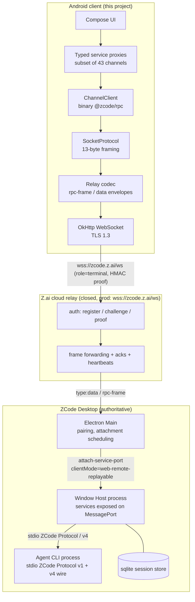

### 7.2 ZCode Protocol v1 (stdio NDJSON — baseline contract)

`[VERIFIED]` `packages/shared/src/zcode-protocol/index.ts`:

- **Envelope** (strict zod): Request `{id, method, params?, trace?}`; Notification `{method, params?, trace?}`; Response `{id, result}`; Error `{id, error:{code, message, data?}}`. Error code `sessionUnavailable = -32004`.
- **Identity constants**: `ZCODE_PROTOCOL_NAME = "ZCode Protocol"`, `ZCODE_PROTOCOL_VERSION = 1`, `ZCODE_PROTOCOL_V4_WIRE_VERSION = 3`.
- **Method registry** (selection, verbatim strings): `runtime/capabilities`, `session/create`, `session/resume`, `session/list`, `session/read`, `session/messages`, `session/events`, `session/subscribe`, `session/send` (deprecated-ish: adapter attachment fallback only), `session/stop` (deprecated: v4 `stop` command), `session/fork`, `session/compact`, `session/goal`, `session/close`, `session/setModel`, `session/setThoughtLevel`, `session/setMode`, `workspace/readPresentation`, `workspace/hooks/trustGrant`, `provider/updateAccountConfig`, `provider/testModelConnectivity`, `workspace/updateInteractionPreferences`, `workspace/updateModelIoPreferences`, `workspace/updateOffPeakToolPolicy`, `workspace/updateDynamicWorkflowPolicy`, `mcp/list`, `plugins/*` (24 methods), `skills/referenceCatalog`, `workflows/*` (6), `automation/*` (5), `offPeak/*`, `usage/stats`, `process/childProcesses`, `computer-use/operation-event`.
- **Server→client notifications**: `session/event` (params = one `ZCodeSessionEvent`), `state.updated {scope: server|workspace|session, revision, reason?, patch}`, `startup/storagePath`, `startup/storageState`, `process/resourceSample`, `plugins/operationProgress`.
- **Reverse (server→client) requests** — how interactive approvals surface on the stdio plane: `interaction/requestPermission`, `interaction/requestUserInput`, `interaction/requestProviderRuntimeHeaders`, `interaction/requestOfficialMcpAuthHeaders`, `interaction/browserList`, `interaction/browserExecute`.
- **Key params**: `session/create` `{sessionId?, workspace{workspacePath, workspaceKey, workspaceIdentity?, remoteSessionId?}, parentSessionId?, mode?: plan|build|edit|yolo|auto, model?, persistence?, thoughtLevel?, mcpServers?, toolAllowlist?, toolDenylist?}`; `session/send` `{sessionId, content, attachments?, inputId?, queryId?, modelSelection?, expectedRevision?}` → `{sessionId, accepted:true, stateRevision}` (**async-ack**: output arrives as events; send must never block on generation).
- **Session events** (25 wire types, discriminated union): `session.created|resumed|updated|titleUpdated|closed`, `turn.started|steerQueued|steerDrained|completed|failed`, `message.upserted|removed`, `part.started|delta|upserted|removed`, `model.streaming`, `tool.updated`, `permission.requested|resolved`, `userInput.requested|resolved`, `checkpoint.created`, `rewind.triggered`, `streamRecovery.updated`.

**Status in this project:** the desktop phone path does **not** use v1-over-stdio directly — it uses the binary Channel protocol carrying v4. v1 matters because (a) `runtime/capabilities` semantics recur, (b) Option C/F (app-server bridge) speaks exactly this, (c) event/payload schemas are shared vocabulary. `[VERIFIED]`

### 7.3 `@zcode/rpc` binary Channel protocol (the wire format to port)

`[VERIFIED]` `packages/rpc/src/`:

- **Serialization** (`serialization.ts`): each value = `[1-byte DataType tag][VQL varint length][data]`; DataType ∈ `{Undefined=0, String=1, Buffer=2, VSBuffer=3, Array=4, Object=5 (JSON fallback), Int=6 (VQL varint)}`. VQL varint = little-endian 7-bit groups (`readIntVQL`/`writeInt32VQL`).
- **Request types** (`channels.shared.ts`): `RequestType {Promise=100, PromiseCancel=101, EventListen=102, EventDispose=103}`; `ResponseType {Initialize=200, PromiseSuccess=201, PromiseError=202, PromiseErrorObj=203, EventFire=204}`.
- **Frame**: header array `[type, id, channelName, name(command|event)]` serialized as an Array; body per request type. Client request ids are integers; the reference client has no 31-bit wrap handling beyond safe-integer JSON fallback (wire-codec comment).
- **Sessions**: `ChannelServer.registerChannel(name, channel)` with `call(ctx, command, arg)` / `listen(ctx, event, arg)`; client `ChannelClient.getChannel(name)`; `ProxyChannel` generates typed proxies from descriptors.
- **Transports**: `IMessagePassingProtocol` implemented over MessagePort, sockets, WebSocket (`SocketProtocol` adds a **13-byte frame header**), and stdio.
- **Connection scoping**: on connect the server re-scopes channel `zcode-agent` via `createZCodeAgentConnectionScope` with `clientMode` and `role: "terminal-client" | "trusted-host-relay"`; replayable clients get `terminal-client`.

**Port scope for Android** (ADR-003): SocketProtocol framing (13-byte header: incl. message type, id, flags per `persistent-protocol.ts`), serialization, request/response/event state machine, keepalive (`persistent-protocol` measure/heartbeat), ChannelClient/Server subset. Estimated port surface ≈ 1,200–1,800 LOC Kotlin for a faithful subset — derived from measured file sizes (websocket.ts 105 + remoteServiceAccess.ts 223 + channelServer.ts 283 + serialization/protocol/persistent-protocol ≈ 1,100 total reference). `[ENGINEERING INFERENCE on LOC]`

### 7.4 v4 wire protocol (conversation plane)

`[VERIFIED]` `packages/shared/src/zcode-protocol-v4/`:

#### 7.4.1 Hello handshake

- Server → client `hello`: `{kind:"hello", protocolVersion:3, connectionId, clientMode, deliveryProfile ("continuous"|"replayable", must match clientMode), serverTime (clock calibration), capabilities: HostCapabilities, auth:{userId?}}`.
- Client → server `clientHello`: `{kind:"clientHello", protocolVersion:3, clientId, clientKind: "desktop"|"web"|"mobileRemote"|"mobileApp" (optional), clientMode, capabilities, topics…}`.
- `HostCapabilities` (server-declared; verified schema): required booleans `nativeDialogs`, `localTerminal`, **`binaryFrames`** (comment: ws-binary, relay-link probing — the protocol contemplates binary frames on relay links), `compression: "none" | "permessage-deflate"`; optional booleans `workspaceHookReview`, `independentPlanState`, `workflowRunDeltas` (enables key-level `workflowRun.*` deltas and raises actor/node caps 256→1024). Legacy hosts missing optional bits = false; consumers must test `=== true`. `[VERIFIED]` — capability-driven degradation is a protocol concept we adopt (§39).

#### 7.4.2 Topics and delivery

- Topics: `conversation/<sessionId>`, `sessions-index/<workspaceId>`, `workspace-config/<workspaceId>`.
- Frames: `TopicWireFrame {wireVersion:3, kind:"complete"|"fragment", deliveryKind:"initial"|"online"|"recovery", logicalFrameId, logicalFrameOrdinal, topic, subscriptionId, frame|fragment{fragmentIndex, fragmentCount, logicalBytes, checksum:{crc32}, dataBase64}}`.
- Delivery profiles: **continuous** (desktop) vs **replayable** (phone): replayable links receive snapshot + bounded deltas and are expected to resync; the sessions-index topic carries task list state; `MAX_LEGACY_TASK_IDS_PER_SUBSCRIBE = 200`.

#### 7.4.3 Methods (`V4_METHODS`, verbatim)

`v4/connection/flow`, `v4/controller/subscribe|resync|unsubscribe`, `v4/conversation/subscribe|resync|unsubscribe|rowsRange|plans|fileChanges|fileRewindPreview|backgroundBashOutput|workflowRunEvents|workflowRuns|workflowRunArtifacts|workflowRunArtifactData|workflowRunArtifactRead|workflowRunWorkspace|workflowRunNodeResult|usage`, `v4/usage/stats`, `v4/attachment/begin|chunk|commit|abort|read`, `v4/conversation/attachmentRead|attachmentStat`, `v4/attachment/previewSource`, `v4/commands/query`, `v4/command`.

Notifications: `v4/conversation/frame` (snapshot/delta topic frames), `v4/telemetry/event`, `v4/telemetry/local-ttft`, `v4/cua/permission-observation`.

`[VERIFIED]` Comments mark `rowsRange`-family methods as "只读、无状态、超时重发安全" (read-only, stateless, safe to re-send on timeout) — the protocol's own idempotency guidance.

#### 7.4.4 Command plane

`v4/command` carries `CommandEnvelope`:
`{commandId (uuid v7, client-generated, invariant across retries), clientId, sessionId|null, baseRevision?, baseLogEpoch?, type, payload, issuedAt (client clock, telemetry-only)}`. Commands requiring optimistic-concurrency guard: `COMMANDS_REQUIRING_BASE_REVISION` and `ROW_TARGETING_COMMANDS` require `baseRevision` / `baseLogEpoch` respectively — parse fails otherwise. `[CORRECTED 2026-09-28, Phase 2]` The v1.0.1 example "`COMMANDS_REQUIRING_BASE_REVISION` (e.g. `sendText`)" is wrong against the v3.14.3 schema (command.ts:296, commit `29628c9`): `sendText` is NOT in the set; the verified set is applyFileRewind, forkAssistant, editUserQuery, retryTurn, setAssistantFeedback, sendQueuedNow, editQueueItem, reorderQueueItem, deleteQueueItem, setAutoDrain, switchModelConfig, switchCollaborationMode, setFollowupMode, pauseGoal, resumeGoal; `ROW_TARGETING_COMMANDS` = applyFileRewind, forkAssistant, editUserQuery, retryTurn, setAssistantFeedback. The Kotlin port implements the verified sets verbatim (see docs/protocol/v4-wire.md §5). Command set (verbatim): `createSession`, `createSelectionSideSession`, `sendText`, `stop`, `compact`, `forkAssistant`, `editUserQuery`, `retryTurn`, `sendQueuedNow`, `editQueueItem`, `resolveInteraction`, `switchModelConfig`, `switchCollaborationMode`, `cancelBackgroundWork`, `cancelWorkflowRun` (workId≡runId), `resumeWorkflowRun`, `renameSession`, `deleteSession` (+ `createSession` config override shape). Server replies with idempotent `commandResultSchema` ACK.

`resolveInteraction` payload: `{interactionId, answer {optionId?, freeText?, action?, content?}}`; synthesized option ids include `allowOnce` / `allowAlways` / `allow_project` / `deny` and the special `workflowRefine` (free-text refinement for workflow create/amend permission). Mapping from v4 answers to `ZCodePermissionResponse` verified in `interaction-broker.ts:v4AnswerToPermissionResponse`.

#### 7.4.5 Limits (`PROTOCOL_V4_LIMITS`, verbatim — hard budgets)

| Limit | Value | Meaning for Android |
|---|---|---|
| `maxFrameBytes` | 1 MiB | physical frame ceiling; relay enforces (cf. #228) |
| `logicalFrameAssemblyMaxBytes` / `MaxFragments` / `MaxConcurrent` / `MaxStagedBytes` / `TimeoutMs` | 16 MiB / 1024 / 32 / 32 MiB / 30 s | reassembly bounds for fragmented logical frames |
| `transportEnvelopeIdMaxChars` | 256 | envelope id regex class `[A-Za-z0-9._~-]+` |
| `subscriberBufferMaxOps` / `MaxBytes` | 500 ops / 1 MiB | subscriber-side buffer bound |
| `eventRetentionPerSession` | 2000 | server-side replay window per session |
| `snapshotTailWindowRows` | 60 | snapshot tail size (rows) |
| `rowsRangeMaxLimit` | **200** | max rows per `rowsRange` query |
| `toolOutputFinalHeadBytes` / `TailBytes` | 32 KiB / 32 KiB | tool output truncation |
| `goalVerificationsRetained` | 20 | goal verification history |
| `pendingCommandsDisplayMax` | 32 | pending-command display cap |
| `commandPendingTtlMs` | 24 h | pending command TTL |
| `idempotencyTablePerSession` | 512 | server dedupe table per session |
| `conversationQueryTimeoutMs` | 10 s | read-query timeout |
| `attachmentMaxBytes` | 20 MiB | attachment size cap |
| attachment chunk | ≤ 512 KiB decoded, per-request proof ≤ 1 MiB | chunked upload/download |

#### 7.4.6 Conversation rows (UI projection vocabulary)

`[VERIFIED]` `rows.ts` row kinds: `turnHeader` (turn boundary, authoritative timing, per-turn file summary), `userInput` (with `origin`/`originMeta` — no text sniffing), `assistantText`, `reasoning`, `toolCall` (with state machine pending→running→completed/error and input/output titles), `artifact`, `subagent`, `hookInvocation`, `timelineMarker`. Clients observe `row.upserted` + `row.delta` standard ops. Assistant text may be visually merged with adjacent rows client-side.

### 7.5 Relay physical envelope and budgets

`[VERIFIED]` Three-layer measurement (from `measureTopicNotificationEnvelopeBytes`, quoted shape):

```json
{ "type": "data",
  "payload": { "zcode_type": "rpc-frame", "bridgeSessionId": "<transportId>",
               "bridgeGeneration": <n>, "recoveryId": "<transportId>", "seq": <n>,
               "dataBase64": "<base64 of Channel binary frame>",
               "checksum": {"algorithm":"crc32","value":"<8hex>"} },
  "client_ts": <ms>, "server_ts": <ms> }
```

Envelope id regex: `^[A-Za-z0-9._~-]+$`. Budgets observed in installed bundle: max physical frame, max fragments, saturation high/low watermarks 1 MB/256 KB, 8 MB replay buffer, 45 s ack grace, 10 s heartbeat interval, 30 s ack watchdog. `[REQUIRES VALIDATION]` exact fragment/ack message names for the acknowledged raw adapter (closed) — Phase 1 spike observes live traffic to confirm (§46 Q1).

### 7.6 Authentication & cryptography — Known / Unknown / Must-verify

**Known `[VERIFIED]`:**
- Algorithm: HMAC-SHA256; key = `passHash` (the QR `hash` param, base64 string of a sha256 digest); message = `${nonce}|${role}|${sid}`; encoding = base64url. Roles: `device` (desktop), `terminal` (phone). The web remote reimplements this in WebCrypto — same construction (agent-verified).
- Nonce is server-issued per `auth_challenge` → per-attempt freshness (proof cannot be precomputed from QR alone). `[ENGINEERING INFERENCE: replay resistance rests on server nonce uniqueness]`
- Desktop stores `pass_hash` under credential key `web-remote-control:external-relay:pass_hash`; `deviceSid` under `webRemoteControlExternalRelayDevice.deviceSid` in settings.
- Reset path exists ("leaked-qr") that re-registers the device and invalidates prior QRs.

**Unknown `[UNKNOWN]`:**
- Server-side expiry of QR params (`t`) and of `pass_hash` after pairing; rotation policy.
- Whether `mid`/`name` are validated (spoof/resistance characteristics).
- Whether the relay binds one proof per connection or allows re-auth on the same socket.
- Rate limiting / lockout behavior on failed proofs.

**Must verify before Phase 1 exit `[REQUIRES VALIDATION]`:** live round-trip of the terminal-role handshake against `wss://zcode.z.ai/ws` using a QR freshly generated on the desktop, including failure paths (wrong proof, reused nonce, second terminal while first connected). **Do not implement UI until this gate passes** (§43 Phase 1, §43.0).

**Android reproduction:** `javax.crypto.Mac("HmacSHA256")` with the key held as raw bytes inside Keystore-wrapped storage; per §26.6 the HMAC key *can* be generated inside Android Keystore (`KEY_ALGORITHM_HMAC_SHA256`) only if the QR hash is imported at pairing time — i.e., the key material originates **outside** the device, so Keystore import (or Keystore-wrapped Tink keychain encryption of the hash) is required. Exact storage design in §12.4/§26.6. Never log the hash or proof (§34).

### 7.7 Service channel inventory (43 channels, verbatim names)

`[VERIFIED]` `channels.ts:75-176` — `file`, `media-preview`, `system`, `terminal`, `git`, `git-checkpoint`, `setting`, `credential`, `cua-permission`, `cua-pip-session`, `broadcast`, `zcode-task`, `window-controller`, `zcode-agent`, `zcode-session`, `conversation-share`, `file-watcher`, `oauth`, `provider-settings`, `model-selection`, `provider-provisioning-target`, `usage-stats`, `coding-plan-subscription`, `client-config`, `client-scenes`, `skills`, `skill-sync`, `mcp-sync`, `plugins`, `plugin-management`, `subagents`, `commands`, `hooks`, `memory`, `settings-sync`, `bots`, `feedback`, `prompt-attachment-transfer`, `off-peak-task`, `onboarding-record` (+`media-preview`, `window-controller` noted above). Per-channel Android classification in §13.3.

### 7.8 `IZCodeTaskService` surface (the task-list plane)

`[VERIFIED]` `packages/services/src/session/zcodeTaskService.ts` — methods (selection): `createTask`, `resumeTask`, `sendPrompt`, `enqueueTaskCommand|promoteTaskCommand|cancelTaskCommand`, `stopGeneration`, `compactSession`, `goalSession`, `respondPermission`, `respondElicitation`, `listTasks|listTaskList|listPinnedTasks|listArchivedTasks`, `createTaskGroup|renameTaskGroup|deleteTaskGroup`, `getTaskSnapshot` / `getTaskSnapshotWithEtag` / `Body` / `Ref` / `ToolCallsSlice` (ETag-cached, sliced variants), `setMode`, `setModel`, `renameTask`, `setTaskPinned`, `archiveTask`, `deleteTask`. Events: `onDynamicStreamEvent(taskId)`, `onDynamicTaskTerminalOutcome`, `onDynamicTaskReady`, `onDynamicTaskEvent`, `onDynamicWorkspaceEvent`, `onError`. Session status enum: `idle|running|waiting|paused|completed|error` (+ archived timestamps).

### 7.9 `IZCodeAgentService` surface (the conversation plane)

`[VERIFIED]` `packages/services/src/zcode-agent/zcodeAgent.ts:569-864` — `initialize`, `createSession`, `resumeSession`, `listSessions`, `readSession`, `readSessionMessages`, `readSessionDebug`, `readSessionEvents`, `sendPrompt`, `compactSession`, `goalSession`, `setModel`, `setThoughtLevel`, `setMode`, v4 surface (`helloConversationV4`, `subscribeConversationV4`, `unsubscribeConversationV4`, `conversationRowsRangeV4`, `sendConversationCommandV4`, …), dynamic events (`onDynamicSessionEvent`, `onDynamicProcessResourceSample`, …).

### 7.10 Self-hosted server HTTP/WS surface (Option B)

`[VERIFIED]` `packages/server/src/http.ts` / `zcode-server-cli`:

- `GET /api/server-info` → `{serverId, name?, version, protocolVersion, authRequired, workspaces[{path,label}], capabilities{desktopContinuous, websocketRpc, processResourceTelemetry}}`.
- `POST /api/rpc-host-capability` → one-time token for `/ws/host` (header `x-zcode-rpc-host-capability`); `/ws/host` clients get `desktop-continuous`/`trusted-host-relay`.
- `GET /ws` → ChannelServer with `web-remote-replayable`/`terminal-client` (exactly the phone profile).
- `POST /api/connect-remote` (SSH/WSL/Docker targets), `GET /ws/remote/:id` (single-use; exposes only `file`, `git`, `system`, `terminal`; close codes 4000/4004), `POST /api/bots/:provider[/:botId]` (webhook, `x-zcode-bot-secret`).
- Auth: `ZCODE_SERVER_AUTH_TOKEN` (env; legacy `ZCODE_SERVER_TOKEN`); presented as `?token=` → HttpOnly `zcode_lite_token` cookie; protected paths exactly `/api/*`, `/ws*`. No Bearer support. Non-loopback binding without token is refused (zcode-server-cli: fail-closed).
- Distribution wrapper: `zcode --web --workspace <path> --port 3030 --host 0.0.0.0 --token <t>` (README-verified).

### 7.11 Workspace identity semantics

`[VERIFIED]` (root AGENTS.md, verbatim rules): "`workspaceIdentity` 用于身份隔离，`workspacePath` 用于文件操作、命令 cwd、Git 和路径展示"; "**identity key 统一为 `workspaceIdentity?.trim() || workspacePath`**" (dedupe, binding, cache, queue, persistence, request correlation); "远程链路贯穿传递 `workspaceIdentity` 与 `remoteSessionId`，不得仅按路径匹配"; new interfaces keep local-path fallback; remote identity reuses existing construction/parsing utilities. Attachment scope requires all three: `{remoteSessionId, workspacePath, workspaceIdentity}` (`validation.ts:210-220`). Mismatch guard exists desktop-side (`REMOTE_WORKSPACE_IDENTITY_MISMATCH`).

**Android rule:** task/workspace identity in the app = `(endpointId, workspaceIdentityKey)` where `workspaceIdentityKey = workspaceIdentity?.trim() ?: workspacePath` — never a bare path (§9.3, §42 INV-12).

### 7.12 Known unknowns (protocol)

Consolidated in §46: relay fragment/ack message names (Q1), QR/nonce server-side semantics (Q2–Q4), window-token mode vs sid/hash QR (Q5), `mobileApp` clientKind expectations vs `mobileRemote` (Q6), capabilities the official phone client declares (Q7), whether binary (non-base64) frames are possible over the relay (Q8 — schema hints base64, plan for base64), bootstrap-response/workspace-list shape stability (Q9), single-terminal takeover semantics (KICKED code observed; exact behavior to verify) (Q10).

---

## 8. Architecture Decisions

### 8.1 Architecture principles (each with its reason)

| # | Principle | Why it exists (grounded in verified facts) |
|---|---|---|
| P1 | **Single source of truth**: ZCode desktop/runtime owns task/session/agent state; Android owns presentation + local client state | Phone attaches to the *existing* window Host with `web-remote-replayable`; relay stores no business state; duplicating authority would create unresolvable divergence |
| P2 | **Separation of transport / domain / UI**; no UI→network coupling | Transport must be replaceable (relay ↔ direct server, §11); UI churn must never break the wire codec; agents building UI must not touch sockets |
| P3 | **Deterministic state transitions**: all projection changes flow through pure reducers driven by protocol events with explicit seq | Replay/duplicate/out-of-order handling (#228-class recovery, process death) is only correct if state transitions are reproducible |
| P4 | **Idempotent commands**: every Android-originated mutation carries a client-generated `commandId` (uuid v7) stable across retries | Protocol verified: `commandEnvelopeSchema` says "uuid v7，客户端生成，重试不变"; server keeps a 512-entry/session idempotency table |
| P5 | **Replay-safe event handling**: snapshot → deltas with `logEpoch`/`seq` watermarks; dedupe and discard stale | v4 delivery is explicitly replayable for phone-class clients; network transitions (Wi-Fi↔5G, Doze) are guaranteed to produce gaps |
| P6 | **Stale event protection**: every applied frame checks `(logEpoch, seq)` monotonicity and subscription generation | Reconnect replaces subscriptions; late frames from the old generation must be dropped, not merged |
| P7 | **Ordering guarantees declared, not assumed**: per-topic seq ordering only; cross-topic ordering is undefined | Protocol provides seq per topic; assuming global order would corrupt state on bursts |
| P8 | **Backpressure is explicit**: use `v4/connection/flow` (saturated/drained/closed) and bounded buffers; drop + resync rather than grow | Verified flow-control method exists; unbounded queues kill mobile processes (OOM) |
| P9 | **Bounded memory & message sizes** everywhere (render windows, caches, tool output head/tail 32 KiB) | Verified limits; 55 MB sessions exist in the wild (#228) |
| P10 | **Cancellation is first-class**: every in-flight request is cancelable; every screen scope cancels its subscriptions | Users navigate away mid-stream; EventListen/EventDispose (102/103) exist for this |
| P11 | **Retries are classified** (safe-always / safe-with-commandId / unsafe) per §28.6 | Blind retry of `sendText` duplicates prompts; rowsRange is documented safe to re-send |
| P12 | **Authentication is pluggable per transport** (relay HMAC proof vs server token) | Two verified auth mechanisms exist; more may come (window-token mode) |
| P13 | **Authorization minimality**: request only read/list/subscribe for MVP; never call `credential`, `oauth`, `setting` write paths | "Anyone holding the link operates the window" — the app must not widen that blast radius |
| P14 | **Credential isolation**: pairing secret lives in Keystore-wrapped storage; never in logs, backups, or screenshots of state | Link = full control (docs); stolen-phone threat (§26) |
| P15 | **Secure persistence**: Tink AES-GCM w/ Keystore-wrapped keys over DataStore; EncryptedSharedPreferences is deprecated | Verified platform guidance |
| P16 | **Privacy by default**: prompts/diffs/paths never leave the device except through the paired transport; redaction rules for logs/notifications | User code is the asset; notification leakage is a threat (§26) |
| P17 | **Observability with redaction**: structured logs with correlation IDs (connectionId, sessionId, commandId), never secrets | Debugging a distributed client without leaking credentials |
| P18 | **Testability**: pure protocol codecs and reducers are JVM-testable; a protocol-faithful mock server decouples CI from a live desktop | Solo developer + agents must be able to verify without the Mac online |
| P19 | **Offline/reconnect behavior is designed, not emergent**: cached projections labeled stale; explicit offline model (§17.6) | Android background network death is guaranteed (Doze); users must trust the label |
| P20 | **Version compatibility by negotiation**: hello capabilities + `app_version` gate + strict-schema decode with unknown-field tolerance | ZCode ships weekly (changelog cadence verified); the protocol has v3/v4 and capability flags |
| P21 | **Proportionate complexity** (§2.3): no microservices, no k8s, no custom crypto, no on-device inference | Solo-developer product; the value is in UX + correctness, not infrastructure |

### 8.2 ADR system

- Directory: `docs/adr/` in the future app repo (§40). Numbering `ADR-NNN-slug.md`, status `proposed|accepted|superseded by ADR-XXX`.
- An ADR is **mandatory** for: transport selection or addition; protocol implementation strategy changes; authentication/pairing changes; state ownership changes; persistence schema changes; any new third-party dependency in `core/*`; any relaxation of §42 invariants; distribution channel changes.
- `architectural.md` is updated when an ADR supersedes a decision recorded here (spec-first, §41.6).

**ADRs established by this document:**

| ADR | Decision (summary) | Status |
|---|---|---|
| ADR-001 | Android architecture: single-activity Compose, layered modules with strict dependency direction (§40); MVVM + unidirectional data flow; no MVI framework dogma beyond reducers | Accepted |
| ADR-002 | MVP transport = official ZCode relay (`wss://zcode.z.ai/ws`, terminal role) behind a transport abstraction; direct-server transport designed-in, delivered later | Accepted |
| ADR-003 | Protocol implementation = hand-ported Kotlin subset of `@zcode/rpc` + v4 schemas (no codegen from TS; no shared JS runtime) | Accepted |
| ADR-004 | Secure pairing: `CredentialVault` (Tink/Keystore-sealed custody) + `CredentialSigner` (challenge→proof capability) consumed by transport; BiometricPrompt gate; no novel crypto; verified HMAC reproduced exactly | Accepted |
| ADR-005 | State ownership per §14 table; Android never authoritative for task execution | Accepted |
| ADR-006 | Replay/recovery: snapshot+`afterSeq` resubscribe; `(logEpoch, seq)` stale-guard; pagination via `rowsRange` | Accepted |
| ADR-007 | Push: not in MVP; architecture reserves a notification-bridge interface; FCM (Play build) / UnifiedPush+ntfy (FOSS build) are Phase 2 candidates pending §24.6 verification | Accepted (deferred) |
| ADR-008 | Persistence split: Room for structured durable stores (projections/journal/outbox/interactions/drafts); DataStore for preferences/config/credential envelopes; cacheDir for blobs — rationale and revisit triggers in §17.2 | Accepted |
| ADR-009 | Terminal: view-only streaming terminal in Phase 6; interactive terminal with soft-keyboard strategy later; full terminal not MVP | Accepted |
| ADR-010 | Diff renderer: custom Compose renderer over a small unified-diff parser; no heavyweight dependency | Accepted |
| ADR-011 | Direct transport (Option B) and endpoint multiplexing: designed-in via `Transport` + `EndpointDescriptor` from day one | Accepted |
| ADR-012 | Distribution: GitHub Releases APK (+Obtainium guidance) first; Play closed testing optional later; signing key strategy fixed before first release | Accepted |

### 8.3 Architecture options (A–G) — investigation and comparison

Dimensions per option: transport, authentication, authorization, latency, reliability, offline behaviour, security, implementation effort, maintenance burden, dependency on ZCode internals, dependency on third-party infrastructure, failure modes, NAT considerations, background Android implications, push capability, version compatibility, cost, privacy, operational complexity.

**Option A — Official ZCode relay** (`wss://zcode.z.ai/ws`, sid/hash QR, terminal role)

| Dimension | Assessment |
|---|---|
| Transport | WSS to Z.ai relay; desktop is also a WS *client* (outbound only) — survives any NAT/firewall that allows the desktop's own outbound TLS |
| Authentication | HMAC-SHA256 challenge/proof with QR-carried passHash `[VERIFIED]` |
| Authorization | Bearer-equivalent: possession of QR grants full window operation (docs); relay enforces single terminal `[VERIFIED]` |
| Latency | Extra hop via Z.ai edge; adequate for chat streaming; sensitive to regional routing and the observed DNS flakiness on some networks |
| Reliability | Medium: heartbeat/ack watchdog verified; community reports disconnect loops (#328) and frame overflow on large sessions (#228) |
| Offline behaviour | None server-side beyond replay buffer (8 MB, 45 s ack grace observed); desktop restart = full re-pair |
| Security | TLS to Z.ai; secret = QR hash; trust Z.ai infrastructure (privacy tradeoff, below) |
| Implementation effort | **Low-medium**: handshake + envelope codec; no desktop-side changes |
| Maintenance burden | Medium: closed, undocumented, can change in any weekly release |
| Dependency on ZCode internals | High (closed relay behavior), though the *protocol vocabulary* is open |
| Third-party infra | Z.ai cloud only (no cost) |
| Failure modes | Relay outage; QR expiry; KICKED by second terminal; DNS failures (observed locally) |
| NAT | None (both sides outbound) |
| Android background | Same constraints as any WSS client (§25); relay keeps no push channel for us |
| Push capability | **None** (verified absence) |
| Version compat | Version-gated by QR `app_version` (v3/v4 app routes exist) — must pin & detect |
| Cost | Free |
| Privacy | Conversation metadata + content flow through Z.ai relay. **The relay terminates TLS and therefore has transport-level visibility of application payloads** — same exposure as today's web remote (no regression, no improvement). No application-layer E2E exists in verified ZCode `[VERIFIED absence]` |
| Operational complexity | Zero (that's the point) |

**Option B — Direct ZCode server** (`packages/server` / `zcode-server-cli` / CLI `--web` distribution over Tailscale/tunnel)

| Dimension | Assessment |
|---|---|
| Transport | WSS/WS to a server the *user* runs; binary Channel protocol directly (no relay envelope) |
| Auth | Shared-secret token (`?token=` → cookie) `[VERIFIED]`; TLS depends on fronting (Tailscale Serve = tailnet HTTPS; tunnel = ACME) |
| Authorization | Full service surface of that server; single-user by design; loopback-fail-closed default |
| Latency | Direct/one hop; best at home (LAN) |
| Reliability | Tied to user's machine + chosen network path; no relay bugs (#228/#328 don't apply) but no relay resilience either |
| Offline | Same as A: nothing survives desktop restart except app-side cache |
| Security | Good when fronted by Tailscale/tunnel TLS + strong token; bad if user exposes raw port — app must warn |
| Effort | Medium: needs user setup (install/run server, VPN or tunnel) but reuses the *same* Channel codec as Option A |
| Maintenance | Low (open source, versioned) |
| ZCode internals | Low — documented-by-source surface |
| Third-party infra | Optional: Tailscale (free tier) or Cloudflare Tunnel (free) |
| Failure modes | Desktop asleep/offline; tunnel down; token rotation |
| NAT | Solved by Tailscale (WireGuard) or tunnel (outbound) |
| Background Android | Same as A; plus Tailscale VPN app interaction on Android (VPN always-on affects battery) |
| Push | Not built-in; but the user controls the server → a tiny bridge could post to ntfy/FCM later |
| Version compat | Server reports `protocolVersion` in `/api/server-info` `[VERIFIED]` — cleanest negotiation story |
| Cost | Free |
| Privacy | **Best**: traffic can stay entirely inside the user's tailnet |
| Operational complexity | Medium for the user (setup), zero for the app |

**Option C — LAN/local connection** (Option B restricted to same-network, mDNS/manual IP)

| Dimension | Assessment |
|---|---|
| Transport | Plain WS over LAN (or WSS if the server fronting provides it) |
| Auth | Token; self-signed cert TOFU pinning possible `[PROPOSED]` |
| Latency | Minimal |
| Reliability | Great at home; useless away |
| Security | LAN exposure risks (rogue devices); Android 16 **Local Network Protection** applies — opt-in on 25Q2 builds, enforcement deferred to a later release; **VPN interfaces are excluded** from the local-network definition, so Tailscale traffic is not affected `[VERIFIED 2026-09-27]` |
| Effort | Low on top of B (same server; discovery = NSD/mDNS or QR-carried LAN URL) |
| Push | None |
| Role | **Fallback tier inside Option B's endpoint list**, not a standalone product option |

**Option D — Tailscale/private network** (fronting for B)

| Dimension | Assessment |
|---|---|
| Transport | WireGuard tunnel; desktop reachable via tailnet IP/MagicDNS; `tailscale serve` adds HTTPS |
| Auth | Tailnet identity + server token; TLS from serve |
| Latency | Direct paths (DERP relay fallback) |
| Reliability | High; independent of LAN |
| Security | Strong transport topology (identity-bound mesh) — but Tailscale is one transport topology, **not** an application security guarantee; the direct endpoint's own token auth and TLS still apply |
| Effort | User installs Tailscale on both ends; app treats it as transparent |
| Push | None inherent |
| Cost | Free personal tier (2026 pricing v4: ~6 users, unlimited personal devices) |
| Privacy | Excellent |
| Role | **Recommended fronting for Option B** |

**Option E — Cloudflare Tunnel / equivalent** (fronting for B)

| Dimension | Assessment |
|---|---|
| Transport | `cloudflared` on desktop → public WSS hostname (ACME TLS) |
| Auth | Token at app layer; optional Cloudflare Access service tokens |
| Latency | Public edge hop |
| Reliability | High; survives NAT/ISP changes |
| Security | TLS + CF; exposes a public URL (obscured) — must keep server token mandatory |
| Effort | User runs one daemon; no account needed for quick tunnels (ephemeral URLs complicate QR reuse) |
| Push | None inherent |
| Privacy | Traffic traverses CF edge |
| Role | **Alternative fronting for Option B**; also the shape of a future self-hosted relay (§50.6) |

**Option F — `zcode app-server` / stdio-oriented bridge**

`[VERIFIED]` `zcode app-server` speaks ZCode Protocol v1 NDJSON on stdio with full session control. A phone cannot speak stdio; a bridge (small daemon on the desktop: stdio ⇄ WebSocket) would be required — i.e., a *new user-installed component*, which is exactly Option B's cost with a *less* complete surface for our needs (v1 lacks the paginated v4 conversation plane as the primary surface). **Verdict: not selected.** Documented because it is the cleanest *protocol test oracle* for Phase 1 (drive `app-server` from a Kotlin JVM test to validate codec porting without a desktop app).

**Option G — Phone-hosted/Termux ZCode runtime**

`[VERIFIED assumption base]` The CLI is Node 24 + bundled tools; Termux can run Node. `[REQUIRES VALIDATION]` native tool binaries (bfs/rg/ugrep builds), mpv-class deps absent, battery/thermal profile, and the entire "agent works on a phone" product sense. **Verdict: future experiment only (§50.7); excluded from MVP architecture.** The transport interface must not preclude it (it's just another endpoint host).

**8.3.1 Selection per phase (with reasoning)**

- **Phase 1–5 (spike → state core): Option A only.** It is the only transport requiring *zero user setup*, it is what the QR the user already has opens, and proving it de-risks the largest unknown (closed relay). The transport abstraction (ADR-011) is built in from the first commit so A does not contaminate the design.
- **Phase 6–7: Option B/D/E delivered** as "advanced connection" (user opt-in), because: relay limits (#228/#328) and no-push are structural; direct server removes both for users willing to run one command; identity model (§9.3) already supports multiple endpoints.
- **LAN (C)** falls out of B as an endpoint candidate ordering (LAN → tailnet → tunnel → relay).
- **F** is a test fixture, not a product transport. **G** is out of scope.

**Why not "Option B first"?** Because requiring users to install/run a server before any value ("pair and see your tasks") kills the product's core moment. Option A delivers the day-one experience with zero desktop changes; Option B is the power path. Both share ~90% of the stack (ADR-011).

---

## 9. System Architecture

### 9.1 Overall system context

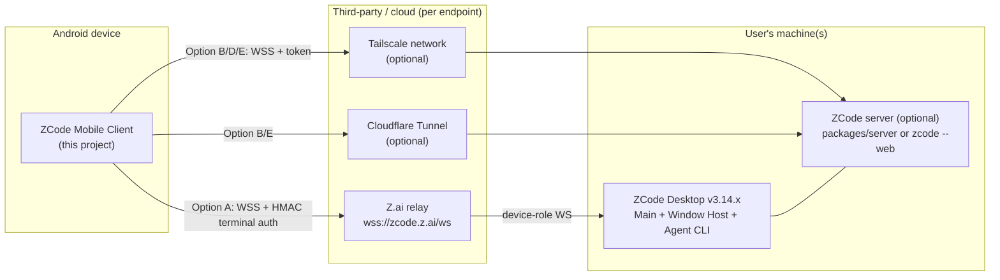

Notes: the desktop's ZCode agent may in turn run workspaces on SSH/WSL/Docker remotes — invisible to the phone except as `remoteSessionId` context (verified model §5.3). The phone never talks to those remotes.

### 9.2 Android internal architecture

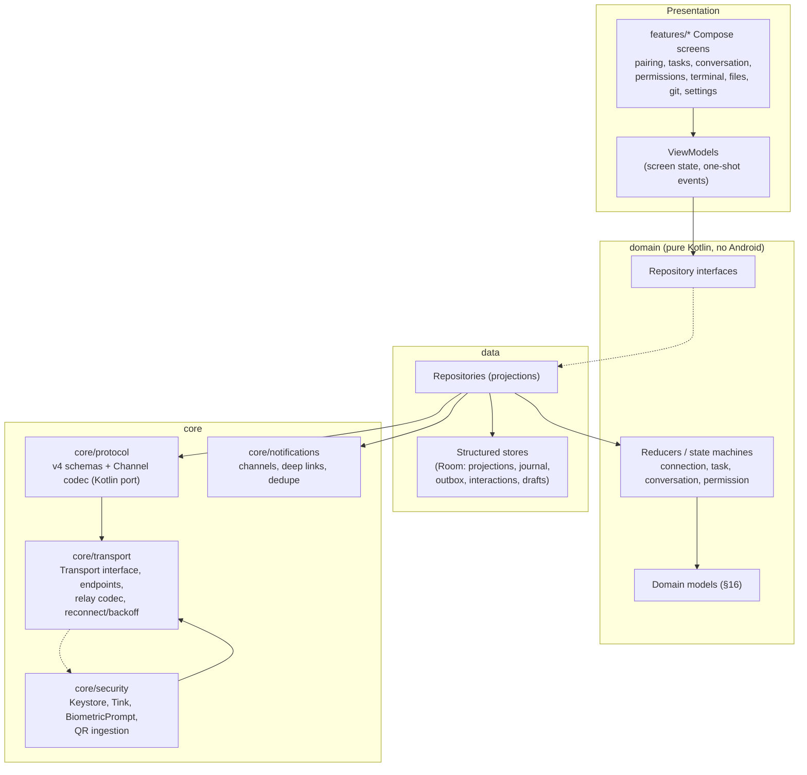

Dependency direction (enforced, §40.2): `features → data → domain`; `domain → {models, repo interfaces}` only; `core/* → nothing app-specific`; `data → core/protocol`; **never** `features → core/transport` directly; **never** `domain → Compose/Android UI`; **never** `transport → UI`.

### 9.3 Desktop/runtime relationship and authority topology

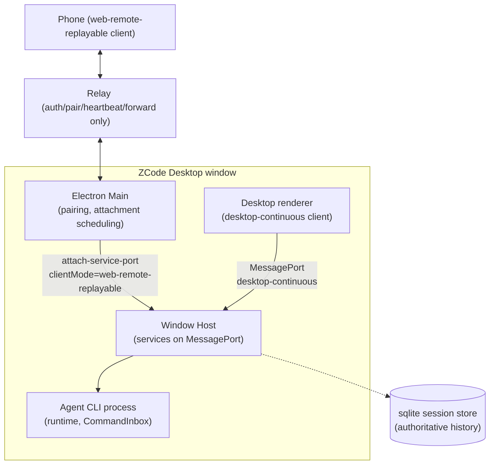

`[VERIFIED]` The phone and the desktop renderer are *peers* of the same Host: same services, same v4 commands, different delivery profile. This is why "desktop remains authoritative" is structural, not aspirational: the runtime's `CommandInbox` serializes admitted commands; the phone's optimistic overlays are pending until the runtime's authoritative projection says otherwise.

### 9.4 Transport architecture

```mermaid
flowchart TB
    subgraph App["Android transport layer"]
        TI["Transport interface<br/>(§11.2)"]
        AUTH["AuthStrategy"]
        EP["EndpointRegistry<br/>(endpoint descriptors, health, ordering)"]
        RC["RelayTransport<br/>(rpc-frame codec, terminal auth)"]
        DC["DirectTransport<br/>(server-info handshake, token auth)"]
        RM["ReconnectManager<br/>(backoff, network triggers, resume)"]
    end
    EP --> TI
    TI <|.. RC
    TI <|.. DC
    RC -- "wss relay" --> RELAY["Z.ai relay"]
    DC -- "wss /ws" --> SERVER["ZCode server"]
    TI --- RM
    AUTH -.-> RC
    AUTH -.-> DC
```

### 9.5 Authentication / pairing sequence (Option A)

```mermaid
sequenceDiagram
    participant U as User
    participant A as Android app
    participant K as CredentialSigner<br/>(Keystore/Tink)
    participant R as Relay wss://zcode.z.ai/ws
    participant D as Desktop (role device)
    U->>A: scan QR (sid, hash, t, mid, name, app_version)
    A->>A: parse + validate + compatibility gate
    A->>K: seal passHash (Tink, Keystore-wrapped key)
    A->>R: WS connect (TLS)
    A->>R: auth_init {role:"terminal", device_sid:sid, meta{name:"<device model>"}}
    R-->>A: auth_challenge {nonce}
    A->>K: compute proof = HMAC-SHA256(passHash, "${nonce}|terminal|${sid}") base64url
    A->>R: auth_response {device_sid, proof}
    R-->>A: auth_ack / pair_status_ack {pair_status:"waiting"}
    R->>D: pair_status_query → desktop shows "phone connecting"
    D-->>R: (desktop already paired/registered; pair_status matched)
    R-->>A: pair_status_ack {pair_status:"matched"}
    A->>R: bootstrap-request / workspace-list-request
    R-->>A: workspaces[] → open workspace bridge (rpc-frame channel begins)
```

`[REQUIRES VALIDATION]` exact phone-side messages beyond auth (`bootstrap-request`, `workspace-list-request`, `workspace-bridge-open`, `mobile-view-state-update`) are known by name from the installed bundle's `routePayload` but their schemas must be captured in the Phase 1 spike (§46 Q9).

### 9.6 Conversation streaming flow

```mermaid
sequenceDiagram
    participant A as Android
    participant R as Relay/Transport
    participant H as Window Host (authoritative projection)
    A->>R: v4/conversation/subscribe {sessionId, deliveryKind:"web-remote-replayable", afterSeq?, includeSnapshot?}
    R->>H: (bridged)
    H-->>A: v4/conversation/frame {kind:"complete", deliveryKind:"initial", frame:{snapshot rows, eventSeq}}
    loop live deltas
        H-->>A: v4/conversation/frame {kind:"complete", deliveryKind:"online", frame:{deltas, seq}}
        A->>A: reducer: (logEpoch,seq) monotonic check → apply → StateFlow
    end
    Note over A: UI renders via LazyColumn window;<br/>markdown parsed per-message AST (cached)
    A->>R: v4/conversation/rowsRange {…, limit ≤ 200} (scroll-back, pagination)
    H-->>A: rows page (stateless, timeout-safe resend)
```

### 9.7 Permission interaction

```mermaid
sequenceDiagram
    participant H as Runtime (Host)
    participant A as Android
    participant U as User
    H-->>A: permission.requested {requestId, toolCallId, toolName, riskLevel, reason, input, suggestedPermissionUpdates?}
    A-->>U: approval card (+notification if backgrounded)
    alt user approves/denies
        U->>A: tap option (optionId) [+ free text for workflowRefine]
        A->>A: state → Submitting; generate commandId (uuid v7)
        A->>H: v4/command resolveInteraction {interactionId, answer{optionId, freeText?}} [idempotent]
        H-->>A: commandResult ACK
        H-->>A: permission.resolved {requestId, decision}
        A->>A: state → Resolved (authoritative confirmation)
    else resolved elsewhere (desktop user answered first)
        H-->>A: permission.resolved
        A->>A: stale-guard: card → Resolved-by-elsewhere; drop pending submit
    else network dies mid-submit
        A->>A: submit marked pending-retry; on reconnect, reconcile with permission state from snapshot
    end
```

### 9.8 Reconnect / replay

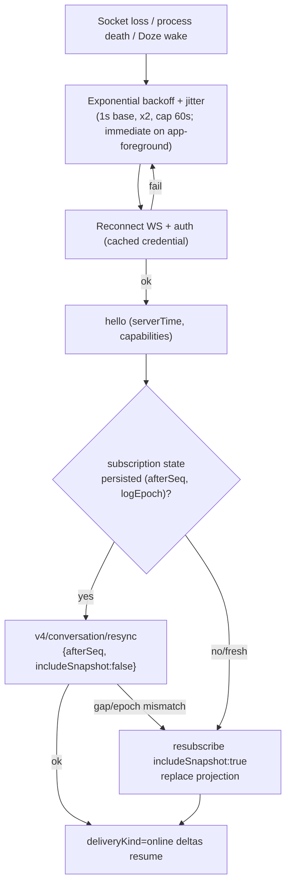

### 9.9 Notification flow

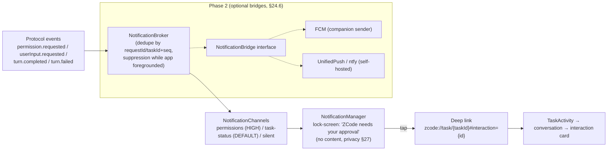

### 9.10 Data ownership

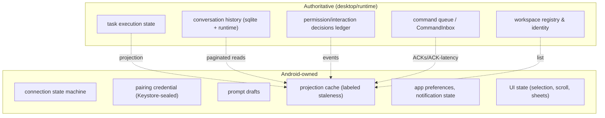

### 9.11 Failure recovery (topology)

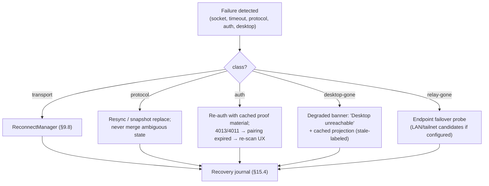

### 9.12 Future direct-connection architecture

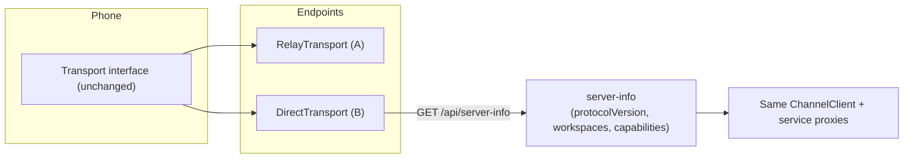

No feature UI may branch on transport type; capability flags (`serverInfo.capabilities`, hello `HostCapabilities`) are the only permitted variability source (§42 INV-6).

### 9.13 Identity model (identifiers)

| Identifier | Meaning | Producer | Android treatment |
|---|---|---|---|
| `deviceSid` | Relay-registered desktop device id (`d_…`) | Relay, on desktop registration | Stored per endpoint; part of endpoint identity; **not** a secret |
| `deviceMid` | Desktop machine id in QR | Desktop | Paired-endpoint metadata only |
| `passHash` (`hash`) | QR-carried shared secret (base64 sha256 digest) | Desktop at QR generation | SECRET — Keystore-sealed; never logged; never synced |
| pairing record (Android) | `(endpointId, endpoint kind, deviceSid, sealed credential, pairedAt, appVersion)` | Android | One row per QR scan; multiple endpoints supported |
| `workspaceIdentity` / `workspaceKey` | Workspace isolation identity; identity key = `workspaceIdentity?.trim() \|\| workspacePath` | Desktop/runtime | Never render as path; path is display-only `[VERIFIED rule]` |
| `remoteSessionId` | Desktop-side remote-workspace connection id | Desktop main | Opaque correlation id |
| `sessionId` / `taskId` | A ZCode task/session (`sess_…`-class ids; task list ids are service-level) | Runtime | Primary UI key; namespaced by endpoint + workspace identity |
| `messageId` / `partId` | Message and part identity in conversation | Runtime | Row keys in projection |
| `interactionId` | permission/userInput interaction instance (v4) | Runtime | Approval card identity; dedupe + stale-guard key |
| `requestId` | Permission request id (session-event plane) | Runtime | Mapped to interactionId; notification identity |
| `commandId` | Client-generated uuid v7 command envelope id | **Android** | Stable across retries (idempotency key); logged redacted |
| `clientId` / `connectionId` | Android client identity per endpoint; server-issued per connection | Android / server | Connection-scoped; regenerated per connect |
| `recoveryId` / `bridgeSessionId` | Relay transport correlation | Relay/transport internals | Opaque; never persisted |
| `seq` / `logEpoch` | Per-topic event watermark | Runtime | The stale-guard currency; persisted per subscribed session |
| `revision` / `stateRevision` | Store revision for CAS checks (`expectedRevision`, `baseRevision`) | Runtime | Optimistic-concurrency currency; never used as identity |
| `etag` | Snapshot validator (task snapshots) | Runtime | Cache validation only; never an identity |
| `rowId` (turn anchor) | Conversation row identity (v4 rows) | Runtime | Render keys and scroll anchors |

**Rules:** one identifier is never used as another (e.g., a permission `requestId` is not an `interactionId` across planes — mapping is explicit in the protocol bridge layer). Task identity is `(endpointId, workspaceIdentityKey, sessionId)`.

---

## 10. Android Architecture

### 10.1 Recommended stack (versions verified 2026-09-27)

| Layer | Choice | Version | Verified source | Rationale |
|---|---|---|---|---|
| Language | Kotlin | **2.4.20** (2026-09-07; language release 2.4.0) | kotlinlang.org (S20) | Current stable; Compose compiler ships in Kotlin 2.x |
| UI | Jetpack Compose (BOM) | **2026.09.00** → core 1.12.1, material3 **1.4.0**, material3-adaptive 1.3.0 | developer.android.com BOM mapping (S19) | Stable baseline; Expressive via material3 **1.5.x** explicit dep behind `@OptIn` (ADR in §44) |
| Design system | Material 3 (+ dynamic color, M3 Expressive stable parts) | per BOM | S19 | Native-first mandate; adaptive components for large screens |
| Min / target / compile SDK | **26 / 36 / 36** (compileSdk 37 evaluated when AGP supports stable) | — | Play policy S23; Android 16 docs S21; Android 17 exists (S22) | 26 = notification channels, adaptive icons, java.time; 36 = current Play requirement |
| IDE/Build | Android Studio (current stable) + AGP 9.x, Kotlin DSL, version catalog | AGP 9.3.x | S25 | R8 full mode default; 16 KB page alignment |
| Coroutines/Flow | kotlinx-coroutines | current stable | — | StateFlow-driven unidirectional flow |
| Serialization | kotlinx.serialization (JSON) | current stable | — | zod → Kotlin data classes hand-ported (§13.1); JSON for relay envelopes; binary codec hand-written |
| WS client | **OkHttp 5.x** (`okhttp-android`) | 5.1.0+ | okhttp releases (S25) | Binary frames (ByteString), TLS 1.3, mature reconnect semantics; Ktor 3.5.x acceptable alternative but adds engine layers we don't need |
| DI | Manual DI (constructor) + small `AppContainer` — **no framework** | — | — | Solo-dev proportionality (§2.3); module boundaries do the real work |
| Persistence | **Room** for structured durable stores (task projections, conversation page cache, recovery journal, command outbox, interaction store, drafts); **DataStore (Proto)** for preferences/config/small metadata (endpoints, settings, notification state); **Tink+Keystore** for credential envelopes | latest stable | ADR-008 | EncryptedSharedPreferences deprecated; each engine does only what it is good at (§17.2) |
| Secrets | Tink (AES-GCM streaming) + Android Keystore-wrapped key; BiometricPrompt gate | latest stable | §26.4 | Verified platform guidance |
| QR | CameraX 1.4.x + ML Kit barcode-scanning **bundled** (works off-GMS) | stable | S25 | In-app scanner is the pairing path (App Links on zcode.z.ai impossible — not our domain) |
| Markdown | **compose-richtext 2.x** + `richtext-codehighlighting`; custom diff renderer | 2.x | S25 | Designed for streaming/partial markdown; custom block interception |
| Background | Foreground service `specialUse` (connected indicator, user opt-in); WorkManager for periodic reconnect probes; **never dataSync** | — | §25 | FGS dataSync runtime budget would kill the socket |
| Push (Phase 2) | FCM high-priority data messages (Play build) / UnifiedPush+ntfy (FOSS build) | — | S24 | Only with user-run bridge (§24.6) |
| Widgets (Phase 3) | Glance | 1.2.x | S25 | "Pending approvals" widget is the differentiator |
| Testing | JUnit, kotlinx-coroutines-test, Turbine, MockK/ hand fakes, Compose UI tests, MockZCode server (§35.4) | — | — | JVM-testable core |
| Perf | Baseline Profiles + Macrobenchmark; R8 full mode; 16 KB alignment | — | S25 | Startup budget §28.1 |
| CI | GitHub Actions (§36) | — | — | — |

**Deliberate exclusions:** Compose Multiplatform (no iOS commitment; protocol/domain modules stay pure Kotlin = free KMP option later, §50.1), Hilt/Koin (DI framework unneeded at this scale), Ktor client (OkHttp suffices; revisit only if KMP becomes real), RxJava, Retrofit (no REST API in the product; server-info is one GET).

### 10.2 Threading model

- One `Dispatchers.Default`-confined reducer/decoder pipeline; WS I/O on OkHttp threads bridged to a single `Channel<Unit>`-backed parser coroutine (ordered, per connection); UI strictly on `Dispatchers.Main` via StateFlow.
- No shared-mutable state outside StateFlow/reducer; repository = merge of (cache, transport events) with explicit reconciliation.

### 10.3 Module map (detail in §40)

`app` · `core:protocol` · `core:transport` · `core:security` · `core:notifications` · `core:common` · `domain` · `data` · `features:pairing` · `features:tasks` · `features:conversation` · `features:permissions` · `features:terminal` · `features:files` · `features:git` · `features:settings` · `core:testing` (+ `tools/mockzcode` JVM mock server). Android library modules for all but `app`.

---

## 11. Transport Architecture

### 11.1 Requirements

T1 Replaceable per endpoint without UI changes (ADR-011/002). T2 Binary-frame WebSocket with TLS. T3 Pluggable auth (relay HMAC terminal proof; server token; future window-token). T4 Deterministic reconnect with resume (`afterSeq`). T5 Backpressure-aware (`v4/connection/flow`). T6 Observability (connection ids, redacted logs). T7 Multi-endpoint registry with health probing and ordered failover. T8 No transport-specific types leak above `core/transport`.

### 11.2 Transport interface (conceptual contract — no implementation code)

Responsibilities assigned to `Transport` (interface + lifecycle), semantics normative:

| Operation | Contract |
|---|---|
| `connect(endpoint)` | Establish TLS WebSocket to the endpoint; **does not** authenticate; emits connection-state transitions (§14.4.1) |
| `authenticate(signer)` | Perform transport-specific handshake. Relay: request `auth_challenge` → call the injected `CredentialSigner.proof(nonce, role, sid)` → send `auth_response`. Direct: attach token via `TokenProvider`. The transport **never holds long-lived secret material** — it holds only a capability that answers challenges (§26.3). Emits `Authenticated(hello)` with negotiated capabilities + serverTime |
| `send(frame)` | Serialize + fragment per physical limits (relay: rpc-frame envelope; direct: raw Channel frames); **bounded queue**, signals saturation via flow API |
| `receive: Flow<InboundFrame>` | Ordered per-connection frames after parse; parse errors are terminal for the frame, reported, never swallowed |
| `close(reason)` | Graceful close; releases socket; idempotent |
| `reconnect(policy)` | Backoff + jitter + trigger sources (network change, app foreground, manual); emits attempt accounting |
| `subscribe(subscription)` / `unsubscribe` | Maps to v4 subscribe/resync/unsubscribe with `afterSeq` bookkeeping |
| `recover(subscriptions)` | Re-auth + resync flow of §15; the **only** path that may issue snapshot replacement |
| `capabilities: StateFlow<CapabilitySet>` | Union of hello `HostCapabilities` + server-info capabilities (direct) |

**Does NOT belong in transport** (hard rule): domain models, conversation reducers, permission logic, persistence, notification logic, UI state, credential *custody or raw material* (the security module owns sealing and signing; transport receives only a `CredentialSigner`/`TokenProvider` capability that answers challenges), retry policy of *commands* (domain owns idempotent retry; transport owns connection retry only), any logging of payload content.

### 11.3 Endpoint model

```text
EndpointDescriptor {
  id, kind: RELAY_ZAI | DIRECT_SERVER,
  displayName, pairedAt,
  wsUrl (relay: wss://zcode.z.ai/ws; direct: user-supplied),
  credentialRef (Keystore-sealed handle; never raw),
  desktopAppVersion (from QR/app_version or server-info.version),
  candidates: [primary wsUrl, optional fallback urls (LAN, tailnet, tunnel)]
}
```

Failover order for a DIRECT endpoint with candidates: LAN URL → tailnet name → tunnel URL → (never auto-switch to relay without user consent — different trust domain) `[PROPOSED]`.

### 11.4 Transport-specific behaviors

- **RelayTransport**: JSON text WS; `type:"data"` envelopes carrying base64 Channel frames; heartbeat `pair_status_query` every 10 s with 30 s ack watchdog (matching desktop's observed cadence `[VERIFIED]`); treat `error{code:"KICKED"}` as single-terminal takeover → user-visible "connected elsewhere" state; close-code mapping per §33.
- **DirectTransport**: binary WS frames (no base64); `GET /api/server-info` preflight (token via `?token=` first request → cookie jar; store token as secret); capability discovery from server-info + hello; close codes 4000/4004 mapped. **Auth models differ per transport and must not be conflated:** direct mode uses shared-secret token + `zcode_lite_token` cookie `[VERIFIED]`; relay mode uses the HMAC challenge/proof (§7.6). No relay-auth assumption may be carried into direct mode or vice versa.

### 11.5 Networking design (§28 topics)

- **TLS**: platform defaults (TLS 1.3 preferred). Certificate pinning: **no static CA pinning** (rotation risk); DIRECT self-hosted certs may be TOFU-pinned per endpoint with user-visible fingerprint confirmation `[PROPOSED]`; relay uses standard WebPKI. **TLS terminates at the relay/server** — it protects the pipe, not the payload from the endpoint operator (§26.1 trust model).
- **Timeouts**: connect 10 s; auth handshake 15 s; frame parse is event-driven (no read timeout beyond WS idle); heartbeat watchdog 30 s (relay) / protocol ping (direct); query timeout 10 s (verified `conversationQueryTimeoutMs`).
- **Keepalive**: relay heartbeat (above); OkHttp `pingInterval(20s)` for direct endpoints to survive NAT idle drops.
- **Reconnect**: exponential backoff base 1 s, factor 2, cap 60 s, full jitter; **immediate on app foreground** and on network-available callback; attempt budget then degraded state (user action available). Reconnect must never auto-resubmit pending commands (domain layer decides, §17.6).
- **Network change detection**: `ConnectivityManager.NetworkCallback`; on change, probe current connection; transparent handover is *not* assumed — resync flow handles gaps (§15).
- **Metered networks**: stream normally while foregrounded; background probes only; no bulk history prefetch on metered unless user-enabled.
- **Captive portals**: detected via TLS/probe failures → user-visible "network requires sign-in" state.
- **DNS failure**: distinguish NXDOMAIN/NODATA (endpoint down) from timeout (unreachable) → different user messaging; relay ENOTFOUND observed in the wild (S18) so this is a real path.
- **IPv4/IPv6**: platform dual-stack; no hard-coded IPs anywhere (endpoint descriptors carry hostnames).
- **Proxy**: honor system proxy for HTTPS; no PAC scripting.
- **Large messages**: inbound fragments reassembled within `logicalFrameAssemblyMaxBytes=16 MiB` / 1024 fragments / 30 s timeout `[VERIFIED limits]`; oversized → protocol error → resync (never merge).
- **Compression**: none assumed; permessage-deflate is optional-to-negotiate `[REQUIRES VALIDATION whether relay offers it — assume no]`.
- **Backpressure**: transport-level bounded send queue (drop-oldest for telemetry-class frames, never for commands); subscribe to `v4/connection/flow` and apply `saturated` → pause non-essential reads UI-side (§28.5).

### 11.6 Multi-workspace / multi-instance (§31)

- Multiple **endpoints** (desktops) supported from Phase 7; each endpoint exposes its own workspace list (relay `workspace-list-request` / direct `server-info.workspaces`) `[VERIFIED shapes exist]`.
- Workspace identity = `(endpointId, workspaceIdentityKey)` (§7.11). The app never uses paths as identity (AGENTS.md rule is adopted verbatim).
- Multiple QRs for the same desktop create the **same** endpoint (dedupe by deviceSid) with credential rotation semantics (§12.7).

---

## 12. Authentication & Pairing

### 12.1 Credential model

`[VERIFIED]` The pairing credential for Option A is the QR's `hash` (base64 sha256 digest) + `sid` (device id) + endpoint metadata (`t`, `mid`, `name`, `app_version`). Raw password never exists on the phone. The credential's authority = full control of the desktop window (docs). For Option B the credential is the server token.

### 12.2 QR ingestion flow (normative)

1. In-app scanner (CameraX + ML Kit bundled) **and** manual paste/typed link (accessibility + desktop-emulator fallback). (App Links auto-open on zcode.z.ai is impossible — not our domain; the QR encodes an https URL, so camera-app scan opens a browser today; our scanner intercepts inside the app.)
2. Parse URL; require path suffix `/remote/v4` (accept `/remote/v3` with a compatibility warning, §39); require params `sid` (format `d_` + base62, length sanity), `hash` (base64, 44 chars expected for 32-byte digest — validate, don't assume), `t` (epoch ms sanity: not future, not older than 10 min by default → warning "QR may be stale — desktop: refresh QR"), `mid`, `name`, `app_version`.
3. Compatibility gate: parse `app_version` → minimum-supported-desktop matrix (§39.3). Below minimum: block with explanation; above maximum-tested: warn-continue.
4. Dedupe by `sid`: same sid → **rotation flow** (§12.7), not a new endpoint.
5. Write nothing until validation passes (no partial state on a malformed QR).

### 12.3 Pairing handshake

Exactly §9.5. Failure mapping: `error{code:"AUTH_FAILED"}` → credential invalid/expired → re-scan; close 4013 → invalid mobile connection (bad params); close 4011 → session expired; close 4009 → another terminal connected (single-terminal rule) — UI explains and offers "take over" (connect; the other page gets KICKED) with explicit consent `[PROPOSED — takeover semantics REQUIRES VALIDATION, §46 Q10]`.

### 12.4 Secure storage (exact, no "secure storage" hand-waving)

**Conceptual boundary (normative):** `CredentialVault` (custody: sealed storage, load/wipe/rotate) and `CredentialSigner` (capability: given a challenge nonce, produce the verified HMAC proof without exposing material) are the **only** two surfaces over the pairing secret. `core:transport` depends on `CredentialSigner`/`TokenProvider` interfaces; no transport component may read, cache, log, or retain the secret itself. This separates **credential custody → proof capability → transport** without touching the verified ZCode HMAC algorithm (§7.6, INV-10).

| Item | Where | Encryption | Backup | Notes |
|---|---|---|---|---|
| passHash (relay credential) | DataStore file (proto) value field | **Tink AES-GCM, key wrapped by Android Keystore AES key** (StrongBox if available) | Excluded from Android backup (`android:dataExtractionRules` exclude) | Decrypted only in memory during handshake |
| Optional Keystore-resident HMAC key | Android Keystore (`KeyProperties.KEY_ALGORITHM_HMAC_SHA256`), key material = imported passHash bytes | Keystore hardware boundary | Non-exportable by design | Import at pairing; if StrongBox unavailable → software keystore |
| Server token (direct endpoints) | DataStore value | Tink-wrapped as above | Excluded | — |
| deviceSid / endpoint metadata | DataStore | Plaintext (not a secret) | Included (safe) | — |
| Projection cache | DataStore (or Room) | Plaintext, but **must exclude from backup** if it contains conversation content | Excluded | Privacy §27 |
| Drafts | DataStore | Plaintext (user's own content, on-device) | Included (user benefit) | — |
| Notification history / last interaction state | DataStore | Plaintext | Excluded | — |

Biometric gate: `BiometricPrompt` with `CryptoObject` gating the Tink key usage **per app-start first unlock** and **on credential reveal/rotate/unpair**; not per-frame (unusable UX). Devices without secure lock screen: explicit reduced-security consent screen (§2.6 E7).

### 12.5 Device identity (Android side)

`clientId` = random uuid v4 generated once per install, rotated on "reset app identity" setting; `meta.name` sent at auth = `Build.MODEL` (user-renamable). Never reuses `mid`/`name` from the desktop QR as *its own* identity — those describe the desktop.

### 12.6 Session expiration / re-authentication

On close 4011/4013 or `AUTH_FAILED`: keep the endpoint record, mark credential `suspect`, prompt re-scan (QR refresh on desktop invalidates old hash — docs). On transient auth failure (network): standard reconnect, no prompt. `[REQUIRES VALIDATION]` whether relay permits multiple auth attempts per connection; if not, transport tears down and reconnects per attempt (bounded: 3).

### 12.7 Rotation and unpair

- **Rotate (same desktop)**: scan fresh QR with same `sid` → replace sealed credential atomically; in-flight connection torn down and re-established; old hash overwritten (cannot be revoked server-side by us — desktop "refresh QR" already invalidated it `[VERIFIED]`).
- **Unpair (local)**: delete Keystore-wrapped key material + DataStore endpoint record + caches; confirm with biometric; explain that desktop-side "Stop" is also required (docs: closing dialog ≠ stopping).
- **Secure wipe**: `DeviceIdling`-free immediate deletion; no tombstones containing secret material; logs redact hashes unconditionally (§34).

### 12.8 What must be verified before relying on pairing (§26/§46 pointers)

`[REQUIRES VALIDATION, BLOCKING for Phase 1 exit]`: terminal-role handshake E2E; behavior on second terminal (KICKED vs reject); QR `t` enforcement; whether `bootstrap-request` requires a fresh nonce/proof. **Never invent cryptographic behavior** — any deviation from the verified construction is a bug, not an optimization.

---

## 13. Protocol & RPC

### 13.1 Implementation strategy (ADR-003)

Hand-ported Kotlin subset, verified against the TS schemas by **golden vectors**: for each message type, fixtures are generated from the TS zod schemas (run once per tracked ZCode version in CI via a small TS script — *dev-time tooling only, not shipped*) and committed as JSON; the Kotlin decoder must round-trip them. Unknown fields: tolerate + preserve raw (forward compatibility); unknown message types: typed as `Unknown(typeId, raw)` and counted (§39.3). **Fail-closed rule (INV-14):** tolerance applies to *structurally safe* unknowns only — a known schema violation is rejected safely (resync, never merge); an **unknown command type is never executed**; an **unknown permission option id is never mapped to an allow decision** (fail closed, §20.4); security-sensitive payloads that fail validation surface a safe failure, never a degraded-but-permissive interpretation. This avoids a JS runtime on device while keeping drift detectable.

### 13.2 Port layers (bottom-up)

1. **bytes**: VQL varint, DataType tags, CRC32 (wire-standard, not java.util.zip variant unless bit-identical — verify in Phase 1).
2. **socket**: 13-byte SocketProtocol framing (header serialize/parse per `persistent-protocol.ts` semantics: message type, id, flags; keepalive ping/pong).
3. **channel**: ChannelClient state machine (Promise/EventListen/EventDispose; PromiseSuccess/Error/EventFire), request-id allocation, timeout/cancellation mapping to `PromiseCancel`.
4. **v4-wire**: hello/clientHello, TopicWireFrame (complete/fragment reassembly within verified limits), topics, methods/notifications tables, command envelope (+ CAS requirement validation), conversation rows.
5. **relay-codec** (Option A only): `{type:"data", payload:{zcode_type:"rpc-frame", …}}` envelope, fragmentation per observed relay budget, heartbeat/auth state machine.
6. **service-proxies**: typed Kotlin interfaces for the subset in §13.4, generated *manually* (no codegen) with fixtures.

### 13.3 Service inventory (all 43 channels classified)

Legend: **MVP** = minimum viable product (§43.4); P2/P3 = later phases; Class: R=read-only usage, W=writes, E=events. "Fallback if unavailable" = behavior when server rejects/omits the channel.

| Channel | Android? | Phase | Class | Security sensitivity | UI consumer | Fallback |
|---|---|---|---|---|---|---|
| `zcode-task` | **MVP** | 4 | R+W+E | High (drives tasks) | Tasks, conversation | Feature disabled + banner |
| `zcode-agent` | **MVP** | 4 | R+W+E (v4 plane) | High | Conversation | Fatal for conversation feature |
| `zcode-session` | MVP-adjacent | 4 | R (legacy read/list) | Medium | Tasks (legacy list fallback) | Prefer v4 sessions-index |
| `file` | P2 | 6 | R (read-only scope enforced app-side) | High (arbitrary read) | Files viewer | Disabled |
| `media-preview` | P2 | 6 | R | Low | Image/video in chat | Link-out placeholder |
| `terminal` | P2 | 6 | R (view-only first) | **Critical** (shell access) | Terminal viewer | Disabled; never enabled silently |
| `git` | P2 | 6 | R | Medium | Git panel | Disabled |
| `git-checkpoint` | P3 | 7 | R | Medium | History/restore view (read-only) | Disabled |
| `window-controller` | No | — | — | High (desktop window control) | — | Never |
| `conversation-share` | P3 | 7 | R | Medium | Share/read-only timeline | Disabled |
| `file-watcher` | P3 | 7 | E | Low | Files freshness | Poll instead |
| `oauth` | **No** | — | — | Critical (credentials) | — | Never (N6) |
| `credential` | **No** | — | — | Critical | — | Never (N6) |
| `setting` | P3 | 7 | R (subset) | Medium | Settings sync view | Disabled |
| `provider-settings` / `model-selection` | P2 | 6 | R + W(model switch only) | Medium | Model picker | Disabled |
| `provider-provisioning-target` | No | — | — | High | — | Never |
| `usage-stats` | P2 | 6 | R | Low | Usage view | Hidden |
| `coding-plan-subscription` | No | — | — | High | — | Never |
| `client-config` / `client-scenes` | P3 | 7 | R | Low | Feature flags display | Defaults |
| `skills` / `skill-sync` / `mcp-sync` | P3 | 7 | R | Low | Skills/MCP viewers | Hidden |
| `plugins` / `plugin-management` / `plugin-sync` | P3 | 7 | R | Medium | Plugins viewer | Hidden |
| `subagents` / `commands` / `hooks` | P3 | 7 | R | Low | Inspectors | Hidden |
| `memory` | P3 | 7 | R | Medium | Memory viewer | Hidden |
| `settings-sync` | No | — | — | Medium | — | Never (write surface) |
| `bots` | No (product) | — | W | High | — | Never (webhook is server-side) |
| `feedback` | P3 | 7 | W | Low | Feedback form | Mailto fallback |
| `prompt-attachment-transfer` | P2 | 6 | W (via v4 attachment commands preferred) | Medium | Composer attachments | v4 attachment plane only |
| `off-peak-task` | P3 | 7 | R | Low | Idle-time list | Hidden |
| `onboarding-record` | No | — | — | Low | — | Never |
| `broadcast` | P3 | 7 | E | Low | Cross-surface sync | Ignore |
| `system` | P2 | 6 | R | Medium | Desktop status (hostname, uptime) | Hidden |
| `cua-permission` / `cua-pip-session` | No | — | — | High | — | Never (computer-use is desktop-visual) |

**Large-payload / background-use supplement** (channels Android may enable; the rest are never ported regardless of payload profile):

| Channel | Large-payload risk | Background use? | Protocol dependency |
|---|---|---|---|
| `zcode-agent` | High — conversation frames; mitigated by §28.3 pagination | Yes (core) | v4 wire + capability negotiation |
| `zcode-task` | Medium — snapshots; ETag + tool-call slices | Yes (core) | `IZCodeTaskService` surface |
| `terminal` | High — unbounded output; app-side ring buffer (§21) | FGS window only, opt-in | `ITerminalService` (verified) |
| `file` | Medium — chunked reads, size caps | No (foreground feature) | file service |
| `v4/attachment/*` | Bounded by protocol (512 KiB chunks / 20 MiB cap) | Upload foreground-only | attachment transaction plane |
| `usage-stats` | Low | No | usage query |

### 13.4 Minimum viable service surface (§16) — the actual MVP list

**MVP-required** (no MVP without these): `zcode-agent` (hello, v4 subscribe/resync/rowsRange/command, sessions-index), `zcode-task` (listTasks, getTaskSnapshot(WithEtag), resumeTask, sendPrompt (or v4 sendText path), stopGeneration, respondPermission, respondElicitation), relay auth + bootstrap/workspace-list. **Why:** these five flows — pair, list, open, stream+send, approve — are the product (§43.4).

**Phase 2:** model/mode switch, usage, attachments (begin/chunk/commit/read), system status. **Phase 3:** file/git read-only, conversation share read-only, skills/plugins viewers, feedback. **Advanced:** terminal interactive, git-checkpoint restore, memory, workflows inspection. **Desktop-only / not appropriate:** window-controller, oauth/credential, coding-plan-subscription, bots (as client), cua-*, settings-sync, onboarding-record, provider-provisioning-target. **Unknown:** exact capability gating per channel on replayable connections (`[REQUIRES VALIDATION]` — spike enumerates what a terminal-role connection may call; e.g. desktop may gate `terminal` to interactive sessions only).

Every classification above has a fallback row in §13.3 so a server that refuses a channel degrades the feature, never the app.

---

## 14. State Ownership

### 14.1 Definition of "authoritative"

A state object's **authority** is the component whose value, after any sequence of concurrent operations, defines the truth all other representations must converge to. Authority implies: (a) it may reject/override writes; (b) it is the recovery source after any party restarts; (c) its absence/destruction defines the state as lost. For ZCode, the runtime (window Host + Agent CLI + its sqlite store) is authoritative because it holds the CommandInbox, the event journal, and the history; the relay holds nothing (verified); Android is a *cache + control surface*.

### 14.2 State ownership table (§7 required)

| State | Authority | Android role | Android representation | Mutable by Android? | Persistence (Android) | Recovery strategy | Conflict strategy |
|---|---|---|---|---|---|---|---|
| Task execution state | ZCode runtime | projection | `TaskSummary` StateFlow per endpoint+workspace | No (read-only; commands request changes) | cache, ETag-validated | listTasks/snapshot resync | Runtime wins; Android overlay discarded on ACK/revision |
| Conversation history | ZCode runtime (sqlite journal) | cached projection, paginated | rows store (windowed, tail-biased) | No | Room page cache | `rowsRange` re-fetch + resubscribe snapshot | `(logEpoch, seq)` monotonic guard; snapshot replaces |
| Streaming deltas | ZCode runtime | transient render state | per-row text buffer | No | **never persisted** | snapshot on resubscribe | drop stale seq |
| Draft prompt (per task) | Android | source of truth until sent | DataStore draft `[CORRECTED 2026-09-28, Phase 4]` → persisted in **Room** per ADR-008/E4 (implemented Phase 4) | **Yes** | Room | local persistence | — |
| Pending commands | Android (outbox) + runtime (idempotency table) | submit + track ACK | outbox with commandId | Yes (create/retry/cancel) | DataStore `[CORRECTED 2026-09-28, Phase 4]` → **Room** per ADR-008/E4 (implemented Phase 4) | re-ACK reconcile after reconnect; TTL 24 h (verified server TTL) | Runtime ACK wins; duplicate ACKs deduped by commandId |
| Permission decision | ZCode runtime protocol | command issuer | interaction card state | Yes (issue only) | interaction state cache | reconcile from snapshot after reconnect | Already-resolved requests flip UI; late submits no-op |
| Connection state | Android | source of truth | connection state machine | Yes | in-memory + last-state hint | state machine §14.4.1 | — |
| Pairing credential | Android Keystore-sealed store | sole holder on phone | sealed blob | Yes (rotate/wipe) | Tink+Keystore | re-pair on loss | — |
| Workspace registry | Desktop | cached list | endpoint+workspaces | No | cache | re-fetch bootstrap/server-info | Desktop wins |
| Model/mode selection | Desktop | command issuer + echo | picker state | Yes (via switch commands) | cache of last-known | resync | Runtime echo wins |
| Notification state (seen/snoozed) | Android | source of truth | DataStore | Yes | DataStore | — | — |
| App preferences / privacy settings | Android | source of truth | DataStore | Yes | DataStore | — | — |
| UI state (selection, scroll, sheets, theme) | Android | source of truth | Compose state (+saved state) | Yes | SavedStateHandle | process-death restore | — |

### 14.3 What "Android never authoritative" forbids

No local mutation of conversation rows (edits are *commands*, e.g. `editUserQuery`); no local "task cancel" bookkeeping that survives contrary runtime evidence; no merging of divergent histories; optimistic overlays must have a defined reconciliation (ACK/revision/snapshot) and a max lifetime (`commandPendingTtlMs` 24 h verified; UI treats > 60 s pending as degraded `[PROPOSED]`).

### 14.4 State machines — transitions and illegal transitions

#### 14.4.1 Connection

States: `Unpaired → Pairing → Authenticating → Connecting → Connected → Reconnecting → Recovering → Degraded → Failed → Closed`. Terminal-side states persist per endpoint.

| From | Event | To |
|---|---|---|
| Unpaired | QR validated | Pairing |
| Pairing | credential sealed | Authenticating |
| Authenticating | auth_ack + pair matched | Connecting |
| Connecting | hello received | Connected |
| Connected | socket loss / Doze kill | Reconnecting |
| Reconnecting | ws+auth ok | Recovering |
| Recovering | resync applied (gap-free) | Connected |
| Recovering | epoch mismatch / gap unresolvable | Connected (after snapshot replace) |
| Any | user unpair / wipe | Closed |
| Authenticating | 4013/4011/AUTH_FAILED | Failed (→ Pairing via re-scan) |
| Reconnecting | budget exhausted | Degraded |
| Degraded | manual retry / network restored | Reconnecting |
| Connected | desktop closed (DesktopDisconnected) | Degraded |

Illegal: `Pairing → Connected` (must authenticate); `Degraded → Recovering` (must pass through Reconnecting); `Failed → Connected` (must re-pair); `Closed → any` (identity destroyed). All other transitions are logged as anomalies (§34).

#### 14.4.2 Task (projection)

`Unknown → Loading → Idle | Running | WaitingForPermission | WaitingForUser | Completed | Failed | Cancelled (+ Disconnected overlay)`.

| From | Event | To |
|---|---|---|
| Unknown | list/snapshot arrives | any per `status` |
| Running | `permission.requested` | WaitingForPermission |
| Running | `userInput.requested` | WaitingForUser |
| WaitingForPermission | `permission.resolved` | Running |
| Running | `turn.completed` | Completed |
| Running | `turn.failed` | Failed |
| Running | stop command ACKed | Cancelled (runtime-confirmed) |
| Any | connection Degraded | previous state + `stale` flag |

Illegal: `Completed → Running` (a *new turn* is a new runtime state; if the protocol emits it, treat as title/revision update — never resurrect locally); `WaitingForPermission → Completed` without `permission.resolved` + terminal event (implies desktop forced resolution; display "resolved elsewhere").

#### 14.4.3 Permission (interaction card)

`Requested → Displayed → Submitting → Resolved` (+ `Expired | Cancelled | Stale | Failed`).

| From | Event | To |
|---|---|---|
| Requested | card rendered | Displayed |
| Displayed | user taps option | Submitting |
| Submitting | commandResult ACK (+ `permission.resolved`) | Resolved |
| Submitting | send failure (transport) | Displayed (retryable; commandId preserved) |
| Any | `permission.resolved` arrives first | Resolved (by-elsewhere flagged) |
| Any | session resnapshot lacks the interaction | Stale |
| Any | desktop session closed | Cancelled |
| Requested | TTL passed without resolution (desktop-defined; 5-min dialog expiry documented for Claude-class products; ZCode TTL `[UNKNOWN]` → treat as Stale after reconnect reconciliation) | Expired |

Illegal: `Resolved → Submitting` (double-tap guarded by state + idempotent commandId); `Stale → Submitting`. Duplicate taps: second tap while Submitting is a no-op (state + commandId dedupe). Late responses after Resolved: dropped, logged (correlation id kept for QA).

---

## 15. Replay & Recovery

### 15.1 Recovery architecture (first-class)

Recovery is a subsystem, not an error path: a **Recovery Journal** (per endpoint: last hello serverTime, subscription set with `(topic, afterSeq, logEpoch)`, last applied op per subscription, pending outbox) persisted at every state transition, consulted on every (re)connect. Nothing about recovery depends on UI liveness.

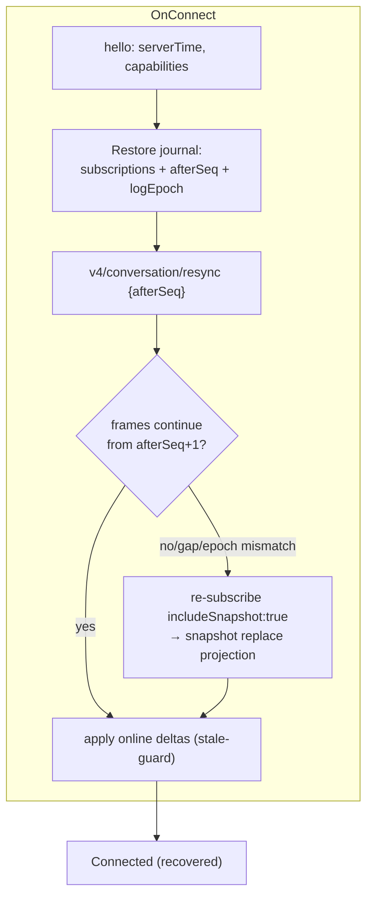

### 15.2 Scenario matrix (each: Detection / Response / Authority / Recovery request / Reconstruction / User-visible / Timeout / Retry / Terminal failure)

**S1 Connection lost (socket error, idle timeout)**
Detection: WS failure callback or heartbeat watchdog (30 s relay). Response: state → Reconnecting; keep last projection visible with `stale` badge. Authority: transport. Recovery request: reconnect → resync (§15.1). Reconstruction: journal + resync/replace. User-visible: top banner "Reconnecting… n" with elapsed; conversation readable. Timeout: backoff budget 2 min → Degraded. Retry: §11.5. Terminal: Degraded with manual retry + endpoint diagnosis hints.

**S2 Android process killed**
Detection: none (new process starts cold). Response: full startup path. Authority: journal (DataStore). Recovery: connect → authenticate (sealed credential) → restore journal → resync. Reconstruction: projection cache + snapshot replace where needed. User-visible: normal launch; recovers to task list + last task. Timeout: as S1. Retry: as S1. Terminal: as S1.

**S3 Phone sleeps (Doze)**
Detection: n/a (OS). Response: sockets die silently; on wake (`Lifecycle` foreground), immediate reconnect attempt (skip backoff). Authority: as S1. User-visible: instant "Connected" on unlock if desktop reachable; else S1 path. No background keep-alive is attempted (§25/§29 — battery).

**S4 Wi-Fi → mobile transition**
Detection: NetworkCallback onLost/onAvailable. Response: treat as S1 with *fast* backoff (0.5 s base); do not assume same socket survives. Authority: as S1. Reconstruction: resync; seq guard drops any duplicated tail.

**S5 Desktop temporarily offline (sleep/restart)**
Detection: `DesktopDisconnected` close 4010, or auth ok but bridge open fails, or repeated resync timeout. Response: Degraded with "Desktop unreachable" + guidance ("wake the Mac, relaunch ZCode"). Authority: journal. Recovery: periodic low-rate probe (WorkManager 15-min constrained) → auto-reconnect on reachability `[PROPOSED; user-configurable]`. Terminal: none — indefinite degraded with cached data.

**S6 Relay unavailable**
Detection: connect timeouts / DNS NXDOMAIN / 5xx-equivalents. Response: endpoint failover probe (candidates) if configured; else Degraded ("ZCode relay unreachable — check network"). Retry: standard backoff, capped attempts then probe-only. Terminal: user action (network, or configure direct endpoint).

**S7 Message duplicated**
Detection: `(logEpoch, seq)` already applied. Response: drop + count metric. Authority: watermark. User-visible: none (except anomaly counter in diagnostics).

**S8 Message delayed / out of order**
Detection: seq gap smaller than buffer window → hold buffer (bounded, 500 ops / 1 MiB verified limits); seq jump with gap → gap policy. Response: apply in-seq; hold ≤ 5 s then gap → snapshot replace. Authority: watermark.

**S9 Snapshot stale (applied but old epoch)**
Detection: `logEpoch` changed (desktop replayed/rewound history). Response: discard current projection for that topic, apply snapshot as new base. Authority: runtime. User-visible: brief "syncing" shimmer, content replaces.

**S10 Sequence gap (lost frames)**
Detection: watermark discontinuity. Response: `resync {afterSeq}`; failure → full snapshot. Never "fill" gaps locally.

**S11 Partial frame / fragment lost**
Detection: fragment assembly timeout (30 s verified) or checksum (crc32) mismatch. Response: drop logical frame; request resync for that topic; count metric. User-visible: none (deltas compacted by next frame) unless repeated → S1 path.

**S12 Reconnect succeeds but state changed (task completed/failed meanwhile)**
Detection: snapshot/sessions-index shows terminal state differing from journal. Response: apply authoritative state; reconcile notifications (mark seen if terminal consumed). User-visible: terminal outcome banner on the task.

**S13 Permission request arrives while disconnected**
Detection: on recovery, snapshot/sessions-index contains open interaction (or `permission.requested` replayed). Response: create card + notification now. User-visible: approval card on task open; badge on task list. `[REQUIRES VALIDATION]` whether replayable snapshot includes open interactions — spike confirms; fallback = poll `getTaskSnapshot` on recovery.

**S14 User taps notification after task changed**
Detection: deep link resolves task → state mismatch (completed / deleted / different endpoint). Response: graceful routing — open task if exists; else "task no longer available" screen with endpoint picker. Never crash, never empty-screen.

**S15 Two permission responses (double tap / two devices)**
Double tap: state machine + commandId dedupe (§14.4.3). Two terminals: relay single-terminal policy means only one phone is connected; desktop user resolution wins via `permission.resolved` → our pending submit becomes no-op (stale-guard).

**S16 Send prompt while replay running**
Allowed: command envelope is independent of replay (baseRevision CAS will reject if stale → surface "conversation changed, please resend" with draft preserved). UI enables composer during replay but marks send as "will apply to latest state".

**S17 Task deleted / archived remotely while viewed**
Detection: sessions-index delta removes task. Response: exit detail gracefully ("This task was archived/deleted on desktop") + return to list; local draft for that task preserved until user discards.

### 15.3 Single-terminal takeover UX (KICKED)

`[VERIFIED]` relay sends `error{code:"KICKED"}` / close 4009 when another connection takes the terminal slot. Android shows: "Another ZCode Remote page took over this connection" + actions [Reconnect (takes over back)] [Dismiss]. This is expected behavior of the platform (one page at a time), not an error state.

### 15.4 Recovery journal schema (conceptual)

`{endpointId, helloServerTime, capabilitiesSeen, subscriptions: [{topic, sessionId, afterSeq, logEpoch}], pendingOutbox: [{commandId, type, payloadRef, issuedAt}], lastAppliedPerTopic, version}` — persisted transactionally at each transition; schema-versioned for migration (§32.3).

### 15.5 Snapshot & acknowledgement semantics (normative)

- **Authoritative snapshot → atomic replacement** of the affected projection: the reducer (a) swaps the projection for that topic in one transaction, (b) resets the replay cursor to the snapshot's seq, (c) discards stale derived state (streaming buffers, pending-delta queues) for that topic, and (d) **retains local-only state separately** (drafts, UI state, notification history) — snapshots never overwrite Android-owned state.
- Snapshots **replace**; they never merge or patch runtime-owned projections. Incremental delta frames patch; any ambiguity (seq gap, `logEpoch` change, checksum failure) escalates to snapshot replacement (§15-S9/S10/S11).
- **No `timeout = assume success`:** a command without its ACK is *unknown*, not confirmed (outbox state `Unknown`, §17.5); a query timeout is retried as a fresh stateless query (rowsRange-class is documented re-send-safe `[VERIFIED]`); a resync that cannot complete within budget leaves the projection **labeled stale** — it never silently declares success. Detection always rests on explicit acknowledgement, sequence, revision, ETag, snapshot, replay, or idempotency evidence — never on the absence of an error.

---

## 16. Domain Model

Conventions: every model is an immutable Kotlin data class; ids are typed value classes (`SessionId`, `InteractionId`, …) to prevent identifier mix-ups (§9.13); serialization via kotlinx.serialization with `ignoreUnknownKeys=true` and raw-JSON retention for unknown shapes. Source column: where the field truth comes from. Lifecycle: creation → update path → eviction.

| Model | Identity | Required fields | Optional fields | Source | Mutability | Serialization | Persistence | Lifecycle | Version compat |
|---|---|---|---|---|---|---|---|---|---|
| **Endpoint** | `endpointId` (uuid) | kind, wsUrl, displayName, pairedAt | deviceSid, desktopAppVersion, candidates[], lastHealthyAt | pairing flow | rotate/wipe | DataStore proto | DataStore | until unpaired | `app_version` gate |
| **PairingCredential** | endpointId | sealed blob (hash/token) | sealedAt, kind | QR / server setup | rotate | Tink-sealed bytes | DataStore (encrypted) | rotate/wipe | — |
| **Workspace** | `(endpointId, workspaceIdentityKey)` | identityKey, displayLabel, kind (local/remote/conversation) | path (display-only), remoteSessionId | bootstrap / server-info | no | proto | DataStore cache | re-fetch wins | identity rule §7.11 |
| **Task** | `(endpointId, workspaceIdentityKey, taskId)` | taskId, title, status, workspace ref, createdAt, updatedAt | mode, model, archivedAt, summary(additions/deletions/files), pinned | sessions-index / listTasks / snapshots | no (projection) | JSON (kotlinx) | Room task cache (ETag) | until evicted (LRU) | status enum tolerant |
| **Session** (protocol-level) | sessionId | sessionId, workspace, status, mode, title | model, thoughtLevel, timestamps | zcodeSessionInfoSchema | no | JSON | cache with Task | as Task | strict schema port |
| **ConversationPage** | `(sessionId, logEpoch, range)` | rows[], eventSeq | nextCursor | rowsRange / snapshot | no | JSON | Room page cache | windowed (tail-biased) | logEpoch invalidation |
| **ConversationRow** (sealed) | rowId | kind (turnHeader/userInput/assistantText/reasoning/toolCall/artifact/subagent/hookInvocation/timelineMarker), payload | — | v4 rows | no | polymorphic JSON | with page | as page | unknown-kind fallback row |
| **Message / MessagePart** | messageId / partId | info (role, tokens, cost), parts[] | — | session/messages (legacy plane) | no | JSON | not persisted (only rows cached) | per session read | — |
| **StreamingBuffer** | rowId | accumulated text, lastSeq | — | deltas | replaced per delta | in-memory only | never | per stream | — |
| **ToolCall** | callId (toolCallId) | tool, state(pending/running/completed/error), input | output (head/tail 32 KiB), title, startedAt | toolCall rows / tool.updated | no | JSON | with page | as page | unknown tool → generic |
| **PermissionRequest** | interactionId (+requestId alias mapping) | toolName, riskLevel, reason, input, options | suggestedPermissionUpdates, origin, display | permission.requested | card state only | JSON | Room interaction store | resolved → archived (24 h) | options open-set |
| **UserInputRequest** | interactionId | prompt/questions | options | userInput.requested | card state only | JSON | Room interaction store | as above | — |
| **Diff** | patchHash + files[] | files[{path, additions, deletions, hunks?}] | writeCount, toolNames | patch parts / fileChanges | no | JSON | with page | as page | binary → non-renderable entry |
| **FileRef** | workspace + path | path, size?, mime? | — | file channel reads | no | — | none (ephemeral) | per view | — |
| **Attachment** | attachmentId | mime, size, direction | chunkCursor, localUri | v4 attachment plane | upload/download progress | JSON | metadata only (payload on disk cache) | TTL eviction (§32.4) | ≤20 MiB verified |
| **GitState** | workspace ref | branch?, status summary | log head | git channel | no | JSON | none | per view | — |
| **ModelOption / ModeOption** | option id | id, label | availability | model-selection / snapshot config | no | JSON | cache | per resync | — |
| **AppError** (§33) | errorId (uuid) | category, userMessage, diagnostic, retryable | cause, correlationIds | everywhere | no | JSON | ring buffer (last 200) | session-scoped | — |
| **NotificationRecord** | notificationKey (dedupe) | taskRef, kind, createdAt, seenAt | interactionRef | NotificationBroker | seen/snooze | proto | DataStore | 7-day retention | — |
| **ConnectionState** | endpointId | machine state (§14.4.1) | attempt count, last error | transport | machine only | in-memory | journal | per connect | — |

**Unknown-tolerance rule:** every decoded payload keeps `rawJson`; `unknown` enum cases render via generic fallbacks (§19.5) — the app never crashes on new protocol shapes (INV-8).

---

## 17. Data Layer

### 17.1 Architecture

Repositories expose cold `Flow<State>` + command functions; they merge **transport events** (via domain reducers) with the local stores (Room for structured state, DataStore for preferences) and own reconciliation. No repository talks to OkHttp/WS directly — only to `core/transport`'s session API; no repository knows about Compose.

### 17.2 Database decision (why this split)

**Engine split (decided — ADR-008).** The desktop is the store of record and re-fetch is cheap and paginated (`rowsRange`, ETag snapshots), so Android never mirrors full history — but the client *does* need durable, indexed, transactional stores for state that has lifecycle and transitions. Forcing that shape into DataStore key-value files would be an anti-pattern (manual indexing, no queries, whole-file rewrites, no transactional multi-row updates). Therefore:

| Engine | Owns | Why |
|---|---|---|
| **Room (SQLite)** | task projections (ETag-validated list + detail), conversation page cache, **event/recovery journal**, **persistent command outbox**, **interaction store** (permission/user-input cards), drafts, notification-state rows that need queries | these are structured collections with per-row identity, indexes, range queries, and transactional transitions (exactly what the outbox/journal state machines need); schema migrations are a solved, testable mechanism |
| **DataStore (Proto)** | preferences, feature settings, selected endpoint, UI preferences, small durable metadata (endpoint descriptors, pairing metadata), credential *envelopes* (Tink-sealed blobs) | small, low-cardinality, read-mostly values; atomic file semantics are sufficient |
| `cacheDir` files | attachment payloads | large binary blobs, LRU-managed (§17.3) |

**What proves the split right / triggers revisiting:** if Phase-4 measurement shows Room adds > 100 ms to cold start or the schema churn cost exceeds its query benefit for a given store, that store may drop to DataStore — with an ADR. Conversely, any new durable collection with per-row identity goes to Room by default. Migration path: Room schema exports + migration tests from every shipped version (§32.3); DataStore additive proto fields only.

### 17.3 Cache strategy

| Cache | Content | Validation | Eviction | Size bound |
|---|---|---|---|---|
| Task list | summaries per workspace (Room) | ETag (`getTaskSnapshotWithEtag`) / sessions-index deltas | LRU per workspace; stale > 7 d dropped | ≤ 500 tasks/workspace |
| Conversation rows | tail window + fetched pages (Room) | logEpoch; ETag on snapshot | tail window kept; pages beyond 2 windows evicted | ≤ 2 × render window + 1 page (§28) |
| Interaction store | open/recent interactions (Room) | reconciled on every recovery | resolved > 24 h dropped | ≤ 64 |
| Attachments | payload files in `cacheDir` | size/mime | LRU bytes budget 128 MiB, TTL 7 d | 128 MiB |
| Journal | recovery state (Room) | — | overwritten per transition | tiny |

### 17.4 Drafts and last-viewed

Drafts persist per `(endpointId, workspaceIdentityKey, taskId)` in Room immediately on keystroke (debounced 300 ms); survive process death; explicit discard only. Last-viewed task per workspace restores on connect (user-visible "continue where you left off" behavior).

### 17.5 Command queue — does Android need one?

**Yes, minimal.** The runtime has its own CommandInbox/idempotency table; Android's outbox exists only to (a) make sends survive a transport blip between tap and ACK, (b) give the user truthful pending state, (c) prevent duplicate submits. **Lifecycle:** `Draft → AcceptedLocally (commandId assigned) → Transmitted → Acked (confirmed) | Failed(retryable|terminal) | Expired (TTL 24 h verified) | Cancelled(by user before transmit)`. Persistence: DataStore journal `[CORRECTED 2026-09-28, Phase 4]` — superseded by ADR-008/E4: the outbox is a Room structured durable store (§32.1); the §43.2-4.4 gate evidence (`docs/adr/phase-4-gate.md`) implements Room. **Retry rules:** `sendText`/`resolveInteraction`/user-input: auto-retry only on *transport-level* failure before first transmit; after any server contact, retry is **user-gated** (server may have applied it — idempotency table dedupes, but we don't gamble UI truth). `stop`/`cancelBackgroundWork`: safe to retry aggressively (idempotent semantics, verified command family). **Not** a replica of the runtime queue: Android never reorders, never batches, never holds commands while disconnected beyond the transmit attempt (offline → commands stay local-only, §17.6).

### 17.6 Offline model

| Capability | Offline behavior |
|---|---|
| View tasks/conversation | Cached projection with **"Offline — showing cached state as of HH:mm"** banner; never presented as live |
| Draft prompts | Fully allowed; explicit "will send when connected" affordance at send time: draft stays a draft (no silent queue) |
| Command submission (send/approve) | **Blocked** with clear affordance; approvals are never silently queued (safety: a stale approval the user believes was sent is dangerous) |
| Task control (stop/compact) | Blocked as above |
| Settings/pairing | Allowed (local) |

Rationale for never silently queuing approvals: an approval is a *safety decision* about executing tools on the user's machine; queuing it offline decouples consent from context (§2.5 security-first).

---

## 18. UI / UX Architecture

### 18.1 Philosophy

The app must feel **Android-native and agent-control-first**. Concretely: bottom navigation for the three top-level destinations (Tasks, Activity/Approvals, Settings) with predictive back; edge-to-edge with inset-aware lists; dynamic color (Material You) with a restrained brand fallback; motion = M3 spring physics (Expressive `MotionScheme` where stable) used for state transitions, never decoration; haptics on approvals, stream-complete, and destructive confirms; large text / TalkBack as first-class (§30). The shared ZCode UI's own mobile posture — single-column + drawer (DESIGN.md:487 `[VERIFIED]`) — is respected as the information architecture baseline.

### 18.2 Navigation architecture

- Single-activity; Navigation-Compose with typed routes; deep links `zcode://task/{taskId}#interaction={interactionId}` and `zcode://endpoint/{endpointId}`.
- Top-level: **Tasks** (workspace-grouped list), **Approvals** (cross-task interaction inbox — the "approval first" surface), **Settings**. Workspace switcher = top app bar dropdown (endpoint-scoped).
- Detail flows push on phone (task → conversation); on ≥840dp width, list-detail panes (adaptive).
- Back: predictive back gestures; conversation back restores list scroll position.

### 18.3 Screen/state architecture (principles per screen; not full UI spec)

| Screen | States | Key principles |
|---|---|---|
| Welcome/Pairing | idle, scanning, validating, compat-blocked, error | security explainer before camera; manual link entry; never partial writes |
| Task list | loading (skeletons), empty (per workspace), ready, offline-stale | status chips colorblind-safe; "Needs you" pinned section; live ordering by updatedAt; pull-to-refresh |
| Conversation | loading (paginated), streaming, offline, error, empty | tail-window first render; scroll anchoring; composer pinned; tool cards inline; jump-to-latest FAB with unread count |
| Approvals inbox | empty, list, resolved history | one-tap approve with risk-level styling; deny always requires confirm; free-text refinement for workflowRefine |
| Permission card | §14.4.3 | risk color + tool name + input preview (redacted/collapsed); options exactly as protocol offers (never synthesize) |
| Terminal | view-only stream, reconnect banner | monospace, ANSI colors, search; interactive later (§21) |
| Diffs | per-file cards, collapsed by default | unified view, intra-line highlighting, horizontal scroll for code, copy |
| Files | browser + viewer | read-only; download w/ progress; document-picker share |
| Settings | general, endpoints, privacy, notifications, about | endpoint management (rotate/unpair/diagnose); privacy toggles (notifications content) |
| Connection center | per-endpoint state machine view | expose §14.4.1 states honestly; "connect elsewhere" takeover UX |

Error / offline / reconnecting / empty / loading states are **mandatory per screen** (Definition of Done §49); skeletons over spinners; every destructive action confirms; every long-running action is cancelable where the protocol allows.

### 18.4 Gestures & components

Swipe-to-archive on task rows `[PROPOSED]`; long-press for context menus; bottom sheets for filters/model pickers; `FlexibleBottomSheet`-class component from M3 (or the popular third-party until stable — §44). Snackbars for reversible outcomes only; dialogs for unrecoverable ones.

### 18.5 Design system (§51)

- **Typography**: default Roboto/system; code in JetBrains Mono (OFL) with tab-size 4/8 setting; iOS-zoom token irrelevant (native).
- **Spacing/shape**: M3 tokens (4 dp grid; shape scale from theme; no custom radii beyond theme).
- **Status colors (semantic, colorblind-safe)**: Running=progress blue, WaitingForPermission/You=amber, Completed=green, Failed=red, Disconnected=grey + icon (never color-only — §30).
- **Dark/light/dynamic**: full dark theme (default follows system), dynamic color when available, brand seed otherwise; conversation surface uses slightly elevated background for readability.
- **Icons**: Material Symbols; tool icons mapped per known tool family with generic fallback icon (§19.5).

### 18.6 Large screens / foldables

Phone portrait is primary. ≥600dp: task list + detail side-by-side (list-detail). Foldable posture via `material3-adaptive` (1.3.0 in BOM, verified). Landscape: conversation keeps composer accessible; terminal rotates for width. Desktop-windowing/split-screen: state survives (SavedStateHandle + ProcessDeath §15-S2). The app is never a *desktop* target.

---

## 19. Conversation Architecture

### 19.1 Rendering pipeline

`v4 conversation rows` → domain reducers (projection) → UI model list (windowed) → LazyColumn items → per-row Composable by kind (turnHeader, userInput, assistantText, reasoning, toolCall, artifact, subagent, hookInvocation, timelineMarker — all verified kinds, with generic fallback). Assistant text adjacent-row merging is a *render* concern only (protocol comment says clients may merge visually).

### 19.2 Streaming ingestion (§22)

Pipeline (normative): **network chunks → protocol events (decoded frames) → domain events → coalescer → state store → UI projection**. No layer skips the coalescer; the UI never observes raw network cadence.

- Delta path: `row.delta`/`model.streaming` → per-row `StreamingBuffer` (mutable, off main) → **coalesced** publication to Compose at ≤ 30 Hz per row (frame-budget aligned) via `snapshotFlow`-friendly immutable snapshots. Never emit per-token recomposition of the whole list (`key=rowId` + `contentType` stable).
- Partial markdown: parse per-message AST with a **stabilized prefix** strategy — parse only the un-cached suffix; incomplete constructs (open code fences) render as literal text until closed (compose-richtext supports custom block interception; incomplete-block handling is our component) `[PROPOSED]`.
- Large outputs: tool output truncated head/tail 32 KiB by protocol (verified) — UI adds "show full output" → `rowsRange`/dedicated slice fetch (`getTaskSnapshotToolCallsSlice`).
- Scroll anchoring: auto-scroll only if user is at bottom (threshold < 80 dp); user-scroll interruption sets `followBottom=false`; "resume-to-bottom" FAB with unread delta count; on new-turn boundary while pinned → keep pinned.
- Memory/virtualization: LazyColumn with stable keys; render window = 60 rows around viewport (matches verified `snapshotTailWindowRows`); offscreen rows dispose streaming buffers; history beyond window loads via `rowsRange` (≤ 200 rows/query) with prefetch at scroll edge and `PageCache` (§17.3).

### 19.3 Message classes rendering

User messages: origin-aware (typed, pasted, workflow launch — `originMeta` verified) with attachments thumbnails. Assistant text: markdown w/ code highlighting. Reasoning: collapsed by default (one-line preview), expandable, visually muted. Errors/turn failures: distinct error card with retry affordances where commands exist (`retryTurn`). Timeline markers (compaction, model change, fork): inline separators. Subagent/agent rows: expandable child timeline (lazy).

### 19.4 Pagination & recovery interplay

Initial open: snapshot tail (≤ 60 rows) → immediate paint; older history fetched on demand (page = 200 max verified); pages keyed by `(logEpoch, rowId)` — any epoch change invalidates the whole page cache for that session (§15-S9). Scroll position survives reconnect via rowId anchoring when the anchor row still exists; otherwise jump-to-latest with "history changed" notice.

### 19.5 Tool UI (§23)

Generic tool card anatomy: icon + tool name + state badge + one-line title (protocol supplies titles) + expandable input/output. Known-tool specializations (Bash w/ exit status + duration; Read/Write/Edit w/ path + diff link; Search w/ query + result count; Browser w/ URL; MCP w/ server.tool; Agent/Subagent w/ child timeline; Git w/ operation summary). **Unknown tool → generic fallback renderer** with raw JSON (collapsed) — protocol independence preserved (the UI never assumes a tool enum). Tool → feature routing: Edit/Write cards deep-link to the diff viewer.

---

## 20. Permission Architecture

### 20.1 Data flow

Verified planes: (a) session events `permission.requested`/`resolved` with `PermissionRequestedPayload {requestId?, toolCallId, toolName, riskLevel, reason, input, suggestedPermissionUpdates?, origin?, display?, fullAccessSupported?, optionsPolicy?}`; (b) v4 `resolveInteraction {interactionId, answer{optionId?, freeText?, action?, content?}}` with synthesized options `allowOnce/allowAlways/allow_project/deny` + special `workflowRefine`. Both mapped via `interaction-broker.ts:v4AnswerToPermissionResponse` `[VERIFIED]`. Android consumes events for *display*, answers via v4 command; legacy reverse-request plane (`interaction/requestPermission`) exists for stdio clients (Option F) and is **not** used by the phone path `[VERIFIED by topology]`.

### 20.2 Approval UX (safety-critical)

- Card shows **every piece of decision context safely available**: tool name + icon, the action class, the *target* (file/command/URL as the protocol's `input` provides), the workspace and session it belongs to, the originating command/turn where identifiable, the protocol's `reason`, risk level styling (colorblind-safe, never the sole signal), **input preview** (JSON collapsed, path-highlighted; large inputs truncated with "view full" → full-screen inspection), and *exactly* the option set the protocol offered — never synthesized options; `fullAccessSupported` respected. Each option is rendered with its consequence spelled out ("Allow once — this request only", "Allow always — future identical requests run without asking", "Deny — the agent is told no").
- Approve = single tap for low risk + confirm step for `allowAlways`-class and high risk; **Deny always confirms** and offers optional reason (free text) when the protocol accepts it; `workflowRefine` opens a text field (verified special-casing).
- Approvals inbox (Approvals tab) aggregates all open interactions across tasks; notification deep-links into it.
- While offline/disconnected: card shows "Waiting for connection" and submission is blocked (§17.6) — **never queued silently**.

### 20.3 Race/failure matrix (§24 required)

| Scenario | Detection | Behavior |
|---|---|---|
| Duplicate taps | state `Submitting` | no-op; commandId unchanged |
| Late response after resolve | `permission.resolved` already applied | drop submit; card shows resolved-by |
| Resolved elsewhere (desktop/other terminal) | `permission.resolved` event | card flips with "Resolved on desktop"; pending submit discarded |
| Already-resolved on reconnect | snapshot lacks interaction / shows resolved | mark Stale/Resolved; no resubmit ever |
| Network disconnect mid-submit | send error before ACK | back to `Displayed (retryable)`, commandId preserved; on reconnect reconcile-first (snapshot) then offer retry |
| Stale interaction (session moved on) | reconnect snapshot; TTL unknown (`[UNKNOWN]` desktop TTL) | Stale label; submit disabled |
| Task cancellation | session closed / task deleted | card → Cancelled |
| CAS/invalid interaction rejection | commandResult error | surface protocol message; mark Failed(recoverable=resync) |
| Permission arrives during reconnect | recovery reconciliation (§15-S13) | card + notification after resync |

State machine and illegal transitions: §14.4.3. Sequence diagram: §9.7. **Invariant INV-4:** permission actions are idempotent (stable commandId) and never auto-retried after server contact.

### 20.4 Fail-closed semantics (security-sensitive graceful degradation)

UX degradation and *security* degradation are different things, and only the first may be graceful:

| Situation | UX behavior | Security behavior |
|---|---|---|
| Known, valid permission request | render card, allow explicit choice | normal flow |
| Unknown **option id** | card renders, unknown options shown as inert "unsupported option" | **never mapped to allow**; only recognized deny/allow semantics actionable |
| Unknown **tool name** | generic tool card | approval still explicit; no auto-allow heuristics |
| Malformed / schema-violating payload | safe failure state ("could not display this request") | **not rendered as approvable**; resolve via resync; never interpreted leniently |
| Ambiguous interaction state after reconnect | card marked Stale | submission disabled until authoritative state confirms |
| Missing required fields (e.g. no option set) | safe failure | **fail closed** — no default allow path exists in the code |

An approval that cannot be *understood* is never *approved*. There is no code path in the permission subsystem that reaches an allow decision without a protocol-valid option id — that is INV-14, and it is tested.

---

## 21. Terminal Architecture

`[VERIFIED]` The `terminal` channel exposes a **write-capable PTY surface**: `ITerminalService { create({cols, rows, cwd?}), write({id, data}), resize({id, cols, rows}), dispose({id}), onDynamicData(id), onDynamicExit(id) }` (`packages/services/src/terminal/terminal.ts`). Interactive terminal is therefore *protocol-possible*; view-only is a **product choice**, not a protocol limitation. Whether a `web-remote-replayable` (phone-profile) connection is *authorized* to use it `[REQUIRES VALIDATION]` — the Phase 6 spike enumerates authorization before any UI commitment.

- **MVP decision: view-only streaming terminal** (Phase 6): appended output buffer (ring, 512 KiB), ANSI SGR colors → styled text, minimal cursor-motion support for TUI-class output rendered as plain stream (no full vt100 emulation in MVP — a full emulator is a Phase 3 candidate with xterm-compatible parsing), search + autoscroll + pause. Keyboard input disabled in view-only.
- **Interactive terminal (Phase 3)**: soft-keyboard with auxiliary key row (Ctrl, Esc, Tab, arrows, `|`, `-`, `/`), Ctrl+C/Ctrl+D affordances (explicit, double-tap-safe), paste via clipboard w/ confirmation for multi-line (safety: pasting into a shell), portrait/landscape resize events forwarded if protocol supports; shell lifecycle owned by desktop (attach/detach only); sessions are desktop-owned — the phone never spawns shells beyond what the desktop's terminal service exposes.
- **Security**: terminal = arbitrary shell on the user's machine → gated behind an explicit opt-in setting per endpoint, visible persistent indicator while attached, never enabled silently (§13.3 classification "Critical").
- Large output: ring buffer + chunked fetch; no unbounded Compose text — virtualized line window.

---

## 22. Diff Architecture

- **Parser**: small, self-contained unified-diff parser (`core:common`) → `DiffFile {path, oldPath?, binary?, hunks[] {header, lines[] {type: add/del/context, content, oldNo, newNo}}}`. Handles new/delete/rename headers, mode changes; binary → placeholder card ("binary file changed, N bytes").
- **Renderer**: custom Compose (ADR-010) — no heavyweight dependency found worth its cost in 2026 research (§44): per-file card (collapsed by default, expand count badge), monospace `AnnotatedString` with green/red line backgrounds + intra-line word highlighting, line numbers in a fixed gutter, horizontal scroll for long lines (no soft-wrap for code), copy (line/file), per-file "view file" → Files viewer, search within expanded diff.
- **Large diffs**: hunk virtualization (LazyColumn of hunks); > 5k changed lines per file → summary card ("large diff — open per-file view"); totals from `TurnFileChangeSummary {additions, deletions, files[]}` verified.
- Syntax highlighting in diffs: same engine as markdown code blocks (compose-richtext highlighting module) applied per line — capped for performance, off above 1k-line hunks `[PROPOSED perf guard]`.

---

## 23. File / Attachment Architecture

### 23.1 Protocol basis (verified)

`v4/attachment/begin|chunk|commit|abort|read` — transactions with **≤ 512 KiB decoded chunks**, per-request proof ≤ 1 MiB, `attachmentMaxBytes = 20 MiB`; read is row/index-authorized and chunked; `v4/conversation/attachmentRead|attachmentStat` for share/userInput attachments; `prompt-attachment-transfer` channel exists for composer pre-transfer (used only if v4 attachment command plane is insufficient — Phase 6 verification). Desktop file *paths* never map to Android paths — Android downloads bytes into app cache and exposes `localUri` via FileProvider for share/preview.

### 23.2 Upload (composer attachments)

Document/photo picker (`ActivityResultContracts`); no broad storage permissions (media picker suffices for MVP images; `READ_MEDIA_*` only if user picks library files — scoped). Size gate 20 MiB client-side with clear error; MIME allowlist from protocol (`[REQUIRES VALIDATION]` server accepted types — begin response tells us); chunk upload w/ progress (per-chunk ACK), cancel (`abort`), resume = re-begin (transactions are small; resume-of-partial not promised by protocol) `[VERIFIED semantics: transactional, so resume=retry]`. Temp files in `cacheDir`, deleted on commit/abort (atomic rename pattern).

### 23.3 Download / preview

Progress per attachment; cancel supported; images decode (Coil or BitmapFactory — dependency §44) with EXIF rotation; PDF via system viewer (`ACTION_VIEW` + FileProvider); video via system player (desktop `media-preview` inline streaming is a Phase 3 candidate); unsupported MIME → "download only" card. All previews respect privacy settings (blur-in-recents via `FLAG_SECURE` toggle, §27).

### 23.4 File browser (Phase 6, read-only)

`file` channel scoped read-only by app policy (INV-9: no write/delete calls from the phone in MVP); path roots = workspace; large directories paginated; "download to device" uses attachment-style chunked fetch when channel supports it, else disabled. Storage permission: none required (app-private storage).

---

## 24. Notifications

### 24.1 Source events → notification mapping

| Source (verified events) | Notification kind | Channel | Privacy level (default) |
|---|---|---|---|
| `permission.requested` / `userInput.requested` | Approval needed | `permissions` (HIGH, sound+vibrate) | Locked: "ZCode needs your approval" — no tool/paths |
| `turn.completed` | Task finished | `task-status` (DEFAULT) | Locked: "Task completed: <title>" (title only; toggleable) |
| `turn.failed` / connection Degraded while any task Running | Problem | `task-status` | "Task failed" / "Connection lost" |
| background workflow milestones (if exposed) | Progress (silent, collapsed) | `progress` (SILENT) | hidden on lock |

The broker is **transport-independent** and the sole notification decision point: `incoming event → eligibility (phase, user prefs) → deduplication (notificationKey) → privacy policy → delivery (local now / FGS window / future bridge) → deep link`. UI components never create or cancel notifications directly.

### 24.2 Mechanics

Channels created at first run (Android 26+ requirement); dedupe key = `notificationKey` (interactionId / taskId+terminal-event-seq); group summaries per endpoint ("2 tasks need approval — MacBook"); update-in-place for state changes (approval answered → cancel or morph); taps deep-link (§9.9) with stale-task handling (§15-S14); actions: Approve (only for explicitly allow-listed low-risk tool classes + user opt-in, default **off** `[PROPOSED safety default]`) / Open. Lock-screen visibility user-configurable (public content off by default). Battery: notification-triggered wakes are event-driven, never polling (§29).

### 24.3 Dedup + identity rules

One notification per open interaction (updates replace, never stack); terminal outcomes collapse per task; on recovery/reconnect, reconciliation marks notifications for resolved interactions as dismissed (§15-S12).

### 24.4 Push availability — the honest statement

`[VERIFIED absence]` The official relay offers no push API (docs, bundle, tracker #305). Therefore: **while the app is backgrounded with no push bridge, events are seen on next app open / FGS active window.** UX must never imply otherwise: Settings states "Notifications are delivered while the app is in use or when the live connection indicator is enabled."

### 24.5 Foreground-service mode (interim)

User opt-in **"Live connection"** FGS (candidate type `specialUse` pending the §25.2 validation chain; low-priority persistent notification "Connected to MacBook — tap to disconnect"): keeps socket alive while screen-off for users who accept battery cost; Doze may still batch — documented, not promised (§25.4). Auto-timeout option (e.g., 30 min) `[PROPOSED]`.

### 24.6 Push bridges (Phase 2, behind verification)

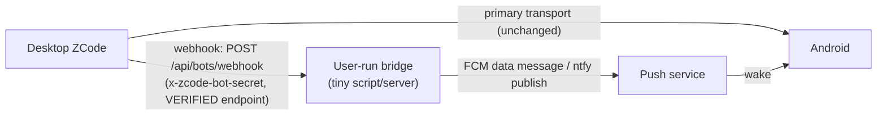

Verification list before shipping: FCM data-message wake behavior on Chinese ROMs & Doze; UnifiedPush distributor availability; secret handling in the bridge (the webhook secret must live on the desktop only); legal/ToS check for relaying notification payloads through FCM (content = ids only, never prompt text). If verification fails → stay with FGS mode and document. Bridge is **user-operated infrastructure**, not a product service (proportionality, §2.3).

### 24.7 Deep-link routing safety

`zcode://task/{taskId}#interaction={interactionId}` routing must survive: deleted/archived task (→ graceful "no longer available" + list), stale interaction (→ task opens, card shows resolved state), wrong endpoint (→ disambiguation if the id exists under another paired endpoint), unpaired device (→ pairing screen; deep link re-validated after pairing), expired session (→ reconnect + re-resolve), malformed ids (→ reject, never crash). **A deep link is a routing hint, not an authorization:** content renders only after the endpoint is paired, connected, and the task is confirmed in the authoritative projection — possessing a deep link grants nothing (unlike the relay QR, which *is* the credential).

---

## 25. Background Execution

### 25.1 Platform facts (classified; accessed 2026-09-27)

| Fact | Class | Detail |
|---|---|---|
| Edge-to-edge + predictive back enforced at targetSdk 36 | **platform restriction** `[VERIFIED]` | design cost, not runtime risk |
| `dataSync` FGS runtime budget (6 h/24 h since Android 15; 2026 sources report tightening for API-36 apps) with on-timeout crash | **platform restriction** `[VERIFIED]` | `dataSync` is excluded from our design regardless of the exact number |
| FGS **start-from-background** restrictions (since API 31): an app may not launch an FGS from the background except via narrow exemptions | **platform restriction** `[VERIFIED]` | the Live-connection FGS is started from the *foreground* only; entering background with it already running is unaffected |
| FGS requires a user-visible notification; Android 13+ requires `POST_NOTIFICATIONS` runtime permission for its visibility | **platform restriction** `[VERIFIED]` | Live-connection indicator doubles as the required notification |
| Doze / App Standby suspend network and jobs even while an FGS is running (deep Doze) | **platform restriction** `[VERIFIED]` | reconnect-on-wake design is mandatory; nothing may assume a live background socket |
| JobScheduler quotas enforced (incl. jobs started while visible, continuing in background, Android 16) | **platform restriction** `[VERIFIED]` | WorkManager probes are rate-limited by design |
| **Local Network Protection (Android 16)**: opt-in during 25Q2 (compat flag `RESTRICT_LOCAL_NETWORK`); **enforcement deferred to a later Android release** (deployment plan 25Q2→26Q2); will be guarded by a new permission in the Nearby-devices group; covers all TCP/UDP local-network traffic from any networking API; DNS (port 53) exempt; **VPN interfaces are excluded from the "local network" definition** | **platform restriction (progressive)** `[VERIFIED 2026-09-27]` | affects LAN direct transport only; Tailscale (VPN) traffic unaffected; the app declares the permission when it ships LAN support and handles `EPERM`/`ECONNABORTED` as the "local network blocked" error class |
| `remoteMessaging` FGS type exists for messaging continuity | **platform capability** — applicability to this app `[UNKNOWN]` | reserved in practice for system-default messaging/RCS handlers; treat as almost certainly not applicable — confirm at the Phase 8 spike, do not design around it |
| Play policy for FGS types (declaration, video/connected-device policy gates for specific types) | **Play policy requirement** `[VERIFIED class]` | if the Play track is used, the chosen type must pass policy review; sideload builds are not Play-policy-bound |

### 25.2 FGS strategy (decision chain — `specialUse` is a candidate, not a decision)

```text
FGS strategy
   ↓  purpose: "live connection while screen-off", user opt-in, bounded duration
candidate service type: specialUse (FOSS/sideload-safe; requires property + justification)
   ↳ rejected for MVP: dataSync (runtime budget → guaranteed kill), remoteMessaging (likely not applicable [UNKNOWN])
   ↓  Android platform validation spike (Phase 8, real devices incl. aggressive OEM ROM):
      - starts only from foreground; survives backgrounding; behavior under Doze
      - notification requirement satisfied by the "Connected" indicator
      - heartbeat cadence tolerated; socket lifetime vs battery measured (§29)
   ↓  Play policy validation (only if the Play track ships): does the declared type + UX pass review?
   ↓  final service type decision = ADR at Phase 8 exit
fallback if spike fails: no FGS — foreground-only live connection + push bridges (§24.6) + reconnect-on-wake
```

**Normative regardless of spike outcome:** the product prioritizes **foreground live connection + reconnect-on-wake + push where available** over any immortal background socket. No architecture may depend on Android permitting an always-on background WebSocket.

### 25.3 Design consequences (normative)

1. Foreground app: full connectivity, streaming, notifications.
2. Backgrounded, Live-connection FGS **off**: sockets die; on next foreground → immediate reconnect + resync (§15); WorkManager periodic probe (≥ 15 min, network-constrained) only for opted-in "auto-reconnect" endpoints.
3. Backgrounded with the Live-connection FGS **on**: started from the foreground, low-rate heartbeats, auto-timeout (default 30 min) `[PROPOSED]`; battery impact measured before release (§29); never `dataSync`; `specialUse` subject to the §25.2 chain.
4. Screen locked: same as backgrounded; notifications per §24; full-screen intent only if user enables "urgent approvals" (`USE_FULL_SCREEN_INTENT`, user-granted on 14+).
5. Doze maintenance windows: assume batching; every reconnect path is resync-correct (never delta-assuming).
6. Process death: §15-S2 cold recovery; SavedStateHandle for UI; journal for transport.
7. LAN direct transport: handle Local Network Protection errors (`EPERM`/`ECONNABORTED`) as first-class "local network blocked" guidance; declare the future permission when required by the enforced release (tracked in §39.4 drift watch).

## 26. Security

### 26.1 Assets and trust boundaries

**Trust model (normative).** TLS protects the pipe, not the payload from the endpoint operator — the relay (and any direct endpoint) is itself a TLS *termination point*:

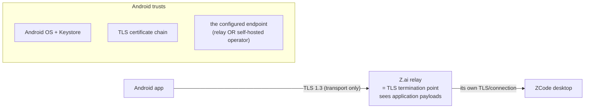

- **Relay mode trust:** the Z.ai relay terminates transport encryption and forwards application payloads. *This does not establish that relay operators inspect or retain payloads* — no such behavior is verified or alleged; it establishes only that the **transport trust boundary sits at the relay**. No application-layer E2E encryption exists in verified ZCode `[VERIFIED absence]` — none is claimed, and the app adds none (INV-10: no custom crypto).
- **Direct/self-hosted mode trust:** the operator of the direct endpoint (the user's own machine fronted by Tailscale/Cloudflare/LAN) becomes the relevant transport trust boundary. Tailscale changes *who* sits at that boundary (the user's tailnet), not *whether* the boundary exists.
- **What Android trusts:** the Android OS and Keystore, the TLS certificate chain, the configured endpoint, and the relay/server per selected transport.

| Asset | Sensitivity | Boundary |
|---|---|---|
| Pairing credential (relay passHash / server token) | **Crown jewel** — grants full desktop-window control | Keystore/Tink-sealed vault; memory during signing only; never in transport custody (§12.4) |
| Conversation content (prompts, code, diffs) | Confidential (user IP) | Visible to the selected endpoint (relay operator in relay mode); device display; on-device cache |
| Desktop file access (via terminal/file channels later) | Critical | Gated per-endpoint opt-in; read-only MVP |
| Device identity (clientId, endpoint metadata) | Low | Plain storage |

Boundaries: (1) Android app ↔ endpoint = TLS + protocol auth; (2) app internals = module boundaries + INV rules (credential only in `core/security`); (3) device = lock-screen + biometric gate + backup exclusion.

### 26.2 Threat model (STRIDE-flavored, per master prompt §25 list)

| # | Threat | Asset | Attacker | Attack | Impact | Likelihood | Mitigation | Residual risk |
|---|---|---|---|---|---|---|---|---|
| T1 | QR theft / pairing URL leakage (shoulder-surf, sync'd screenshot, shared chat) | credential | anyone with the URL | full desktop window operation | Critical | Medium | treat link as bearer (docs); short display lifetime; user education; desktop "refresh QR" revocation `[VERIFIED]`; app marks credentials older than 24 h "rotate recommended" | Post-theft until rotation — inherent to ZCode's design |
| T2 | Malicious app on phone reads credential | credential | local malware | storage scrape, memory read, clipboard, screenshots of QR at pairing | Critical | Low-Med | Keystore/Tink sealing; no clipboard use for secrets; `FLAG_SECURE` on pairing & approval screens; no screenshots of credentials; minSdk 26 hygiene | Compromised OS = game over (documented) |
| T3 | Screen scraping / overlay attack on approval UI | approval decisions | malware | taps approval via overlay, or reads card content | High | Low-Med | confirm-step for high-risk + allowAlways; `FLAG_SECURE` optional setting; hide content in recents; no accessibility-service invocation by us | Android cannot fully stop determined local malware — disclosed |
| T4 | ADB / debug build leak | secrets | physical attacker | debuggable build dumps; logcat | High | Low | release-only builds disable verbose logging; R8; no secrets in logs (INV-3); test builds use mock server only | — |
| T5 | Crash reports / analytics leakage | prompts, paths, hashes | third-party collector | payload capture | High | — | **No third-party crash/analytics SDK in MVP** (proportionality + privacy); crash reports local-only export | none |
| T6 | Android cloud backup exfiltration | credential, conversations | cloud account compromise | restore to attacker device | High | Low | `dataExtractionRules`: credentials + conversation cache excluded from backup; drafts included only (no creds) | — |
| T7 | Clipboard sniffing (QR link paste) | credential | malware | read pasteboard | High | Low-Med | never auto-read clipboard for pairing URLs; paste only via explicit UI action; clear after parse | — |
| T8 | Lock-screen / notification content leak | prompts, paths, code | bystander | glance at lock screen | Medium | Medium | default locked-screen text = category only ("needs approval"); content toggle per §24.1 | user opting into rich content |
| T9 | Stolen phone (unlocked state unknown) | credential, cache | thief | open app, read conversations | High | Medium | biometric gate (per §12.4) + short re-lock; remote considerations out of scope (no MDM); recommend system "find my device" wipe in docs | If no lock screen set — warned at pairing (E7) |
| T10 | Stolen/compromised desktop | everything | thief/malware on desktop | pivot to phone control | High | Low | out of app scope; docs: unpair phone (local wipe) when desktop compromised; rotation invalidates QR | inherent |
| T11 | Session hijack / MITM | transport | network attacker | TLS strip/spoof relay or server | Critical | Low | TLS 1.2+/1.3 only; no user-overridable cert validation for relay (WebPKI); direct endpoints: TOFU pin with fingerprint confirm + warning on mismatch (fail-closed) `[PROPOSED]` | — |
| T12 | Replay attacks on auth | credential | observer of old traffic | replay proof | Medium | Low | nonce from server per challenge `[VERIFIED construction]`; we never cache proofs; `[UNKNOWN]` server nonce policy — noted §46 Q3 | — |
| T13 | Credential reuse across endpoints | credential | — | QR for desktop A pasted into endpoint slot B | Low | Low | endpoint binding by deviceSid; QR dedupe/rotation (§12.2); no cross-endpoint credential imports | — |
| T14 | Malicious workspace / tool request (social engineering via agent) | desktop machine | prompt injection from code/content | agent executes harmful command; user approves from phone with less context | High | Medium | approval card shows tool + input + reason; **never auto-approve** (default actions off, §24.2); desktop-side permission model remains primary; docs warn phone approvals deserve same scrutiny | Phone's smaller context is a real risk — mitigated by input preview + full-input view |
| T15 | Malicious prompt/content rendering | app | crafted content | markdown/HTML injection, image bombs | Medium | Low | render markdown through restrictive renderer (no raw HTML/links auto-open); image decode size caps; file preview sandboxed via FileProvider + system viewers | — |
| T16 | Unsafe notification contents (push bridge) | content | bridge compromise | injected push text | Medium | Low | push payloads carry ids only; app renders text from local projection after connect — push text never displayed raw `[PROPOSED]` | — |
| T17 | Rooted device | all | user-of-device or thief | extract keys, bypass biometric | High | Low | StrongBox when present; biometric gate is deterrent not DRM; documented limitation | inherent to platform |
| T18 | Endpoint spoofing (fake "desktop") | user trust | MITM at pairing | fake QR / fake relay | Medium | Low | QR must come from desktop app UI; app displays endpoint name + deviceSid prefix on approval of pairing; direct endpoints show TLS fingerprint | — |

**Explicit non-goals:** DRM-grade protection against rooted-device owners; defense against a fully compromised host OS (documented).

### 26.3 Credential handling summary (exact, no vagueness)

What is stored, where, encrypted how: §12.4 table (normative). What is *never* stored: raw QR password (doesn't exist on phone), decrypted hashes on disk, proof values after use, full conversation payloads outside cache policy.

**Separation of concerns (why):** *custody* (where the secret rests, how it is sealed/wiped), *cryptographic operation* (the challenge→proof answer, isolated in `CredentialSigner` so it can be unit-tested against the desktop's verified vectors without a socket), and *transport* (consumes proofs, never secrets) are three different responsibilities with three different risk profiles. Coupling them makes every transport change a security review and every crypto review a transport regression; separating them means the HMAC proof can be validated byte-for-byte against the desktop implementation offline (Phase 1 fixture) before it ever touches network code.

### 26.4 Cryptography inventory

| Use | Mechanism | Notes |
|---|---|---|
| Pairing proof (relay) | HMAC-SHA256, key=passHash, msg=`${nonce}\|terminal\|${sid}`, base64url | `[VERIFIED]` — reproduce exactly; never modify |
| Local sealing | Tink AES-256-GCM, key wrapped by Keystore AES-GCM key (StrongBox if available) | Keystore key: `setUserAuthenticationRequired(biometric gate)` where enabled |
| Optional HMAC-in-Keystore | `KEY_ALGORITHM_HMAC_SHA256` import of passHash | Only if import semantics verified in Phase 1; else Tink-sealed bytes path |
| TLS | Platform Conscrypt defaults | No custom trust manager for relay |

**Never invent crypto** (INV-11): no custom KDFs, no "improvements" to the proof message, no local E2E layer added on top (that would be a *different* protocol than the desktop speaks).

### 26.5 Security incident response (§48)

| Incident | Actions |
|---|---|
| Credential leaked (QR shared/screenshotted) | App: rotate via fresh QR (same sid) or unpair; Desktop: press refresh-QR (invalidates old `[VERIFIED]`); document desktop "Stop" |
| Phone stolen | User: unpair from desktop (Stop + refresh QR); device wipe via Find My Device; app credential excluded from backups so restore is safe |
| Desktop compromised | Unpair phone locally; rotate; assume conversation cache readable → "clear cache" action; re-pair only after desktop remediation |
| Relay compromised (hypothetical) | Affects all users equally (Z.ai incident response); app ships endpoint allowlist + direct-transport as the privacy escape hatch; disclosure note in README |
| Protocol vulnerability found | Private report to Z.ai (feedback/security channel), ADR documenting affected flow, compatibility gate bump |
| Malicious APK installed | Out of app control; docs: verify Obtainium/GitHub source; signed-release consistency (§37) |
| Notification leaks private data | Kill-switch flag: server-rendered privacy levels; immediate hotfix path via settings fallback ("minimal notifications" mode) |

### 26.6 Threat-model review gates

Security review is a **phase gate** at Phases 3 (pairing), 8 (permissions), 10 (files/terminal enablement), and pre-release (§43). Gate = re-walk T1–T18 against the delta built in that phase; any new HIGH with unmitigated likelihood blocks the gate (§43.0).

---

## 27. Privacy

- **Data leaving the device:** only (a) protocol traffic to the user's chosen endpoint (relay: Z.ai sees it, same as official web remote today; direct: stays in user's network) and (b) nothing else in MVP — no analytics, no crash SDKs, no ads, no tracking (hard rule, proportionality + trust).
- **On-device data:** conversation cache (excluded from backup), drafts (included — user benefit), prefs. Clear-cache and full-reset actions in Settings with data inventory shown.
- **User-visible privacy controls:** notification content level; recents screenshot protection (`FLAG_SECURE` toggle); conversation cache on/off (with UX cost warning); per-endpoint "auto-reconnect" and Live-connection FGS.
- **Clipboard:** never read without user action; never write secrets.
- **Permissions rationale screen:** camera (pairing), notifications (approvals), biometrics (security), network (obviously), local network (direct endpoints, Android 16), media picker (attachments), full-screen intent (optional urgent approvals).
- **License/attribution screen** (§38) listing OSS components.

---

## 28. Performance

### 28.1 Budgets (engineering targets — clearly marked as targets, not guarantees)

| Metric | Target (mid-range 2023 device, e.g. 8 GB / SD 7-gen class) | Class |
|---|---|---|
| Cold start → task list (warm cache) | ≤ 1.2 s (P50) / ≤ 2.0 s (P95) | engineering target |
| Cold start → interactive (baseline profile) | ≤ 800 ms P50 | engineering target |
| Task list refresh (cached + ETag 304-class) | ≤ 300 ms P95 | engineering target |
| Conversation first render (tail snapshot 60 rows) | ≤ 700 ms P95 after connect | engineering target |
| Stream update → pixels (delta apply→recompose) | ≤ 1 frame budget (16.7 ms) P95; ≥ 55 fps sustained under 3 active streams | engineering target |
| Max retained conversation memory (text rows) | ≤ 24 MiB strings + ≤ 8 MiB spans per open session; app total ≤ 220 MiB typical | engineering target |
| Max rendered message window | 60 rows materialized + 2 pages cached (§19.2) | engineering target |
| Reconnect → recovered state | ≤ 3 s P95 on healthy network | engineering target |
| Large diff (5k lines) open | ≤ 1 s P95, jank-free scroll | engineering target |
| Battery (foreground streaming 30 min) | ≤ 6% on referenced device | engineering target |
| APK size | ≤ 12 MiB download (ML Kit bundled dominates) | engineering target |

### 28.2 Techniques (bound to budgets)

Baseline Profiles (startup), R8 full, stable `contentType`/keys in LazyColumn, per-row markdown AST cache, coalesced streaming publication (§19.2), `rowsRange` windowing, image decode downsampling, strict-mode in debug, Macrobenchmark gates in CI (§36) for cold start + streaming scroll.

### 28.3 Large session protection (§36 — dedicated risk)

`[VERIFIED]` failure class #228: full-snapshot of huge sessions overflows relay physical frames (`remote.rpcFrame.messageTooLarge`). Normative rules: (1) never issue subscribe-with-snapshot for a session whose size is unknown without tail-first semantics available — initial open uses snapshot tail (60 rows verified) + `rowsRange` paging; (2) `rowsRange` limit ≤ 200 (verified max); (3) no client-side request may assemble logical frames > 16 MiB; (4) if a snapshot frame arrives fragmented, reassembly obeys verified assembly limits (1024 fragments/30 s); overflow → protocol error → resync, never merge; (5) history windowing per §19.4; (6) large-frame telemetry counter surfaces "session too large for current transport" honestly with direct-endpoint suggestion.

### 28.4 Backpressure

Inbound: bounded per-connection parse channel (1024 frames); overflow → count + resync (correctness over completeness). Domain: reducers are O(1) amortized per op; subscriber buffers mirror protocol bounds (500 ops/1 MiB verified). UI: coalesced emission; drops *render* frames, never *state* ops. Outbound: command queue is tiny and human-rate; telemetry frames (if any) are drop-oldest. `v4/connection/flow` saturated signal → pause optional reads (usage/preview prefetch), resume on drained. **No unbounded queue anywhere** (INV-5).

### 28.5 Concurrency rules

All projection mutations flow through one reducer per session (single-writer per topic, message-passing, no locks on shared collections); UI reads via StateFlow; cross-session reducers are independent (parallel safe); reconnect/recovery takes a per-endpoint mutex (no double resync); command submits are serialized per session via the outbox; notification broker is single-threaded. Two taps, task finishing while screen open, send-during-replay, notification-on-stale-session: all resolved by the state machines of §14 + stale-guard watermarks; no ad-hoc synchronization.

### 28.6 Idempotency classification

| Action | Retry class | Mechanism |
|---|---|---|
| send prompt (`sendText`) | requires commandId; auto-retry only pre-transmit | uuid v7 envelope (verified invariant) + outbox |
| permission response | requires commandId; **user-gated retry** after any server contact | idempotent commandId; stale-guard |
| user input answer | same as permission | — |
| stop/cancel | safe to retry aggressively | idempotent semantics verified command family |
| rowsRange / usage / snapshot reads | safe always | protocol comments verified "超时重发安全" |
| model/mode switch | requires commandId; echo-reconciled | switch commands + config echo |
| create task | requires commandId; duplicate create = duplicate task (server has no natural key) → pre-transmit retry only | outbox |
| rename/archive/delete | requires commandId; retryable post-ACK-failure with confirmation | — |
| fork (`forkAssistant`) | requires commandId; row-targeted (`baseLogEpoch` verified) → retry only pre-transmit | outbox |
| model switch (`switchModelConfig`) | requires commandId; echo-reconciled | config echo |

### 28.7 Memory boundaries per layer (normative)

| Layer | Bound | Overflow behavior |
|---|---|---|
| Raw inbound frames | parse channel 1024 frames × ≤ 1 MiB | drop + resync (INV-5) |
| Decoded frames / event queue | subscriber buffer 500 ops / 1 MiB (verified limits) | drop + count |
| Domain state | per-topic projection; streaming buffer ≤ 8 KiB/row | snapshot replace |
| Room cache | §17.3 bounds (2 windows + 1 page; ≤ 500 tasks) | LRU eviction |
| Compose state | render window 60 rows + viewport | dispose offscreen |
| Image previews | decode ≤ 2048 px edge, downsampled | placeholder |
| Terminal output | ring buffer 512 KiB | drop-oldest |
| Diff | hunk virtualization; > 5k lines/file → summary card | lazy fetch |
| Attachments | 128 MiB `cacheDir` LRU budget | evict oldest |

No layer may retain a second full copy of another layer's data (raw string + decoded JSON + parsed AST for the same frame is forbidden): each frame is owned by exactly one buffer at a time. Layer budgets are consistent by construction — no layer can be handed a payload larger than its bound (the 1 MiB protocol ceiling is checked *before* allocation, never after).

---

## 29. Battery

- **No polling.** Everything event-driven from the socket or push bridge; WorkManager probes are the only periodic work (≥ 15 min, network+charging-constrained where possible) and only for opted-in auto-reconnect.
- Foreground streaming: render coalescing; no wakeups from app when backgrounded without FGS.
- Live-connection FGS: low-frequency heartbeats (10 s relay cadence matches desktop's own — acceptable), partial wakelock *not* held beyond socket lifetime; auto-timeout default 30 min `[PROPOSED]`; persistent notification is low-priority (no sound, no heads-up).
- Radios: single socket per endpoint; no parallel candidate probing while connected; TLS session reuse via OkHttp pool.
- Disk writes: batched DataStore flushes (debounced 300 ms) except journal-critical transitions (state machine edges).
- Explicit rejection (design rule): polling for task status is forbidden; if push is unavailable, the answer is the FGS mode + honest UX, not polling.

**Measurement method (every battery claim):** `batterystats`/Battery Historian on the named §35.6 devices, fixed scenario (30 min foreground streaming on Wi-Fi; 8 h background with FGS on vs off), fixed network condition; reported as target vs measured with device class. Battery numbers are engineering targets with measurement provenance — never guarantees.

---

## 30. Accessibility

Designed-in from Phase 6 UI work (not bolted on):

- TalkBack: every interactive element labeled; tool cards announce as "Tool, Bash, running, tap to expand"; approval cards announce tool + risk + options; live-region announcements for stream completion and permission arrival (rate-limited).
- Touch targets ≥ 48 dp; approval buttons ≥ 56 dp with spacing.
- Font scaling to 200% without truncation (conversation uses `FontScaling`-safe line heights; code blocks scroll, never clip).
- High-contrast / reduced-motion: honor system settings — disable non-essential animations (stream shimmer, transitions) under reduced motion.
- Color-independence: status = icon + color (§18.5); diff add/remove = symbols + color.
- Keyboard navigation (physical keyboard/Chromebook-class): full tab order, Enter=approve focus semantics `[PROPOSED]`.
- Screen-reader semantics tested in UI test suite (semantics tree assertions) — part of DoD.

**Testable acceptance requirements (DoD-linked):** (1) every interactive element exposes a semantics label — asserted in Compose UI tests; (2) touch targets ≥ 48 dp (56 dp approval actions) — lint rule + test; (3) task list and approval flows operable at 200% font scale — screenshot test; (4) TalkBack traversal order matches visual order on the task list and approval card — scripted check + per-release manual audit; (5) reduced-motion disables shimmer/transition animations — behavior test; (6) status never encoded by color alone — snapshot review gate.

---

## 31. Internationalization

- All strings externalized from day one (`core:common` string resources; no hardcoded strings in features); pseudolocale test build in CI.
- Plurals via ICU (`PluralsResource`); date/time via `java.time` formatters with `DateTimeFormatter.ofLocalized*`; relative times ("2 min ago") via `Duration`-based formatter honoring 12/24 h locale preference.
- RTL: layouts use start/end semantics (Compose defaults) — verified by RTL pseudolocale screenshot tests; no directional icons without auto-mirroring.
- Number formatting localized; long-string tolerance (German-class) via flexible layouts; first release = English + Simplified Chinese (mirroring ZCode's own en/zh i18n `[VERIFIED]`), structured for community additions.

---

## 32. Persistence

### 32.1 Engines

**Room**: task projections, conversation page cache, recovery journal, command outbox, interaction store, drafts. **DataStore (Proto)**: endpoints/pairing metadata, credential envelopes (Tink-sealed), preferences, notification settings. **Cache files (`cacheDir`)**: attachment payloads. The split and its rationale are normative (§17.2, ADR-008).

### 32.2 What is persistent vs not

Persistent: §12.4 + §17.3 tables (normative). Ephemeral: streaming buffers, in-flight frames, decrypted secrets in memory only, connection state (journal hint excepted).

### 32.3 Migrations (§47)

DataStore proto schemas are additive-first: new fields optional, never renumbered; breaking change = new message + read-old/write-new migration step. Room: standard incremental migration chain, each shipped with (a) schema export, (b) migration test from every prior shipped version, (c) destructive-migration fallback only for re-fetchable caches — **never** for the credential envelope (DataStore+Tink, migrated additively) or the outbox/journal (migrated forward). Migration failure → app refuses to start *with data intact* (no destructive fallback on credential store) and shows recovery screen; corrupted DB → quarantined copy + fresh init (cache only) + user notice. Atomicity: DataStore writes are atomic per file; journal updates single-transaction; partial-write risk handled by journal replay (idempotent transitions).

### 32.4 Retention & deletion

Cache retention: §17.3 (LRU/TTL); conversations cache cleared per endpoint on unpair; full reset = delete all app data via system settings (documented) + in-app "erase everything" (biometric-confirmed). Backups: §26.2-T6 rules.

---

## 33. Error Handling

### 33.1 Universal error model

`AppError { category, userMessage (localized), developerDiagnostic (structured), retryable: NO|AUTO|USER, recoverable: bool, autoRecovery: RecoveryAction?, correlation: {endpointId?, connectionId?, sessionId?, commandId?}, safeToExpose }`.

Categories (with mapping to verified protocol/transport facts):

| Category | Example source | Retryable | Auto-recovery | User message pattern |
|---|---|---|---|---|
| `auth` | AUTH_FAILED, 4011, 4013 | no | → re-pair flow | "Pairing expired — scan the QR again" |
| `authz` | server refuses channel/role | no | feature-disable | "This connection doesn't allow X" |
| `transport` | socket, DNS (incl. verified ENOTFOUND), TLS | auto | reconnect/failover | "Connection lost — reconnecting…" |
| `network` | captive portal, no route | auto w/ backoff | — | "Network unavailable / sign-in required" |
| `protocol` | parse failure, seq gap unresolvable, messageTooLarge | resync | snapshot replace | "Sync problem — refreshing" |
| `serialization` | unknown shape breaking contract (should be rare via unknown-tolerance) | no | report + continue degraded | (diagnostic; generic user copy) |
| `server` | relay INTERNAL (observed) | auto limited | — | "ZCode relay error — retrying" |
| `session` | sessionUnavailable (-32004) | no | task list refresh | "This session is no longer available" |
| `task` | command rejected (CAS, invalid state) | user | reconcile | "Conversation changed — please try again" |
| `permission` | interaction invalid/expired | no | stale-mark | "This request was already handled" |
| `storage` | DataStore/Room failure | no | quarantine+reinit (§32.3) | "Local data problem — cache reset" |
| `android` | camera denied, FGS revoked, VPN kills socket | varies | settings deep-link | actionable, specific |
| `notification` | channel blocked | no | — | banner in-app |
| `versionIncompat` | app_version gate, capability absent | no | compat screen / feature-hide | "Update ZCode desktop to ≥ X" |
| `unsupportedFeature` | capability flag off | no | hide | — |
| `timeout` | query 10 s (verified), auth 15 s | auto limited | — | "Taking too long — retrying" |
| `cancelled` | user/scope cancellation | — | silent | — |
| `internal` | bugs | no | crash-safe report | "Unexpected error (code)" |

Rules: every error carries correlation ids (redacted per §34); user messages never contain hashes/paths unless the user's own action displayed them; every category maps to at least one automated test (§35); transport close codes → categories: 4000/4004 (`transport`), 4009 (`session`-conflict, takeover UX §15.3), 4010 (`transport` desktop-gone), 4011/4013 (`auth`), 4012 (`session` workspace closed).

**Distinct categories, never conflated:** *unknown error* (unclassified failure — report with correlation ids, generic copy) ≠ *unsupported feature* (server/capability legitimately lacks it — hide quietly) ≠ *protocol incompatibility* (version/contract mismatch — compat gate, §39). Mapping an incompatibility to "unknown error" hides a fixable contract bug; mapping "unsupported" to "error" creates false alarms; both are review failures.

---

## 34. Logging / Observability

- **Levels**: `debug` = protocol raw frames/stream chunks (debug builds only, never persisted); `info` = lifecycle (connect/auth/pair/subscribe/command ACK), permission results; `warn` = recoverable anomalies (gap→resync, retry, fallback); `error` = unrecoverable (handshake failure, auth loss, storage failure). Mirrors ZCode's own logger rules (`[VERIFIED]` AGENTS.md §日志 — adopted verbatim).
- **Structured context**: every log line carries `{endpointId, connectionId, sessionId?, commandId?}` correlation; a rolling in-memory diagnostics ring (last 500 events, error+warn+key lifecycle) exportable **by explicit user action** from Settings → "Export diagnostics" (user-reviewed share sheet).
- **Never logged (INV-3)**: passHash/hash, proofs, tokens, prompt text, file contents, paths beyond basename, credentials, personal data. Redaction is centralized (single log sink enforces scrubbers) — not per-callsite discipline.
- **Metrics** (local, privacy-safe, exported with diagnostics): connect success rate, reconnect count/duration, resync causes, seq-gap counts, frame-overflow counts (#228 sentinel), stream coalescing stats, cold start, jank (JankStats), notification tap-through.
- **Crash reporting**: no third-party SDK in MVP; uncaught-handler writes local redacted report; export with diagnostics. A future opt-in hosted path would be an ADR (§45 R12).
- Production protocol diagnostics: capability sets + version fingerprints logged at info (allowed, non-sensitive) to make field compat debugging possible.

---

## 35. Testing

Test pyramid (normative shape): **many pure unit tests → protocol golden fixtures → integration tests (MockZCode) → state-machine/property tests → limited UI tests → few full E2E → manual production-relay canary**. Bottom layers run on every PR; E2E and canary are release-adjacent (§36).

### 35.1 Unit (JVM, fast, mandatory per layer)

Protocol: VQL varints, DataType tags, CRC32 vectors, 13-byte framing round-trips, fragmentation/assembly at verified limits, golden-vector JSON fixtures per message type (§13.1), unknown-field/type tolerance, CRC mismatch handling. Domain: reducers (snapshot replace, delta apply, stale-guard, dedupe), state machines (all legal/illegal transitions of §14.4 — property tests), retry classifier, outbox lifecycle, recovery journal replay. Security: QR parser (malformed/hostile inputs fuzzed), validation, redaction scrubbers (property: no secret substring ever appears in output). Repositories: cache reconciliation, ETag flows, eviction bounds.

### 35.2 Integration

Transport against **MockZCode** (§35.4) — CI runs **exclusively** against MockZCode; real-desktop runs are local/manual developer smokes, never CI steps. Coverage: auth success/failure paths (wrong proof, expired params, KICKED), subscribe/snapshot/rowsRange flows, reconnect/resync incl. epoch change, outbox pre/post-transmit retry, attachment begin/chunk/commit/abort incl. 512 KiB boundaries and 20 MiB cap, permission resolve + races (resolved-elsewhere), close-code mapping.

### 35.3 UI (Compose tests + screenshot)

Task list (empty/loading/ready/stale), conversation (streaming coalescing behavior with fake clock, scroll anchoring, pagination edge), approvals (all §20.3 cells), offline banners, reconnect banners, pairing screens incl. compat block, TalkBack semantics assertions, dark/dynamic theme snapshots, RTL pseudolocale snapshots, 200% font snapshots.

### 35.4 MockZCode server (§41 — designed, strongly recommended)

A JVM (and CI-side) protocol-faithful mock implementing: relay envelope + auth (configurable accept/reject/challenge behavior), hello/capabilities (scriptable), topics with snapshot+deltas, deterministic fixtures, scripted scenarios: streaming (token pacing), delays, disconnect mid-stream, duplicate events, out-of-order seq, fragmentation, oversized payloads (→ messageTooLarge), permission requests (with auto-resolve races), reconnect replay windows, version negotiation failures. Implementation: Kotlin JVM + Ktor/OkHttp mock WS — *test tooling*, lives in `tools/mockzcode`, never shipped in the app. Point: **CI never requires a live production desktop, and must never touch the production relay or a real user account** (S18 shows even relay reachability is unreliable). Production-relay compatibility is validated only by an isolated, manual, scheduled canary against a disposable test environment (§36, §43 Phase 1) — never as a unit/integration test dependency. INV-15.

Mock scenarios are built **incrementally** — a scenario lands when the phase that needs it lands (guard against mock-first overengineering) — and the server's behavior is grounded only in captured-and-sanitized fixtures, never invented protocol behavior.

### 35.5 End-to-end (device/manual + device-lab)

Full journey of §2.6 on emulator (MockZCode) and on real hardware (real desktop; **local manual runs, never CI**) — the master prompt's E2E list verbatim: pair, connect, open task, send, receive streaming, tool invoked, permission appears, approve, agent continues, disconnect, reconnect, recover, receive notification, tap notification, resume task. Real-hardware matrix in §40-test-matrix below runs pre-release.

### 35.6 Test matrix (practical for a solo developer)

**Physical fleet: one modern flagship + one mid-range + one older supported device.** Everything else runs on emulators.

| Axis | Values covered | Where |
|---|---|---|
| Android versions | API 26 (min, emulator), 14/15 (mid device), 16 (target: flagship + emulator), 17 (best-effort emulator) | emulator + 3 devices |
| Phone class | flagship, mid (4-6 GB), older/low (2-3 GB) | the 3 devices |
| Network | Wi-Fi, 5G/4G, Wi-Fi↔5G transitions, offline, lossy/latency-shaped (traffic shaping), captive portal | emulator netmod + devices |
| ZCode version | min-supported, current stable, latest release (compat gate) | desktop-side matrix (§39) |
| Connection type | relay, direct-LAN, direct-tailnet, direct-tunnel | Phase 10+ |
| Task state | idle, running, waiting-permission, waiting-user, completed, failed, archived | fixtures |
| Session size | empty, small (≤60 rows), medium (≤2k), large (>10k rows, #228 class) | MockZCode fixtures |
| Background | foreground, background+FGS, background no-FGS, Doze, process death | devices (emulators model Doze poorly) |

Minimum CI regression: emulator API 26 + latest, MockZCode suite. Full-matrix sweep = pre-release gate (§36), not per-PR.

---

## 36. CI/CD

GitHub Actions: PR → format (ktlint/ktfmt) → detekt/static analysis → JVM unit tests → :app assembleDebug + unit → instrumentation (API 26 + latest emulator, **MockZCode suite only**) → Macrobenchmark (cold start, streaming scroll) on self-hosted runner (scheduled/nightly) → dependency guard (version diffs) → license report.

**CI security constraints (normative, INV-15/16):** CI jobs never connect to the production relay, never hold real credentials, never contain real pairing QR codes, real conversation content, personal workspace paths, API keys, or provider secrets. The only permitted live-relay check is the **manual compatibility canary**: an operator-run, scheduled probe from a disposable environment following the §43 Phase 1 capture procedure, producing sanitized fixtures — it is a release-adjacent ritual, not CI infrastructure. Fixture policy: capture → redact → validate → commit only sanitized fixtures (§41.3). Main → release pipeline: `assembleRelease` (R8 full, baseline profiles via profileinstaller) → signing via secrets (keystore encrypted, Play App Signing if Play path) → artifact to GitHub Releases with release notes; versioning: semver `MAJOR.MINOR.PATCH+protocol compat` where MINOR tracks compatibility matrix bumps (§39); build reproducibility (locked Gradle, dependency verification checksums); secret scanning; codeql-style SAST `[PROPOSED]`; artifact attestation. Rollback = prior Release tag redeploy; baseline profile regenerated per release; 16 KB page-size check gate.

---

## 37. Distribution

Separation (normative): **build** (CI) → **sign** (release keystore; single stable key from day one — rotation breaks Obtainium/assetlinks) → **publish** (channels below) → **update** (in-app update check against GitHub Releases metadata for non-Play builds, user-consented download + install intent) → **rollback** (prior tag). All policy facts in this section were verified 2026-09-27 and are re-verified each release (§39.4 drift watch) — they are time-stamped facts, not permanent truths.

| Channel | Role | Notes |
|---|---|---|
| GitHub Releases APK | **primary** for MVP | universal APK first, ABI splits later; SHA-256 published; Obtainium-friendly (no "Latest" ambiguity) |
| Obtainium | recommended install path for users | documented in README |
| F-Droid / IzzyOnDroid | future FOSS-build consideration | requires build-metadata reproducibility; not MVP |
| Google Play closed/internal testing | optional later (push/FCM UX) | targetSdk 36 requirement verified (S23); review overhead accepted then |
| Sideload reality (2026) | Android **Developer Verification** phases in from 2026-09-30 (first countries) — register early; consistent signing keys; ADB flow unaffected `[VERIFIED S25]` | affects our users in those countries |

No store assumption may leak into app behavior (e.g., update logic feature-detects install permission).

---

## 38. Licensing

`[VERIFIED]` ZCode is Apache-2.0 (LICENSE + NOTICE + THIRD-PARTY-NOTICES in repo). Technical/legal considerations (not legal advice; flagged for review where noted):

- **Protocol reuse**: implementing a client for the documented/observed protocol is standard interoperability; Apache-2.0 expressly grants patent/copyright license for the *code* — the *wire behavior* of the closed relay is observed, not licensed text; `[LEGAL REVIEW FLAG]` confirm stance on reproducing relay handshake (low risk: functional interop, no source copying).
- **Source reuse**: if any Apache-2.0 ZCode code is translated/copied (e.g., schema constants), preserve attribution per Apache-2.0 §4; our preference: clean-room port from *schema/observation* with golden fixtures, minimal verbatim code (ADR-003) — reduces both license surface and drift.
- **Trademarks**: "ZCode"/Z.ai branding not ours — app naming/icon must avoid confusion (working title e.g. "ZCode Companion (unofficial)" pending `[LEGAL REVIEW FLAG]`); no Z.ai logos.
- **App dependencies**: all proposed deps are Apache-2.0/MIT/BSD-class (§44 table); GPL/LGPL avoided in `core/*` (static linking concerns); JetBrains Mono = OFL.
- **Distribution requirements**: Apache-2.0 notice preservation in-app ("About → licenses" screen generated from the dependency report).

---

## 39. Compatibility

### 39.0 Layered compatibility model

Compatibility is declared **per layer** — a client can be transport-compatible yet feature-incompatible, or protocol-compatible yet permission-feature-incompatible:

| Layer | Negotiated by | Incompatibility mode |
|---|---|---|
| Transport | endpoint kind + WS/TLS reachability | connect failure → endpoint failover |
| Authentication | relay HMAC proof / direct token | auth failure → re-pair / token refresh |
| RPC | `@zcode/rpc` framing + request types | parse failure → protocol error class |
| v4 wire | `protocolVersion: 3` literal + frame schemas | hard compat gate (screen) |
| Service | channel presence + per-connection authorization | feature-disable fallback (§13.3) |
| Schema | strict decode + unknown tolerance | safe reject → resync (INV-14) |
| Feature | `HostCapabilities` / server-info capability bits | hide/disable feature |
| UI | unknown row kinds / tool kinds | generic fallback renderers |

Example: a future desktop accepts our connection (transport+auth compatible) but gates `terminal` for replayable clients → service/feature-incompatible; the app degrades that one feature and must not fail the connection.

### 39.1 Versioning strategy (§46)

| Versioned thing | Scheme | Owner |
|---|---|---|
| Android app | semver | us |
| Protocol wire versions | `ZCODE_PROTOCOL_VERSION=1`, `V4_WIRE_PROTOCOL_VERSION=3` `[VERIFIED]` | ZCode |
| Desktop compatibility | `minSupportedDesktop`, `maxTestedDesktop` (from QR `app_version` / server-info.version) | us (matrix below) |
| Local schema versions | DataStore proto + (optional) Room | us |
| Cache/feature capability | hello `HostCapabilities` + server-info capabilities | negotiated per connect |

Upgrades: app upgrades are backward-compatible with old caches (additive migration §32.3); desktop upgrades never require app upgrade within the matrix; capability negotiation absorbs minor drift (feature flags off when flags absent).

### 39.2 Compatibility matrix (living table, updated per release)

| Desktop version | Status | Notes |
|---|---|---|
| < 3.14.0 | unsupported | v3→v4 remote app routes differ; relay behavior shifted in 3.14 ("improved phone remote service" changelog) |
| 3.14.0–3.14.3 | **supported (tested)** | verified against 3.14.3 |
| future minor (3.14.x) | expected-compatible | golden fixtures re-run in CI per tracked release; strict-schema unknown tolerance |
| future major / v5 wire | incompatible until evaluated | wire version literal check (`protocolVersion:3`) fails fast → compat screen |

### 39.3 Safe degradation rules

Unknown message types → `Unknown` case + counter (never crash, INV-8); unknown fields → preserved raw; missing capability flag → feature hidden; strict-schema failure on a *known* type → protocol error + resync (§33); wire-version mismatch → hard compat screen with download guidance; relay route change (`/remote/v4` → future `/v5`) → QR gate detects before any credential write.

### 39.4 Drift detection (process)

Watch process: **ZCode release → compare protocol contracts → run fixture suite → review breaking changes → update compatibility matrix → ticket if required.** The fixture-regeneration job runs from the *open-source repo* (never the relay — INV-15); new methods/notifications/fields become compatibility tickets before app release. Future developer tool (documented, **not implemented in this task**): a drift-check script that extracts the protocol surface (methods/schemas/limits) from a ZCode checkout and diffs it against the Android fixture set and ported-schema inventory, emitting a structured report. Until it exists, the weekly diff is manual.

---

## 40. Repository Structure

### 40.1 Future repository tree (recommended; every top-level directory explained)

```text
zcode-android/
├── app/                      # Android application module: MainActivity, navigation host,
│   │                         # AppContainer (manual DI), theme wiring, deep-link entry
│   └── src/main/...
├── core/
│   ├── protocol/             # Kotlin port of @zcode/rpc + v4 schemas (bytes, socket, channel,
│   │                         # v4-wire, fixtures). Pure JVM + kotlinx.serialization. NO Android deps.
│   ├── transport/            # Transport interface, RelayTransport, DirectTransport, endpoints,
│   │                         # reconnect/backoff, flow-control. Depends on protocol + security handles.
│   ├── security/             # QR ingestion/parsing, Tink+Keystore sealing, BiometricPrompt gates,
│   │                         # redaction scrubbers. The ONLY module that touches key material.
│   ├── notifications/        # channels, NotificationBroker, dedupe, deep links. Android lib.
│   ├── common/               # result types, AppError, time, diff parser, logging sink, i18n helpers.
│   └── testing/              # fakes, test dispatchers, fixture loaders, protocol asserts.
├── domain/                   # PURE Kotlin: models (§16), reducers/state machines (§14), repository
│   │                         # interfaces, idempotency classifier, recovery journal model.
│   │                         # No Android, no OkHttp, no Compose (enforced by module deps).
├── data/                     # Repositories implementing domain interfaces: projection merge,
│   │                         # caches (DataStore), outbox, journal persistence. Depends on domain + core.
├── features/
│   ├── pairing/              # welcome, scanner, validation, compat gate
│   ├── tasks/                # task list, workspace switcher, task detail shell
│   ├── conversation/         # conversation surface, composer, streaming rendering
│   ├── permissions/          # approval cards, approvals inbox
│   ├── terminal/             # view-only terminal (Phase 6+)
│   ├── files/                # file browser, attachment download/preview
│   ├── git/                  # git panel (Phase 6+)
│   └── settings/             # endpoints, privacy, notifications, about/licenses, diagnostics
├── build-logic/              # convention plugins (Gradle version catalog + shared config)
├── tools/
│   └── mockzcode/            # JVM protocol-faithful mock server (§35.4) — test infrastructure
├── docs/
│   ├── adr/                  # ADR-0001… (§8.2)
│   ├── protocol/             # protocol spec excerpts + fixture changelogs per ZCode version
│   └── runbooks/             # release, compat-bump, incident response (§26.5)
├── baselineprofile/          # macrobenchmark module (startup, streaming scroll)
├── architectural.md -> copied from android-native/ (source of truth pointer)
└── README.md
```

> **[UPDATED 2026-09-28, Phase 6 — ADR-016]** The implemented tree adds **`core/ui`** (shared Compose theme + presentational components: designed token pairs, ConnectionStatusLine, AttentionStrip, SkeletonBar; deps: `core:common` + `api domain` UI-mirror types only — INV-2/6 hold) and the Phase 6 feature modules **`features/tasks`** and **`features/conversation`** per this table. Graph addition: `features/* → core:ui → {core:common, domain}`; `app → core:ui`. The recovery-scenario suite, MockZCode, and fixtures live as described; `tools/mockzcode` gained Phase 6 scenario drivers (production-shape bootstrap tasks, `workspace-list-updated` push).

### 40.2 Dependency rules (enforced by Gradle module graph, verified in CI)

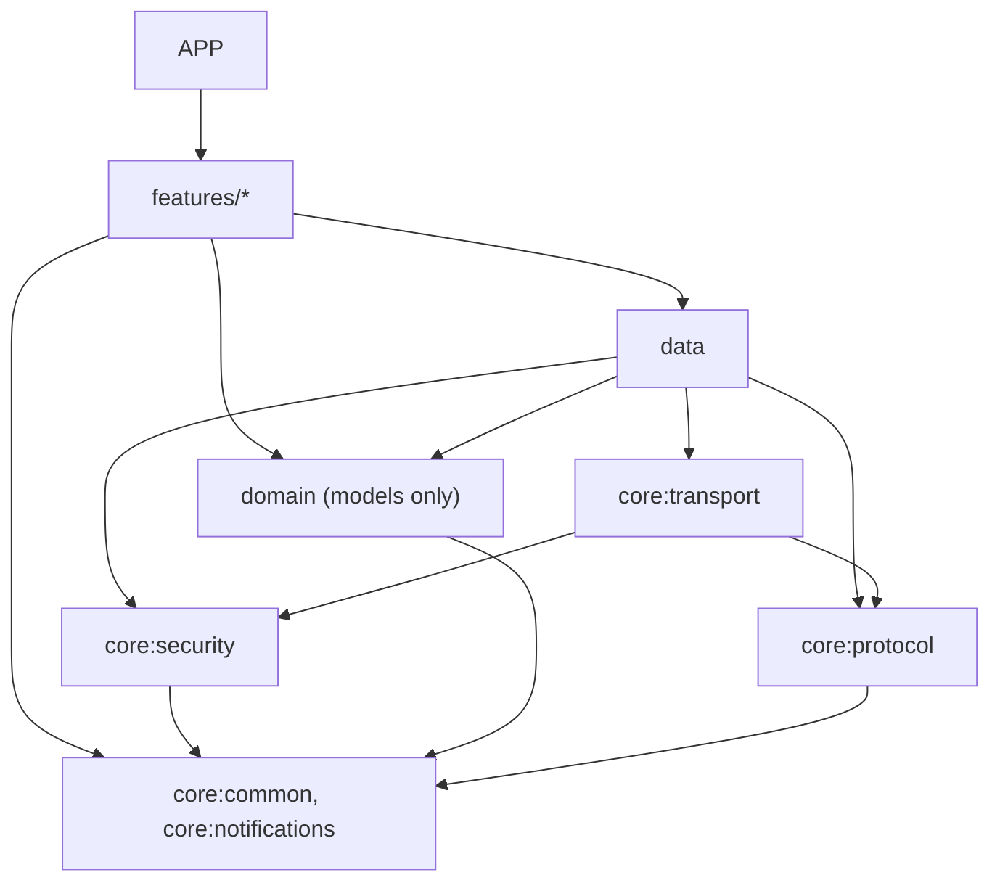

Prohibited (CI-enforced, §40.2): `features → core:transport` (UI never touches sockets); `features → core:security` internals (UI requests via use-cases in data/domain); `domain → Compose / android.*` (pure Kotlin module); `transport → UI`; `core:protocol → Android` (JVM-portable); any module → `core:security` except transport/data (credential isolation, INV-2); `domain → transport` (domain defines interfaces, data binds them).

---

## 41. Agent Development Rules

This project is built by coding agents. Rules that make the architecture agent-proof:

1. **Read order is mandatory**: `architectural.md` → relevant `docs/adr/*` → `docs/protocol/*` → the module being changed. An agent must be able to state, before editing X: "X is owned by module M; its authority is A; the invariant I must preserve is I" (the header comment of each module lists its invariants).
2. **Spec-before-code**: new protocol behavior → update `docs/protocol/` + fixture first; new feature surface → update the feature's section in `docs/` + acceptance criteria first; then tests; then implementation (§41.2 order).
3. **ADR requirements** (§8.2): any decision in the mandatory-ADR list without an ADR fails review (CI check: `docs/adr/` index references in PR description template).
4. **Definition of done per PR** (subset of §49): unit tests for every reducer/codec change; fixture round-trip; no new dependency without ADR + license note; error states + offline states for any new screen; strings externalized; a11y semantics assertions; no secrets in logs (redaction test).
5. **No-go edits** (auto-reject): changes to `core/protocol` wire behavior without fixture + ADR; edits that weaken any invariant INV-1…INV-16 (§42); `git push --force` on shared branches; enabling new Android permissions without a privacy rationale entry; introducing analytics/crash SDKs; touching `~/.zcode` on dev machines from test code.
6. **Review gates**: PRs touching `core/*` require human review (agent PRs to features may auto-merge with green gates + size limits). Every phase exit = human gate (§43.0).
7. **Phase discipline**: an implementation agent works within one phase's work packages; starting a later phase's work early is a review failure; phase gates block progression (§43.0).
8. **When `architectural.md` must be updated** (spec-first, §41.6): transport/auth/state-ownership changes; new service channel adopted; compatibility matrix change; new module; new ADR accepted; any deviation discovered between spec and reality (with a `[CORRECTED <date>]` note — never silent).
9. **Test requirements per layer**: §35 minimums; protocol changes require golden fixtures; state machines require transition-table tests.
10. **Coding rules**: Kotlin official style; error model §33 only (no bare exceptions across module boundaries); no global singletons except `AppContainer`; coroutines exception handler mandatory at roots; all Flow collectors scoped.

### 41.1 Before coding (mandatory checklist)

1. Read the relevant `architectural.md` section(s) and the relevant ADR(s).
2. Read the source contract being implemented (ZCode schema/fixtures or Android interface).
3. Identify the **state owner** (§14) for every piece of state the change touches.
4. Identify the **transport boundary** — nothing above `core:transport` touches sockets (INV-2/6).
5. Identify the **tests** this change requires (§35 minimums) before writing code.

### 41.2 Before changing architecture

1. Update the spec section in `architectural.md` (or the feature doc).
2. Create/update the ADR (§8.2 mandatory list).
3. Update the traceability matrix (§48) if a requirement/component mapping changed.
4. Security-impacting change → threat-model update (§26) is mandatory, not optional.

### 41.3 Before declaring completion

1. Run required tests (unit + integration + fixtures), lint, and architecture checks (module-graph, INV lint).
2. Verify no invariant weakened (walk §42).
3. Update documentation touched by the change (§41 item 8).
4. For fixture-affecting changes: fixtures carry metadata (source, ZCode version, capture date, sanitization status, expected interpretation) and contain **no real credentials, QR codes, conversation content, personal paths, tokens, or provider secrets** (INV-15/16).

### 41.4 Prohibited shortcuts (instant review rejection)

UI → WebSocket directly · duplicate state owners · credential logging · blind retries (esp. post-server-contact) · silent fallback from unsafe permission interpretation (INV-14) · full-history loads (INV-13) · bypassing the transport abstraction (INV-6) · reading the desktop DB directly (INV-7) · production relay or real credentials in CI/tests (INV-15) · desktop paths treated as Android paths (INV-16).

### 41.5 Phase implementation contract

**Implement only the current phase unless explicitly authorized otherwise.** No agent silently jumps ahead, adds future-phase infrastructure, rewrites earlier architecture, or introduces dependencies unrelated to the phase. If a later-phase need is discovered: document it in the phase report and request an architecture update/ADR — do not improvise. Phase gates (§43.0) are stop points: missing evidence = BLOCKED, and the agent stops there and reports.

### 41.6 Change management for `architectural.md`

| Change class | Required process |
|---|---|
| Minor implementation clarification | update the section directly; note `[CORRECTED <date>]` if it reverses prior text |
| New architectural decision | ADR required (§8.2) + section update |
| Breaking protocol assumption | architecture review + compatibility update (§39) + fixture/regression impact |
| Security-impacting change | threat-model update (§26) mandatory + gate re-walk |
| State-ownership change | architecture review mandatory (§14) + INV impact analysis |
| Invariant change | ADR + all downstream section references audited |

---

## 42. Architectural Invariants

| # | Invariant | Enforcement |
|---|---|---|
| INV-1 | **Android is never authoritative** for ZCode task execution/session state (§14) | reducer design + review gate; any local mutation of runtime-owned state is a rejection |
| INV-2 | **UI never owns transport**; UI→network coupling is prohibited | Gradle module graph test (features cannot see `core:transport`) |
| INV-3 | **Credentials/secrets never enter ordinary logs, backups, crash payloads, or telemetry** | centralized redaction sink + property tests scanning all log output for secret substrings |
| INV-4 | **Permission actions are idempotent and replay-safe** (stable commandId; no auto-retry after server contact) | outbox state machine unit tests + §20.3 race matrix |
| INV-5 | **No unbounded queue or cache** anywhere (parse channel, subscriber buffers, render windows, stores — all bounded; verified protocol limits respected) | bounds asserted in unit tests; allocation checks before enqueue |
| INV-6 | **Transport is replaceable without feature-UI rewrites**; features branch on capabilities, never on transport kind | module graph + lint: no transport types above `core:transport` |
| INV-7 | **The desktop's sqlite database is never read directly** by the app; all history via protocol queries | no sqlite driver dependency in any app module (CI dependency check) |
| INV-8 | **Unknown-but-safe protocol shapes never crash the app** (tolerant decode + `Unknown` + counters); known schema violations are rejected safely | golden fixtures incl. unknown-field/unknown-type cases |
| INV-9 | **The phone never issues write operations to desktop filesystem/shell surfaces in MVP** (file read-only, terminal view-only) | typed client interfaces simply do not expose those methods; CI API-surface check |
| INV-10 | **No custom cryptography**; ZCode's verified constructions reproduced exactly; custody, signing, and transport separated (§12.4, §26.3) | crypto code confined to `core:security`; proof fixtures byte-compared to desktop vectors |
| INV-11 | **Every screen implements error/offline/reconnecting/empty/loading states** | UI test suite per screen (DoD §49) |
| INV-12 | **Workspace identity is never a filesystem path**; paths are display-only metadata | typed `WorkspaceIdentityKey` value class; lint against path-typed identity |
| INV-13 | **Large histories are paginated/lazy-loaded**; no full-snapshot requests for unknown-size sessions (§28.3) | transport layer refuses unbounded subscribe; code review gate |
| INV-14 | **Security-sensitive unknowns fail closed**: unknown command types are never executed; unknown permission option ids never map to allow; malformed security payloads never degrade to permissive interpretation | protocol layer unit tests + permission state machine tests (§20.4) |
| INV-15 | **The production relay and real user accounts are never CI dependencies**; no real credentials, QR codes, conversation content, personal paths, or provider secrets ever enter CI, fixtures, or the repository | CI has no relay credentials; fixture lint scans for secret/PII patterns; capture procedure §43-1.4 |
| INV-16 | **Desktop filesystem paths are never treated as Android paths**; they are display-only metadata, and phone features never construct desktop paths | typed wrappers; `file` channel client exposes content streams, not path joins |

Only invariants actually justified by verified facts or threat model are listed; each maps to a CI check or test (§48).

---

## 43. Phased Roadmap

> **Binding rule (no exceptions):** NO polished production UI implementation begins before the Phase 1 exit gate is PASS. Phase 1 must prove, as far as feasible: QR parsing → relay connection → terminal authentication → bootstrap → workspace discovery → frame decoding → at least one real conversation frame → reconnect → state re-sync. This rule binds human and agent implementers alike (§41.5).

### 43.0 Phase-gate semantics

| Gate | Meaning |
|---|---|
| **PASS** | all acceptance criteria green; proceed |
| **PASS WITH KNOWN LIMITATIONS** | criteria green; documented limitations accepted in writing (ADR/open-question refs); proceed |
| **BLOCKED** | a criterion cannot be met now; do not proceed; work the blocker or re-plan |
| **REJECTED** | architecture/assumption invalidated; return to design; ADR revision required |

Agents must never auto-proceed after failed tests; the gate is a human decision, recorded as `docs/adr/phase-N-gate.md`.

### 43.1 Dependency graph

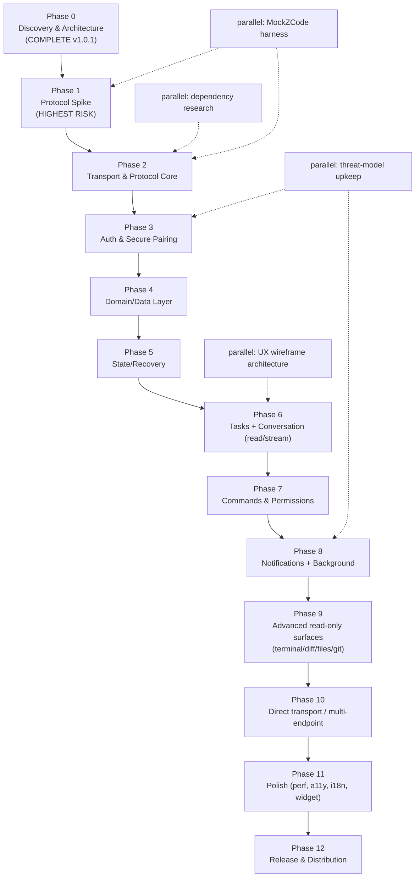

### 43.2 Phases (agent-executable template)

#### Phase 0 — Discovery & Architecture *(COMPLETE — this document, v1.0.1)*

- **Objective:** know the exact boundaries, unknowns, and decisions before any code.
- **Why now:** every phase depends on it; rework at this stage is free.
- **Preconditions:** none.
- **Scope:** reconnaissance (§5–§7), claim verification (§4.3), options (§8.3), architecture (§9–§42), roadmap (here).
- **Non-scope:** any code.
- **Artifacts:** this document + ADR-001…012.
- **Exit gate:** PASS (human review of the self-critique quality checklist). Red-Team Pass 2 applied 2026-09-27.

#### Phase 1 — Protocol Spike (headless JVM + one Android smoke)

> **✅ COMPLETE — PASS WITH KNOWN LIMITATIONS.** Recorded 2026-09-28 14-06-34 BST by `account:zai-individual-coding-plan/GLM-5.3-Flash` (ZCode harness). All spike questions YES against the live production relay (connect / auth matched ×≥8 / receive / decode incl. 2 real conversation frames + rowsRange 200 rows / safe read-only requests / 10-of-10 recovery cycles); Q1/Q2/Q3/Q4/Q9/Q10 answered with evidence; sanitized corpus committed (`fixtures/relay/`); INV-15/16 upheld; device smoke ALL PASS ×3 (API-30 ATD emulator). Full evidence matrix, findings, and accepted limitations: `docs/adr/phase-1-gate.md`.

**Objective.** Prove or kill the highest-risk assumption: an independent client can authenticate to and operate against the production relay, decode its frames, and recover.

**Why this phase exists.** Everything else is buildable regardless; this cannot be skipped or de-risked by code review — only by evidence.

**Preconditions.** Phase 0 accepted; a disposable ZCode test environment available (synthetic workspace, synthetic task content — never personal data, INV-16/§43-1.1); the user's *own* desktop available for QR generation during manual probe windows.

**Scope.** Kotlin port skeleton; relay handshake; live capture with sanitization; one safe request; one conversation frame; one recovery cycle; an on-device smoke of the same handshake.

**Explicit non-scope.** Any UI; persistence; features; CI integration; release artifacts.

**Subphases.**

##### 1.1 Capture & fixture bootstrap (security-critical)
- **Inputs:** disposable desktop environment; fresh QR.
- **Source files / references:** relay envelope §7.5; wire-codec.ts; §36 CI constraints; INV-15/16.
- **Required work:** define and run the capture procedure: *disposable environment → synthetic task → capture → redact → validate → convert to fixture → commit only the sanitized fixture*. Sanitization removes: pairing hashes/proofs, device ids, prompts, file paths, repo names, model keys, any content. Prohibited in fixtures: personal conversations, personal API keys, provider credentials, private repository contents, private filesystem paths, personal tokens, real user secrets.
- **Design constraints:** fixtures carry metadata (source, ZCode version, capture date, sanitization status, expected interpretation — §35.1 taxonomy).
- **Expected artifacts:** capture runbook (`docs/runbooks/capture.md`), first sanitized fixture set, redaction tool (dev-time script).
- **Tests:** redaction tool property test (no prohibited substring survives); fixture schema validation.
- **Acceptance criteria:** ≥ 1 complete sanitized session of relay traffic committed; runbook reviewed.
- **Failure conditions:** any real secret discovered in a fixture → purge from git history + restart capture.
- **Rollback / recovery:** fixtures are additive; discard batch and re-capture.
- **Dependencies:** disposable environment ready.
- **Parallelizable with:** 1.2 (wire codec from schema knowledge).
- **Must precede:** 1.3, 1.4, 1.5.
- **Exit gate:** sanitized corpus committed; no INV-16 violations.

##### 1.2 Binary wire port (bytes → socket → channel)
- **Inputs:** packages/rpc source; golden vectors.
- **Source files / references:** `serialization.ts`, `channels.shared.ts`, `persistent-protocol.ts`, `wire-codec.ts`; §7.3.
- **Required work:** VQL varints; DataType tags; CRC32; 13-byte socket framing; request/response/event state machine.
- **Design constraints:** pure JVM module (`core:protocol`); no Android imports.
- **Expected artifacts:** Kotlin codec + fixture suite.
- **Tests:** round-trip on all fixtures; malformed-input fuzz; CRC mismatch handling.
- **Acceptance criteria:** byte-identical encode/decode against desktop-generated vectors.
- **Failure conditions:** any vector mismatch → stop, diagnose encoding assumption.
- **Rollback / recovery:** module is isolated; no downstream consumers yet.
- **Dependencies:** none (schema knowledge).
- **Parallelizable with:** 1.1.
- **Must precede:** 1.3, 1.5.
- **Exit gate:** codec suite green.

##### 1.3 Relay transport + terminal-role authentication
- **Inputs:** QR from test desktop; capture corpus (1.1); codec (1.2).
- **Source files / references:** §7.6 (verified HMAC construction); §6.2 handshake; installed-bundle strings.
- **Required work:** WSS connect; `auth_init(role:"terminal")` → `auth_challenge` → `auth_response` with `CredentialSigner.proof()`; observe `auth_ack`/`pair_status_ack`; heartbeat; failure paths (wrong proof, second terminal, expired QR).
- **Design constraints:** reproduce the verified algorithm exactly (INV-10); never log hash/proof (INV-3).
- **Expected artifacts:** `RelayAuthClient` (spike quality); recorded auth transcripts (sanitized).
- **Tests:** E2E handshake vs live relay (manual probe window); negative-path fixtures.
- **Acceptance criteria:** handshake succeeds repeatedly; every §46 auth question (Q2/Q3/Q4/Q10) answered with evidence.
- **Failure conditions:** relay rejects independent clients after exhausting transport-level causes → **No-Go §47.1** assessment.
- **Rollback / recovery:** n/a (spike).
- **Dependencies:** 1.1, 1.2.
- **Parallelizable with:** —.
- **Must precede:** 1.4.
- **Exit gate:** handshake PASS + Q2/Q3/Q4 evidence recorded.

##### 1.4 Bootstrap & workspace discovery
- **Inputs:** authenticated connection (1.3).
- **Source files / references:** §46 Q9 (`bootstrap-request`, `workspace-list-request`, `workspace-bridge-open`); installed-bundle `routePayload`.
- **Required work:** capture and decode bootstrap/workspace-list exchanges; open one workspace bridge; document payload schemas as fixtures.
- **Design constraints:** read-only; no command sends.
- **Expected artifacts:** bootstrap schema fixtures + Kotlin decode.
- **Tests:** fixture decode; repeated-session determinism check.
- **Acceptance criteria:** workspace list rendered to spike log for the test desktop.
- **Failure conditions:** bridge open fails consistently → capture + classify (§33).
- **Rollback / recovery:** fallback path documented (sessions-index topic).
- **Dependencies:** 1.3.
- **Parallelizable with:** 1.2 stragglers.
- **Must precede:** 1.5.
- **Exit gate:** Q9 resolved.

##### 1.5 Conversation subscribe + first real frame
- **Inputs:** open bridge (1.4); synthetic conversation with known content.
- **Source files / references:** §7.4 (topics, frames, limits); `rows.ts` row kinds.
- **Required work:** `v4/conversation/subscribe` with `includeSnapshot`; decode one complete snapshot frame + one online delta; verify `rowsRange` ≤ 200.
- **Design constraints:** snapshot → atomic replace (§15.5) implemented minimally.
- **Expected artifacts:** frame decode fixtures; spike log transcript.
- **Tests:** decode suite; limits enforcement (1 MiB ceiling).
- **Acceptance criteria:** one real conversation frame decoded correctly, end to end.
- **Failure conditions:** frame overflow on the *test* session → document limits, switch to smaller session; persistent decode failure → BLOCKED.
- **Rollback / recovery:** n/a.
- **Dependencies:** 1.4.
- **Parallelizable with:** —.
- **Must precede:** 1.6.
- **Exit gate:** "can receive and decode protocol traffic" = YES.

##### 1.6 Reconnect + state re-sync
- **Inputs:** working subscribe (1.5).
- **Source files / references:** §15.1; §9.8.
- **Required work:** kill socket → reconnect → re-auth → resubscribe with `afterSeq` → verify gap-free continuation; force one epoch mismatch → snapshot replace.
- **Design constraints:** no merge of ambiguous state.
- **Expected artifacts:** recovery transcript fixtures.
- **Tests:** scripted disconnect/resync cycle × 10.
- **Acceptance criteria:** 10/10 recoveries correct (or snapshot-replaced correctly).
- **Failure conditions:** any incorrect merge → BLOCKED (No-Go §47.5 assessment).
- **Rollback / recovery:** n/a.
- **Dependencies:** 1.5.
- **Parallelizable with:** 1.7.
- **Must precede:** Phase 2.
- **Exit gate:** "can recover" = YES.

##### 1.7 Android device smoke
- **Inputs:** JVM spike client (1.3–1.6).
- **Source files / references:** §10 stack.
- **Required work:** run the same handshake + one subscribe on a real device (OkHttp WS); verify Keystore HMAC path produces identical proofs (vector test).
- **Design constraints:** throwaway activity/log output only — not product UI (binding §43.0 rule).
- **Expected artifacts:** device smoke notes; proof-vector test.
- **Tests:** on-device handshake × 3.
- **Acceptance criteria:** Android can establish the connection and decode frames.
- **Failure conditions:** Keystore/platform blocker → BLOCKED with platform findings.
- **Rollback / recovery:** n/a.
- **Dependencies:** 1.3.
- **Parallelizable with:** 1.6.
- **Must precede:** Phase 2 app scaffold.
- **Exit gate:** "can Android establish the ZCode connection" = YES.

##### 1.8 Spike report + ADR confirmation
- **Inputs:** all above.
- **Required work:** go/no-go report; confirm or amend ADR-002/003/004/006; update §46 answers; update compatibility notes.
- **Expected artifacts:** `docs/adr/phase-1-gate.md`.
- **Acceptance criteria:** all six spike questions YES (connect / auth / receive / decode / safe request / event + recovery).
- **Failure conditions:** any NO → §47 review.
- **Dependencies:** 1.1–1.7.
- **Exit gate:** **Phase 1 gate decision** (PASS unlocks Phase 2 and — only then — Phase 6 UI work; Phase 2–5 proceed regardless of UI).

**Phase-Level Acceptance Criteria.** All spike questions YES; sanitized corpus committed; Q1/Q2/Q3/Q4/Q9/Q10 answered with evidence; INV-15/16 upheld.

**Phase-Level Risks.** Relay rejects independent clients (§47.1); captured corpus reveals unrecorded message types (→ extend fixtures); device TLS/Keystore quirk (→ findings, not blockers).

**Phase Exit Decision.** PASS / PASS WITH KNOWN LIMITATIONS / BLOCKED / REJECTED — recorded by the human architect.

#### Phase 2 — Transport & Protocol Core

> **✅ COMPLETE — PASS WITH KNOWN LIMITATIONS.** Recorded 2026-09-28 15-36-32 BST by `account:zai-individual-coding-plan/GLM-5.3-Flash` (ZCode harness). All subphase exit gates green: 2.1 state machine matches §14.4.1 exactly (11 transition tests incl. the four illegal transitions); 2.2 RelayTransport production-grade with the full sanitized corpus replaying green against MockZCode (live-socket playback + wire-faithful decode + strict send-shape lint); 2.3 fault-injection storm suite green (disconnect/duplicate/out-of-order/oversized #228-class/CRC/latency + full-jitter backoff unit tests, INV-5 bounded); 2.4 close-code/relay-error mapping complete with every §33 category tested (7 mapping tests) and hello capability negotiation ported; 2.5 MockZCode core (Kotlin JVM on MockWebServer, built on the shipped codecs) with self-test green and CI integration committed (`.github/workflows/ci.yml`); 2.6 centralized redaction logging sink with the INV-3 property test green. Full suite: 88 tests / 0 failures (clean `--rerun-tasks` run). Accepted limitations + evidence: `docs/adr/phase-2-gate.md`. §7.4.4 sendText CAS-set example corrected against v3.14.3 (`[CORRECTED 2026-09-28]`, §41.6 process).

**Objective.** Production-grade transport + complete protocol port, proven against MockZCode.
**Why now.** Every later feature sits on it; the fault matrix must be green before state/UI work is trusted.
**Preconditions.** Phase 1 PASS; corpus + fixtures committed.
**Scope.** `core:transport` full; `core:protocol` completion; MockZCode core; redaction logging; reconnect/backoff/flow.
**Non-scope.** Credential storage UX; features; DirectTransport (skeleton interface only).
**Subphases.**

##### 2.1 Transport interface + connection state machine
- **Inputs:** §11.2 contract; §14.4.1 machine.
- **Required work:** implement interface + states + transitions + illegal-transition detection.
- **Artifacts:** `core:transport` API; state tests.
- **Tests:** transition-table tests incl. illegal transitions.
- **Acceptance:** machine matches §14.4.1 exactly.
- **Failure conditions:** any unverifiable transition.
- **Rollback:** interface-only change; no consumers yet.
- **Dependencies:** Phase 1.
- **Parallelizable with:** 2.5 (MockZCode core), UX track.
- **Must precede:** 2.2.
- **Exit gate:** API frozen for Phase 3–5 consumers.

##### 2.2 RelayTransport production-grade
- **Inputs:** corpus (1.1); §7.5 envelope.
- **Required work:** rpc-frame codec incl. observed fragment/ack semantics; bounded send queue; heartbeat/watchdog.
- **Artifacts:** RelayTransport + fixtures.
- **Tests:** fragmentation/assembly at verified limits; oversized-frame rejection; CRC failure; #228-class fixture.
- **Acceptance:** full corpus replays green against MockZCode.
- **Failure conditions:** any unexplained frame class in corpus → capture + fixture.
- **Rollback:** transport isolated behind interface.
- **Dependencies:** 2.1.
- **Parallelizable with:** 2.3, 2.5.
- **Must precede:** 2.4.
- **Exit gate:** corpus replay 100% green.

##### 2.3 Reconnect, backoff, flow control
- **Inputs:** §11.5; §28.4; §9.8.
- **Required work:** backoff w/ jitter; foreground trigger; `v4/connection/flow` handling; bounded buffers.
- **Tests:** fault-injection suite (MockZCode disconnect/latency storms).
- **Acceptance:** no unbounded growth under any scripted storm (INV-5).
- **Dependencies:** 2.2. **Must precede:** Phase 3. **Exit gate:** storm suite green.

##### 2.4 Capability & error mapping
- **Inputs:** §7.4.1 capabilities; §33 taxonomy.
- **Required work:** hello negotiation; capability set; close-code/error mapping.
- **Tests:** mapping table tests. **Acceptance:** every category has ≥1 test (§33).
- **Dependencies:** 2.2. **Must precede:** Phase 3. **Exit gate:** mapping complete.

##### 2.5 MockZCode core (build with phases — §35.4)
- **Inputs:** corpus; schema knowledge.
- **Required work:** relay-envelope mock + auth scenarios + topic snapshot/deltas + fault scripting (disconnect, duplicates, out-of-order, fragmentation, oversized, races).
- **Tests:** self-test (mock must decode its own output).
- **Acceptance:** 2.2–2.4 suites run entirely against it.
- **Dependencies:** 1.1. **Parallelizable with:** all of Phase 2. **Exit gate:** CI integration.

##### 2.6 Redaction logging sink
- **Inputs:** §34; INV-3.
- **Required work:** single sink, levels, correlation ids, secret scrubbers, diagnostics ring.
- **Tests:** property test — no secret substring in any output.
- **Acceptance:** scrubbers proven on adversarial inputs.
- **Dependencies:** none. **Parallelizable with:** all. **Exit gate:** INV-3 test green.

**Phase-Level Acceptance Criteria.** Fault matrix green; corpus replay green; INV-5/6 upheld; MockZCode in CI.
**Phase-Level Risks.** Corpus gaps for unobserved paths (→ capture more); performance of Kotlin codec (→ benchmark early).
**Phase Exit Decision.** Gate recorded; **architecture freeze evaluation happens here (§51.4)**.

#### Phase 3 — Authentication & Secure Pairing

> **✅ COMPLETE — PASS WITH KNOWN LIMITATIONS.** Recorded 2026-09-28 17-52-46 BST by `account:zai-individual-coding-plan/GLM-5.3-Flash` (ZCode harness). All six subphase exit gates green with executed evidence: 3.1 parser suite (19 tests: full §12.2 gate chain + hostile corpus + 5,000-mutation fuzz, zero state writes on invalid input, E1–E3); 3.2 CredentialVault/CredentialSigner (desktop proof vectors byte-identical on JVM + Tink/Keystore custody, rotation/wipe/forensics; Keystore-HMAC variant behind flag); 3.3 biometric policy decision table + CryptoObject gate (E7 explicit-consent path executed on device); 3.4 pairing UI flow (Compose, E1–E7 screens, flow + Robolectric suites) with **instrumented on-device E2E 3/3 vs in-process MockZCode — first-pair 1101 ms (≤ 60 s budget)**; 3.5 rotation + unpair wipe forensics on device (`masterKeyDestroyed=true`, store empty, keystore aliases gone) + §26.5 incident drill (rotate-in-place / unpair-re-pair) executed; 3.6 T1–T18 re-walk — **no open HIGH**. Full suite 137 JVM tests + 3 instrumented, 0 failures. AGP adoption + dependency set recorded in ADR-013; §9.5 workspace discovery implemented in the transport (Q9-verified shape). Accepted limitations + evidence: `docs/adr/phase-3-gate.md`.

**Objective.** End-to-end secure pairing with custody/signing separation.
**Why now.** Credentials gate everything user-facing; security review must precede UI.
**Preconditions.** Phase 2 core green; threat model current.
**Scope.** §12 full; `core:security`; pairing UI flow; rotation/unpair/wipe.
**Non-scope.** Multi-endpoint UI; direct-endpoint credentials.
**Subphases.**

##### 3.1 QR ingestion & validation
- **Inputs:** §12.2 spec; hostile-input corpus.
- **Required work:** scanner + manual entry; parse/validate; compat gate; dedupe-by-sid rotation detection.
- **Tests:** parser fuzz + malformed/foreign-URL corpus; compat-gate table tests.
- **Acceptance:** zero state writes on invalid input; E1–E3 handled.
- **Dependencies:** Phase 2. **Parallelizable with:** 3.2. **Must precede:** 3.4. **Exit gate:** parser suite green.

##### 3.2 CredentialVault + CredentialSigner
- **Inputs:** §12.4; §26.3; desktop proof vectors.
- **Required work:** Tink+Keystore sealing; load/sign/wipe/rotate; Keystore-HMAC import variant behind flag.
- **Tests:** proof vectors byte-identical to desktop; wipe completeness; no-secret-in-memory-dump sanity.
- **Acceptance:** signer answers challenges without exposing material (API-level guarantee).
- **Dependencies:** none beyond Phase 1 vectors. **Parallelizable with:** 3.1. **Must precede:** 3.4. **Exit gate:** vector tests green.

##### 3.3 Biometric gating
- **Inputs:** §12.4.
- **Required work:** BiometricPrompt + CryptoObject gate; reduced-security consent path (E7).
- **Tests:** gate behavior on devices with/without biometrics.
- **Acceptance:** E7 path explicit; no silent fallback.
- **Dependencies:** 3.2. **Exit gate:** gate tests green.

##### 3.4 Pairing UI flow
- **Inputs:** §2.6 journey; §18.
- **Required work:** welcome → scan → validate → setup → connected; E1–E7 branches; security explainer.
- **Tests:** UI tests per state; E2E vs real desktop (manual).
- **Acceptance:** first-pair ≤ 60 s (§48 traceability).
- **Dependencies:** 3.1–3.3, Phase 2 transport. **Exit gate:** pairing E2E PASS.

##### 3.5 Rotation, unpair, secure wipe
- **Inputs:** §12.7; docs security model.
- **Required work:** rotate-in-place; unpair wipe; desktop "Stop" guidance.
- **Tests:** wipe completeness; rotation continuity.
- **Acceptance:** zero secret remnants (forensic test).
- **Dependencies:** 3.2, 3.4. **Exit gate:** incident-response drill (§26.5) executed.

##### 3.6 Security gate review
- **Inputs:** §26 threat model delta.
- **Required work:** re-walk T1–T18; record residual risks.
- **Acceptance:** no open HIGH. **Exit gate:** human sign-off.

**Phase-Level Acceptance Criteria.** Pairing E2E PASS; security review PASS; INV-3/10/14 upheld.
**Phase-Level Risks.** Keystore OEM quirks (→ device matrix); relay auth edge cases discovered late (→ reopen Q2–Q4).
**Phase Exit Decision.** Gate recorded.

#### Phase 4 — Domain/Data Layer

> **✅ COMPLETE — PASS WITH KNOWN LIMITATIONS.** Recorded 2026-09-28 19-04-14 BST by `account:zai-individual-coding-plan/GLM-5.3-Flash` (ZCode harness). All six subphase exit gates green with executed evidence: 4.1 §16 typed models as pure-Kotlin `:domain` (sealed conversation-row hierarchy ported from the verified rows.ts v3.14.3; INV-8 unknown-tolerance decode suite + §20.4 fail-closed options + INV-12 typed identity; 31 tests); 4.2 Room schema **v1 FROZEN** (10 entities, indices, committed export; DAO suites + migration-test harness green on the committed schema assets); 4.3 repositories with ETag flows, §17.3 bounds, epoch-guarded reconciliation (stale-epoch ops reject with zero mutation; snapshots replace atomically) — 50 seeded randomized reconciliation schedules + §15-scenario store-level replays green; 4.4 outbox full §17.5 lifecycle + §28.6 retry classifier through the PERSISTED path — INV-4 proven (no path duplicates a server-contacted command; illegal transitions persist nothing); 4.5 transactional recovery journal with crash-consistency proven via a mid-transaction SQLite RAISE(ABORT) fault (previous complete snapshot intact) + cold-start replay; 4.6 DataStore-proto preference/endpoint/credential-envelope stores with additive-first golden-v1 migration evidence and at-rest plaintext forensics (INV-3) + production credential-binding swap (ADR-014). Full suite 208 JVM tests / 0 failures + 4/4 instrumented on device (API-30 ATD); ADR-008 revisit trigger measured NOT tripped (persistence first-touch ≈ 38 ms < 100 ms; Q15 resolved: Room stays). Accepted limitations + evidence: `docs/adr/phase-4-gate.md`; toolchain recorded in `docs/adr/adr-014-phase4-persistence-stack.md`.

**Objective.** Typed models and durable stores with the Room/DataStore split (ADR-008).
**Why now.** State work (P5) needs persistence contracts.
**Preconditions.** Phase 3 credential flows stable.
**Scope.** §16 models; Room schema/DAOs; repositories; outbox; journal; DataStore prefs.
**Non-scope.** UI; DirectTransport stores.
**Subphases.**

##### 4.1 Domain models
- **Inputs:** §16. **Required work:** typed value classes + sealed row models + unknown tolerance.
- **Tests:** decode fixtures (unknown field/type). **Acceptance:** INV-8 green. **Dependencies:** Phase 1 codecs. **Parallelizable with:** 4.2. **Must precede:** 4.3. **Exit gate:** model suite green.

##### 4.2 Room schema + DAOs
- **Inputs:** §17.2 split; §32.3.
- **Required work:** entities (tasks, pages, journal, outbox, interactions, drafts), indices, schema export.
- **Tests:** DAO suites; migration drills from v1. **Acceptance:** migration test harness green.
- **Dependencies:** 4.1. **Must precede:** 4.3. **Exit gate:** schema v1 frozen.

##### 4.3 Repositories & cache reconciliation
- **Inputs:** §17. **Required work:** projection merge (transport events + stores), ETag flows, eviction bounds.
- **Tests:** reconciliation property tests. **Acceptance:** no divergence under §15 scenarios replayed at repo level.
- **Dependencies:** 4.1, 4.2. **Exit gate:** repo suites green.

##### 4.4 Command outbox
- **Inputs:** §17.5 lifecycle + classification.
- **Required work:** full state machine (Draft→…→Unknown) + persistence + retry classifier.
- **Tests:** lifecycle + idempotency (INV-4). **Acceptance:** no path duplicates a server-contacted command.
- **Dependencies:** 4.2. **Exit gate:** outbox suites green.

##### 4.5 Recovery journal persistence
- **Inputs:** §15.4. **Required work:** transactional journal writes per transition; replay on cold start.
- **Tests:** crash-consistency (kill mid-write). **Acceptance:** journal never corrupts (§32.3).
- **Dependencies:** 4.2. **Exit gate:** journal drills green.

##### 4.6 DataStore prefs/config
- **Inputs:** §17.2. **Required work:** preference store, endpoint descriptors, sealed credential envelopes.
- **Tests:** additive migration. **Acceptance:** INV-16 (no secrets in plaintext).
- **Dependencies:** none. **Parallelizable with:** 4.1–4.5. **Exit gate:** store suite green.

**Phase-Level Acceptance Criteria.** All store suites green; ADR-008 revisit triggers evaluated with measurements.
**Phase-Level Risks.** Room cold-start cost (→ measure; drop-to-DataStore ADR path exists).
**Phase Exit Decision.** Gate recorded.

#### Phase 5 — State & Recovery Architecture

> **✅ COMPLETE — PASS WITH KNOWN LIMITATIONS.** Recorded 2026-09-28 20-30-53 BST by `account:zai-individual-coding-plan/GLM-5.3-Flash` (ZCode harness). All five subphase exit gates green with executed evidence: 5.1 per-topic single-writer reducers + `(logEpoch, seq)` stale-guard (deterministic suite + model-based property: 60 seeded schedules × 80 ops vs an independent §15.5/S7–S10 reference — zero ambiguous merges; §14.4.2 task machine table verbatim); 5.2 snapshot replacement semantics (atomic replace + cursor reset + derived-state discard + drafts/UI-state retention proven end-to-end); 5.3 journal-driven recovery subsystem with per-endpoint-mutex resync escalation (resume → forced-snapshot on repeat) — **§15 scenario matrix S1–S17 green 17/17** against MockZCode through the real RelayTransport + Room + journal; 5.4 §14.4.3 permission machine + §20.4 fail-closed answer policy with **zero double-apply across 10,000 randomized schedules** and single-commandId retries (INV-4) wired through the outbox; 5.5 invariant coverage table in `docs/invariant-coverage.md` (INV-1…16 each mapped). Full repo: 272 JVM tests / 0 failures + 4/4 instrumented on device (API-30 ATD). Additive transport surface (`resyncSession`, `subscriptionEpoch`) + Degraded-retry budget fix + per-event fault isolation recorded in the gate doc (§41.6 process). **This gate satisfies the §51.4 second freeze condition.** Accepted limitations + evidence: `docs/adr/phase-5-gate.md`.

**Objective.** The correctness core: reducers, stale-guard, recovery — exhaustively tested.
**Why now.** UI without this lies to users under network faults.
**Preconditions.** Phase 4 stores; Phase 2 transport.
**Scope.** §14 machines; §15 all 17 scenarios; §15.5 semantics; property tests.
**Non-scope.** Screens.
**Subphases.**

##### 5.1 Reducers + stale-guard
- **Inputs:** §14; §9.13 identity table.
- **Required work:** per-topic single-writer reducers; `(logEpoch, seq)` guard; duplicate/stale drop.
- **Tests:** transition tables + property tests (random op streams).
- **Acceptance:** zero ambiguous merges under randomized schedules.
- **Dependencies:** 4.3. **Must precede:** 5.3. **Exit gate:** property suite green.

##### 5.2 Snapshot replacement semantics
- **Inputs:** §15.5. **Required work:** atomic replace + cursor reset + derived-state discard + local-only retention.
- **Tests:** S9 scenarios. **Acceptance:** snapshots never overwrite drafts/UI state.
- **Dependencies:** 5.1. **Exit gate:** S9 green.

##### 5.3 Recovery subsystem
- **Inputs:** §15.1. **Required work:** journal-driven resubscribe/resync/snapshot escalation.
- **Tests:** S1–S17 scenario matrix on MockZCode.
- **Acceptance:** 17/17 correct.
- **Dependencies:** 5.1, 5.2, 2.3. **Exit gate:** matrix green.

##### 5.4 Permission state machine integration
- **Inputs:** §14.4.3; §20.
- **Required work:** interaction states wired to events/commands with fail-closed paths (INV-14).
- **Tests:** §20.3 matrix. **Acceptance:** zero double-apply across 10k random schedules.
- **Dependencies:** 5.1, 4.4. **Exit gate:** race suite green.

##### 5.5 Property/model-based testing audit
- **Inputs:** §35 pyramid.
- **Required work:** model-based checks for replay/ordering/idempotency/outbox/snapshot/stale-guards (where useful — not forced).
- **Acceptance:** each invariant INV-1…16 mapped to ≥1 automated check or explicit manual gate.
- **Dependencies:** 5.1–5.4. **Exit gate:** invariant coverage table in `docs/`.

**Phase-Level Acceptance Criteria.** All §15 scenarios + §20.3 matrix + property suites green; invariant coverage complete.
**Phase-Level Risks.** Discovering protocol subtleties late (→ fixture + ADR loop).
**Phase Exit Decision.** Gate recorded — **this gate is the second freeze condition (§51.4).**

#### Phase 6 — Tasks & Conversation (read/stream)

> **✅ COMPLETE — PASS WITH KNOWN LIMITATIONS.** Recorded 2026-09-29 02-16-31 BST by `account:zai-individual-coding-plan/GLM-5.3-Flash` (ZCode harness). All six subphase exit gates green with executed evidence: 6.1 shell/navigation/theme in the new `core:ui` module (ADR-016 — designed ui-ux token pairs, edge-to-edge, predictive back); 6.2 task list (workspace-grouped rails, skeletons, pull-to-refresh, live `workspace-list-updated` ≤ 2 s — §48 U2 tested against MockZCode); 6.3 conversation read + `rowsRange` pagination with S9 interplay; 6.4 streaming render end-to-end (reducer buffers → manager StateFlow → ≤ 30 Hz coalescer → merged display; bounded markdown per ADR-015; tool cards with generic fallback — §48 U6/U7); 6.5 connection center exposing all §14.4.1 states + §15.3 takeover UX; 6.6 per-screen state matrices (INV-11). Full suite 320/320 JVM/Robolectric + 5/5 instrumented (ATD API-30) incl. an on-device cold-start → task list → conversation → streaming → light/dark capture E2E (`docs/evidence/phase-6/`). Transport hardening with regression tests: clean-close classification (was watchdog-delayed), §28.5 single-flight recovery, generation-guarded loss signals. Schema v1 → v2 (additive `tasks.workspaceLabel`, §32.3 drill). Accepted limitations (formal §28.1 budgets deferred to Phase 11 Macrobenchmark; pre-existing matrix load-sensitivity bisected to Phase 5 HEAD; relay plane carries no task ETag; markdown subset per ADR-015) + evidence: `docs/adr/phase-6-gate.md`.

**Objective.** The native product surface for observation.
**Why now.** Protocol, state, and recovery are proven; UI can be honest.
**Preconditions.** Phase 5 PASS; **Phase 1 gate PASS (binding no-UI rule §43.0)**.
**Scope.** App shell, navigation, task list, conversation read/stream, connection center, all state screens.
**Non-scope.** Send/approve (Phase 7); terminal/diff/files.
**Subphases.**

##### 6.1 App shell, navigation, theme
- **Inputs:** §18. **Required work:** single-activity, nav routes, M3 theme + dynamic color, predictive back, edge-to-edge.
- **Tests:** navigation tests; screenshot baselines. **Acceptance:** a11y baseline (§30). **Dependencies:** Phase 5. **Parallelizable with:** 6.2 (after shell). **Exit gate:** shell stable.

##### 6.2 Task list
- **Inputs:** sessions-index projection; §18.3/§20-of-pass screen rules.
- **Required work:** workspace-grouped list, live status, skeletons, pull-to-refresh, ETag cache reads.
- **Tests:** UI suite (empty/loading/ready/stale); perf (§28.1).
- **Acceptance:** live status ≤ 2 s of event (§48).
- **Dependencies:** 6.1, Phase 4/5. **Exit gate:** task-list suite green.

##### 6.3 Conversation read + pagination
- **Inputs:** §19. **Required work:** tail-first render; `rowsRange` scroll-back; page cache; epoch invalidation.
- **Tests:** pagination edge tests; S9 interplay. **Acceptance:** first render ≤ 700 ms P95 (target).
- **Dependencies:** 6.1, 4.3. **Exit gate:** read suite green.

##### 6.4 Streaming render
- **Inputs:** §19.2/§19.3. **Required work:** coalescer, markdown partials, tool cards (generic fallback), scroll anchoring.
- **Tests:** streaming perf (coalescing under burst); jank stats.
- **Acceptance:** ≥ 55 fps sustained under 3 streams (engineering target, measured).
- **Dependencies:** 6.3. **Exit gate:** streaming suite green.

##### 6.5 Connection center
- **Inputs:** §14.4.1; §18.3. **Required work:** per-endpoint state view; takeover UX (§15.3).
- **Tests:** state-driven UI tests. **Acceptance:** every machine state visible honestly.
- **Dependencies:** 6.1. **Exit gate:** suite green.

##### 6.6 State screens + error surfaces
- **Inputs:** INV-11; §33. **Required work:** error/offline/reconnecting/empty/loading for every screen.
- **Tests:** per-screen state matrix. **Acceptance:** INV-11 verified.
- **Dependencies:** all above. **Exit gate:** Phase 6 gate.

**Phase-Level Acceptance Criteria.** §48 rows U2/U3/U5–U7 green; budgets measured on reference device.
**Phase-Level Risks.** Streaming jank on low-end (→ coalescer tuning); markdown edge cases (→ fixture corpus).
**Phase Exit Decision.** Gate recorded.

#### Phase 7 — Commands & Permissions

> **✅ COMPLETE — PASS WITH KNOWN LIMITATIONS.** Recorded 2026-10-01 01-40-00 BST by `account:zai-individual-coding-plan/GLM-5.3-Flash` (ZCode harness). All six subphase exit gates green with executed evidence: 7.1 composer + §17.4 Room drafts + §17.6 offline draft UX (E8 proven on-device across a full activity recreation); 7.2 the REAL outbox replaces the Phase 6 stub — `CommandCoordinator` with INV-4 idempotency, §15.5 unknown outcomes, §28.6 SAFE_AGGRESSIVE retransmit, verified `sendText` payloads; 7.3 approval cards + cross-task approvals inbox fed by the VERIFIED `pendingInteractions` snapshot key (**Q11 RESOLVED** — snapshots DO carry open interactions), fail-closed §20.4 at UI and gate; 7.4 U9 user-input answers (`answer {optionId}`/`{freeText}` compat paths); 7.5 stop/cancel/queue from the verified §9 control/queue state (CAS via the projection revision, held-queue disposition dialog); 7.6 randomized race hardening (1,000 schedules × transport death — zero unsafe outcomes) on top of Phase 5's 10k. Protocol port (spec-first): `docs/protocol/v4-wire.md` §9 — session-state keys with KEY-LEVEL replacement merge + per-key INV-8 tolerance. Full suite **434/434 JVM** (baseline 368, +66) + **7/7 instrumented** (ATD API-30); artifact `app-debug.apk` `0.7.0-phase7 (vc20)`. Field-caught defects fixed with regressions: hub `ensureCoordinator` double-create race, draft-restore wipe, unreachable interaction retry path, mock seq-continuity. Accepted limitations (on-device send segment covered by the JVM E2E; question-array payloads read-only; restore bounce; live-desktop canary pending) + evidence: `docs/adr/phase-7-gate.md`.

**Objective.** The safe write path: send, approve, answer, stop.
**Why now.** Observation without control is half the product; safety machinery (P5.4) is ready.
**Preconditions.** Phase 6 UI stable; §20 architecture.
**Scope.** Composer, drafts, outbox send path, approvals, user-input, stop/cancel.
**Non-scope.** Attachments (Phase 9); model switch (Phase 9).
**Subphases.**

##### 7.1 Composer & drafts
- **Inputs:** §17.4. **Required work:** composer, Room drafts, offline draft UX.
- **Tests:** draft persistence incl. process death. **Acceptance:** E8 (draft never lost).
- **Dependencies:** 6.3. **Exit gate:** draft suite green.

##### 7.2 Send path
- **Inputs:** §17.5; v4 `sendText` envelope.
- **Required work:** outbox integration, CAS (`baseRevision`), pending/confirmed/failed states.
- **Tests:** idempotency (INV-4); offline-block rules (§17.6).
- **Acceptance:** no double-send across any failure sequence.
- **Dependencies:** 7.1, 4.4. **Exit gate:** send E2E PASS.

##### 7.3 Approval cards + inbox
- **Inputs:** §20. **Required work:** cards with full decision context; approvals inbox; fail-closed paths (§20.4).
- **Tests:** §20.3 matrix at UI level; a11y semantics.
- **Acceptance:** approval answered ≤ 3 interactions / ≤ 10 s warm (G2a).
- **Dependencies:** 5.4, 6.3. **Exit gate:** approval E2E PASS.

##### 7.4 User-input answers
- **Inputs:** `userInput.requested` plane. **Required work:** question UI + answers via v4.
- **Tests:** E2E. **Acceptance:** U9 green. **Dependencies:** 7.3. **Exit gate:** suite green.

##### 7.5 Stop / cancel / queue management
- **Inputs:** verified stop/cancel command family. **Required work:** stop, `cancelBackgroundWork`, queue display/edit (`sendQueuedNow`, `editQueueItem`).
- **Tests:** aggressive-retry safety. **Acceptance:** U24 green.
- **Dependencies:** 7.2. **Exit gate:** suite green.

##### 7.6 Race hardening
- **Inputs:** §20.3. **Required work:** adversarial schedules (resolved-elsewhere, stale, disconnect-mid-submit).
- **Tests:** randomized UI+transport fault schedules.
- **Acceptance:** zero unsafe outcomes.
- **Dependencies:** 7.2–7.5. **Exit gate:** Phase 7 gate.

**Phase-Level Acceptance Criteria.** §48 rows U4/U8/U9/U24 green; no silent offline queuing of approvals.
**Phase-Level Risks.** CAS edge semantics (→ verify `baseRevision` behavior on reject).
**Phase Exit Decision.** Gate recorded.

#### Phase 8 — Notifications & Background

> **✅ COMPLETE — PASS WITH KNOWN LIMITATIONS.** Recorded 2026-10-02 18-20-00 BST by `account:zai-individual-coding-plan/GLM-5.3-Flash` (ZCode harness). All five subphase exit gates green with executed evidence: 8.1 the §24.1 NotificationBroker (new `core:notifications` module: §24.2 channels, §24.3 dedupe/collapse, §16 persisted records via the §9.2 data→notifications edge, S12/S13 reconciliation, §15-S13 background re-post) with UI never touching notification APIs; 8.2 §24.7 deep links (manifest + intake + domain-matrix resolution against the rendered projection; U21 routing proven on device incl. stale-safe legs; consume-before-resolve race hardened); 8.3 the §25.2 FGS spike — `specialUse` behind opt-in with 30-min auto-timeout, `remoteMessaging` evaluated NOT APPLICABLE, emulator evidence (fg-priority hold through forced deep Doze) — decision ADR-017; 8.4 the §25.3 WorkManager probe (≥15 min, network-constrained, opt-in, quota-compliance asserted); 8.5 `docs/battery-phase8.md` with honest measured-vs-not-executed split. Full suite **489/489 JVM** (baseline 434, +55) + **9/9 instrumented** (ATD API-30); artifact `app-debug.apk` `0.8.0-phase8 (vc27)`. Field-caught defects fixed with regressions: phase-keyed wiring collectors (dead-session race), deep-link double-navigate, resolver/visible-projection divergence, FGS tap-intent NPE, below-the-fold settings click. Accepted limitations (physical-device battery targets + OEM matrix not executed — Q12 open; Play-policy leg deferred with the Play track; no quick-approve action by default-off design; single-endpoint disambiguation) + evidence: `docs/adr/phase-8-gate.md`, `docs/evidence/phase-8/`, `docs/battery-phase8.md`.

**Objective.** Honest attention: active-session notifications now; validated FGS; bridges deferred.
**Why now.** Usability depends on it; platform validation must precede release claims.
**Preconditions.** Phase 7.
**Scope.** §24 broker/channels/deep links; §25 FGS candidate spike; WorkManager; battery measurement.
**Non-scope.** Push bridges (ADR-007 deferred); widgets.
**Subphases.**

##### 8.1 NotificationBroker + channels
- **Inputs:** §24.1. **Required work:** transport-independent broker, channels, dedupe, privacy levels.
- **Tests:** broker unit suite. **Acceptance:** UI never creates notifications directly.
- **Dependencies:** Phase 7. **Exit gate:** suite green.

##### 8.2 Deep links
- **Inputs:** §24.7. **Required work:** routing + all stale/invalid cases.
- **Tests:** deep-link matrix. **Acceptance:** U21 green; stale-safe.
- **Dependencies:** 8.1. **Exit gate:** matrix green.

##### 8.3 FGS validation spike (§25.2 chain)
- **Inputs:** §25. **Required work:** implement candidate `specialUse` FGS behind flag; measure on §35.6 devices incl. aggressive OEM ROM; evaluate `remoteMessaging` applicability; document.
- **Tests:** background matrix; battery measurement (§29 method).
- **Acceptance:** go/no-go evidence recorded; ADR if adopted.
- **Failure conditions:** unacceptable battery/kill behavior → fallback = no FGS (§25.2).
- **Dependencies:** 8.1. **Exit gate:** ADR for the service type decision `[CORRECTED 2026-10-02]`: recorded as **ADR-017** (`docs/adr/adr-017-phase8-background-execution.md`) — the "ADR-013" number below was consumed by Phase 3's toolchain ADR before this phase ran.

##### 8.4 WorkManager auto-reconnect
- **Inputs:** §25.3. **Required work:** constrained periodic probe for opted-in endpoints.
- **Tests:** JobScheduler quota behavior. **Acceptance:** no quota violations.
- **Dependencies:** 8.3. **Exit gate:** suite green.

##### 8.5 Battery report
- **Inputs:** §29 method. **Required work:** measured targets vs actuals, per device.
- **Acceptance:** within §28.1 targets or documented deviation.
- **Dependencies:** 8.3. **Exit gate:** report in `docs/`.

**Phase-Level Acceptance Criteria.** U20/U21 green; FGS decision recorded; battery evidence published.
**Phase-Level Risks.** OEM kill variance (→ conservative FGS defaults).
**Phase Exit Decision.** Gate recorded.

#### Phase 9 — Advanced Read-Only Surfaces

**Objective.** Diff/files/terminal(view-only)/git/model-switch.
**Why now.** High-value, protocol-supported, sensitivity-gated.
**Preconditions.** Phase 7; §13.3 fallback plan.
**Scope.** §21–§23 + model/mode switch.
**Non-scope.** Interactive terminal (INV-9 stays until ADR); file writes; git-checkpoint restore.
**Subphases.**

##### 9.1 Diff renderer
- **Inputs:** §22. **Required work:** parser + bounded Compose renderer.
- **Tests:** huge/binary/rename/new/delete fixtures. **Acceptance:** 5k-line diff ≤ 1 s (target).
- **Dependencies:** Phase 6. **Exit gate:** suite green.

##### 9.2 Files & attachments
- **Inputs:** §23. **Required work:** download/preview; chunked upload w/ progress/cancel; INV-9/16 enforcement.
- **Tests:** chunk boundaries; 20 MiB cap; MIME handling. **Acceptance:** U11/U14/U15 green.
- **Dependencies:** Phase 7. **Exit gate:** suite green.

##### 9.3 Terminal view-only
- **Inputs:** §21 verified surface. **Required work:** stream view, ANSI, ring buffer, search; **no write calls** (INV-9); authorization check first.
- **Tests:** stream/overflow tests. **Acceptance:** U12 green within bounds.
- **Failure conditions:** replayable clients not authorized → feature disabled (fallback §13.3).
- **Dependencies:** Phase 6. **Exit gate:** spike + suite green.

##### 9.4 Git panel (read-only)
- **Inputs:** `git` channel. **Required work:** status/log view.
- **Acceptance:** U13 green. **Dependencies:** 6.x. **Exit gate:** suite green.

##### 9.5 Model/mode switch
- **Inputs:** verified switch commands. **Required work:** pickers + echo reconciliation.
- **Acceptance:** U16 green. **Dependencies:** 7.x. **Exit gate:** suite green.

**Phase-Level Acceptance Criteria.** §48 rows U10–U13/U16 green; INV-9 upheld.
**Phase-Level Risks.** Terminal authorization refused (→ disabled feature, documented).
**Phase Exit Decision.** Gate recorded.

#### Phase 10 — Direct Transport & Multi-Endpoint

**Objective.** Endpoint-agnostic product: self-hosted server + failover + multi-workspace.
**Why now.** Relay limits/push gaps are structural; direct mode is the power path.
**Preconditions.** Phase 8; server deploy docs.
**Scope.** §11.4 DirectTransport; §11.3 registry; §11.6 multi-workspace.
**Non-scope.** Self-hosted relay product; team features.
**Subphases.**

##### 10.1 DirectTransport
- **Inputs:** §7.10; §11.4. **Required work:** server-info handshake, token secret, binary frames, capability discovery; TOFU pin option.
- **Tests:** integration vs real `zcode --web` + MockZCode. **Acceptance:** auth models never conflated (§11.4).
- **Dependencies:** 2.1. **Exit gate:** direct E2E PASS.

##### 10.2 Endpoint registry + failover
- **Inputs:** §11.3. **Required work:** candidates ordering, health probing, LNP error handling (§25.3).
- **Tests:** failover matrix. **Acceptance:** no auto-switch across trust domains.
- **Dependencies:** 10.1. **Exit gate:** matrix green.

##### 10.3 Multi-workspace UI
- **Inputs:** §11.6; §9.13. **Required work:** endpoint/workspace switcher; identity rule INV-12.
- **Tests:** identity tests. **Acceptance:** U22 green.
- **Dependencies:** 10.2. **Exit gate:** Phase 10 gate.

**Phase-Level Acceptance Criteria.** U22 green across relay + direct endpoints.
**Phase-Level Risks.** Tailscale/tunnel environment variance (→ documented topologies, no guarantees §8.3-D).
**Phase Exit Decision.** Gate recorded.

#### Phase 11 — Polish

**Objective.** Quality bar: performance, a11y, i18n, widget, experiments.
**Preconditions.** Phases 6–10 features complete.
**Scope.** §28 budgets, §30 acceptance, §31 i18n, Glance widget, voice experiment.
**Non-scope.** New protocol surfaces.
**Subphases.** 11.1 Performance hardening (Macrobenchmark gates; budgets or tickets). 11.2 Accessibility (§30 six acceptance items). 11.3 Internationalization (zh-CN + pseudolocales; RTL snapshots). 11.4 Glance widget (pending-approvals; reads broker state only). 11.5 Voice input experiment (#305 ask; measure feasibility; ADR if adopted). Each: Inputs/Artifacts/Tests per its section; Exit gates = respective suites green. **Dependencies:** as listed. **Phase exit:** all §28/§30/§31 items green.

#### Phase 12 — Release & Distribution

**Objective.** Shippable, signed, documented, canary-proven.
**Preconditions.** Phase 11.
**Scope.** §36 pipeline completion; §37 channels; §38 attribution; §43 canary.
**Subphases.** 12.1 Signing & pipeline (stable key, R8, baseline profiles, attestation). 12.2 Docs & canary (README, Obtainium guide, manual compatibility canary per §36; Developer Verification registration). 12.3 Release checklist (§49 DoD × whole app; rollback tag). **Phase exit:** release published.

### 43.3 Feature prioritization

| Feature | MVP | Phase 2 | Phase 3 | Future | Reason |
|---|---|---|---|---|---|
| QR pairing | ✔ | | | | the product's front door |
| Task list | ✔ | | | | orientation surface |
| Conversation + streaming | ✔ | | | | conversation-first |
| Permissions approve/deny | ✔ | | | | approval-first; the #1 unblocker |
| Reconnect/replay | ✔ | | | | recovery-first |
| Send prompts | ✔ | | | | control |
| Notifications (active session) | ✔ | | | | attention, honest scope (§24.4) |
| Push bridges (background attention) | | ✔ | | | needs verification + user infra (§24.6) |
| Model/mode switch | | ✔ | | | secondary control |
| Attachments (up/down) | | ✔ | | | composer completeness |
| Files viewer | | | ✔ | | read scope |
| Diff viewer | | | ✔ | | review depth |
| Terminal (view-only) | | | ✔ | | community ask, critical sensitivity |
| Git panel | | | ✔ | | read-only |
| Multi-endpoint / workspaces | | | ✔ | | power users |
| Direct connection (Tailscale/tunnel/LAN) | | | ✔ | | privacy+reliability escape hatch |
| Voice input | | | ✔ | | #305 ask; platform maturity check |
| Widgets | | | ✔ | | glanceable approvals |
| Interactive terminal | | | | ✔ | highest risk surface |
| Self-hosted relay product | | | | ✔ | infra creep |
| iOS / Wear OS / Termux runtime | | | | ✔ | §50 |
| git-checkpoint restore | | | | ✔ | destructive-action caution |

### 43.4 MVP definition — precise

**Required:** pair via QR scan (relay); credential security (vault/signer, biometric gate); task list with live status per workspace; conversation open (tail snapshot + paginated history) with streaming rendering (markdown, reasoning, tool cards incl. generic fallback); send prompt with draft persistence and truthful pending state; approve/deny permissions + answer user-input questions (idempotent, race-safe, fail-closed); disconnect/reconnect/recover per §15 (all 17 scenarios); **active-session notifications** for approvals/completions; honest offline/stale labeling; error taxonomy fully mapped; a11y baseline (§30); EN+zh-CN strings; zero secrets in logs.
**Optional (may ship in MVP if green early):** model/mode switch; attachment receive+preview.
**Explicit exclusions:** everything in the Phase-2+ columns above, N1–N10, and **guaranteed background attention** — the MVP does not promise a notification when the app is killed and no FGS/push path is active; UX copy says so explicitly (§24.4, G2b).
**Acceptance criteria:** §2.6 journey E2E green on real desktop + MockZCode; §35 suites green; §28 budgets met on reference device; security gate (§26.6) PASS.
**Known limitations (documented in-app):** no push while backgrounded without FGS; one phone connection at a time (platform rule); desktop must be online; large sessions paginate (never bulk-load).

### 43.5 Sequential vs parallel

**Must be sequential:** protocol understanding → transport → auth → state model → UI → write path → notifications. **Parallelizable at any time:** UX wireframe architecture; threat-model upkeep; dependency research; MockZCode expansion; docs/ADR hygiene. **Conditionally parallel:** Phase 8/9 may overlap after Phase 7 (separate subsystems); Phase 11 items are independent.


---

## 44. Dependencies

Evaluation methodology (§45 of prompt): purpose, license, maintenance activity, last release, security history, Android compatibility, binary size, performance, bus factor, alternative — recorded per dependency in `docs/dependencies.md`; dependency-guard CI blocks silent additions.

| Dependency | Purpose | License | Status (2026-09-27 verified) | Size impact | Bus factor | Alternative considered |
|---|---|---|---|---|---|---|
| Kotlin stdlib/coroutines/serialization | language + async + JSON | Apache-2.0 | current stable | baseline | JetBrains | none |
| Jetpack Compose BOM 2026.09.00 (+material3 1.4.0; +material3 1.5.x for Expressive w/ OptIn) | UI | Apache-2.0 | stable per BOM page (S19) | moderate | Google | Views (rejected: streaming UI in Compose is the modern path) |
| material3-adaptive 1.3.0 | large screens/posture | Apache-2.0 | in BOM (S19) | small | Google | manual WindowSizeClass |
| Navigation-Compose | routing/deep links | Apache-2.0 | stable | small | Google | manual (rejected) |
| DataStore | persistence | Apache-2.0 | stable | small | Google | plain files (insufficient atomicity) |
| Tink | local crypto sealing | Apache-2.0 (note: maintained by Google; verify activity) | stable | ~1-2 MiB | Google | raw Keystore+AES handroll (rejected: easy to get wrong) |
| androidx.biometric | BiometricPrompt | Apache-2.0 | stable | small | Google | — |
| OkHttp 5.x + okio | WS/TLS/binary | Apache-2.0 | 5.x stable since 2025-07 (S25) | moderate | square | Ktor 3.5.x (kept as fallback) |
| CameraX + ML Kit barcode (bundled) | QR scan | Apache-2.0 | stable (S25) | ~2-3 MiB | Google | ZXing (rejected: worse ergonomics) |
| compose-richtext 2.x (+codehighlighting) | streaming markdown | MIT | active 2.x (S25) | small-moderate | halilozercan (single maintainer — vendorable fork path documented) | Markwon (View-based, rejected) |
| Coil (Phase 2, images) | decode/cache | Apache-2.0 | stable | small | Coil contributors | BitmapFactory handroll |
| Glance (Phase 3, widget) | approvals widget | Apache-2.0 | 1.2.x (S25) | small | Google | RemoteViews handroll |
| ktfmt/detekt/dependency-guard etc. | tooling | various OSS | stable | build-time | — | — |
| JetBrains Mono | code font | OFL | stable | ~200 KB/font | JetBrains | system monospace |

Rejected classes: DI frameworks, KMP, RxJava, retrofit, FCM SDK (until bridge decision), any analytics/crash SDK (§27). No dependency is added to save "a tiny amount of code" (rule §45).

---

## 45. Risk Register

Every risk: evidence, impact, detection, mitigation, contingency, **phase**, **owner**. Probabilities are qualitative; `unknown` is used where evidence is genuinely absent — no risk is presented as solved that is not.

| # | Risk | Evidence | Probability | Impact | Detection | Mitigation | Contingency | Phase | Owner |
|---|---|---|---|---|---|---|---|---|---|
| R1 | ZCode protocol/relay changes break client | weekly release cadence `[VERIFIED]` | Medium | High | weekly fixture-diff (§39.4); compat matrix | capability negotiation; tolerant decode; version gate | hotfix; direct-transport guidance; matrix pin | all | human architect |
| R2 | Relay behavior changes undocumented (closed) | closed relay `[VERIFIED]` | Medium | High | manual canary (§36) + Phase-1-style probes | envelope checks; graceful protocol errors | DirectTransport becomes primary | 1,2,12 | transport agent |
| R3 | Large sessions overflow frames (#228 class) | feedback #228 `[VERIFIED T2]`; 1 MiB limit `[VERIFIED]` | Medium | High | frame-overflow telemetry; fixtures | pagination rules (§28.3, INV-13) | user guidance + direct endpoint; report upstream | 2,6 | conversation agent |
| R4 | Replay/recovery bugs corrupt projection | fault complexity `[INFERRED]` | Low-Med | High | §15 fault matrix in CI; property tests | snapshot-replace semantics (never merge) | kill-switch "always full snapshot" mode | 5 | state agent |
| R5 | Permission races mishandled | race surface `[VERIFIED]` | Low | Critical | §20.3 matrix tests; stale-guard invariants | state machine + idempotent commandId + fail-closed §20.4 | disable remote approvals via flag | 5,7 | permissions agent |
| R6 | Android background restrictions tighten (17+) | platform trajectory `[VERIFIED]` | Medium | Medium | release tracking (§39.4) | event-driven design; no background-socket reliance | FGS/UX adjustments; push bridge acceleration | 8 | platform agent |
| R7 | Push remains unavailable / bridges fail verification | no relay push `[VERIFIED absence]` | High (MVP) | Medium | §24.6 verification list | FGS mode + honest UX (G2b) | accept limitation; document; revisit per release | 8,12 | product owner (human) |
| R8 | Credential compromise in the wild | bearer-link model `[VERIFIED]` | Low | Critical | incident report channel | §26 threat model; rotation; sealed vault | incident response §26.5; desktop QR refresh | 3,12 | security owner (human) |
| R9 | Service channel gated/refused on terminal role | authorization surface `[UNKNOWN]` | unknown | Medium | Phase-1/6/9 capability enumeration | per-channel fallbacks (§13.3) | feature-disable paths | 1,6,9 | transport agent |
| R10 | Performance misses budgets on low-end | budgets are targets | Medium | Medium | Macrobenchmark gates; JankStats | virtualization; coalescing; profiles | reduce render window; degrade highlighting | 6,11 | UI agent |
| R11 | Memory pressure on huge histories | #228-class data volumes | Medium | Medium | leak/canary tests; bounds asserts | §28.7 layer bounds | aggressive eviction mode | 5,6 | state agent |
| R12 | Battery complaints (FGS users) | Doze/FGS constraints `[VERIFIED]` | Medium | Low | §29 measurement method | opt-in FGS + auto-timeout; no polling | defaults review; ADR | 8 | platform agent |
| R13 | Z.ai ships an official native app | none today `[VERIFIED absence]` | unknown | Medium | tracker/release watch | differentiate: direct transports, open protocol, native polish | reposition as power-user/open client | ongoing | human architect |
| R14 | Play policy / Developer Verification changes | 2026 changes `[VERIFIED 2026-09-27]` | Medium | Low-Med | policy monitoring per release | GitHub-Releases-first distribution | registration; signing continuity | 12 | release owner |
| R15 | Third-party dependency abandonment (compose-richtext single maintainer) | bus-factor audit (§44) | Medium | Medium | dependency guard | vendorable-fork plan; abstraction at render boundary | fork/vendor | 6 | UI agent |
| R16 | Desktop version mismatch in the field | release cadence | Medium | Medium | compat gate telemetry (local) | matrix + gate screens | min-version guidance in release notes | 2,12 | release owner |
| R17 | Solo-developer bandwidth | project constraint | High | Medium | phase gates; scope discipline | MVP strictness (§43.4); agent rules (§41) | descope via prioritization table | all | human architect |

---

## 46. Open Questions

### MVP blockers (must resolve at the phase indicated)

| # | Question | Why it matters | How to verify | Resolve by | Blocking? | Fallback |
|---|---|---|---|---|---|---|
| Q1 | Exact relay `rpc-frame` fragment/ack message names + schedules (closed source) | Transport core correctness | Phase 1 live capture (§15-S11; 8 MB replay buffer + 45 s ack grace observed) | Phase 1 | **BLOCKING** | implement conservative subset: request-resend on timeout, rely on resync |
| Q2 | Server-side QR `t` expiry semantics | pairing UX + security claims | Phase 1 probes with aged QRs | Phase 1 | BLOCKING for pairing UX copy | warn-continue UX |
| Q3 | Relay nonce policy / proof replay resistance | security claims T12 | Phase 1 (observe re-challenge behavior) | Phase 1 | BLOCKING for crypto claims | document as unknown; never cache proofs |
| Q4 | Does relay validate `mid`/`name`? | endpoint spoofing surface T18 | Phase 1 (vary params, observe) | Phase 1 | non-blocking | treat as opaque |
| Q5 | sid/hash QR vs window-token mode (§6.3) — which is stable long-term? | transport investment | Phase 1: implement sid/hash; monitor releases for token mode | Phase 2 | non-blocking (abstraction covers both) | add TokenTransport behind interface |
| Q6 | `clientKind: "mobileApp"` vs `"mobileRelay"` expectations — what does the server do differently? | future-proof identity | Phase 1: declare `mobileRemote` (observed in web), experiment with `mobileApp` | Phase 1 | non-blocking | use `mobileRemote` |
| Q7 | Which channels/methods are permitted for a terminal-role replayable connection (esp. `terminal`, `file`) | §13.3 classifications | Phase 1/6 enumeration probe | Phase 6 | BLOCKING for Phase 6 features | feature-disable fallbacks |
| Q8 | Binary (non-base64) frames over relay — the `binaryFrames` capability bit exists (relay-probing comment) and `compression: permessage-deflate` is negotiable; does the production relay honor them? | bandwidth | Phase 1 live probe declaring `binaryFrames:true` | Phase 1 | non-blocking | assume base64 + no compression |
| Q9 | `bootstrap-request`/`workspace-list-request`/`workspace-bridge-open`/`mobile-view-state-update` payload schemas | pairing completion + workspace list | Phase 1 live capture | Phase 1 | **BLOCKING** | drive UI from sessions-index topic instead |
| Q10 | Second-terminal behavior: KICKED semantics + takeover symmetry | reconnect UX | Phase 1 (two clients) | Phase 1 | non-blocking | conservative: always require user consent to take over |

### Phase-2 questions

| # | Question | Why | Verify | Fallback |
|---|---|---|---|---|
| Q11 | Does snapshot include open interactions (S13)? | notification-after-reconnect | capture snapshots with pending permission | poll task snapshot on recovery |
| Q12 | FGS + Doze behavior on OEM ROMs (background socket longevity) | FGS mode expectations | device-lab matrix Phase 8 | shorter FGS auto-timeout |
| Q13 | FCM/UnifiedPush bridge viability incl. ToS | §24.6 | spike bridge + ROM tests | stay FGS-only |
| Q14 | Attachment MIME allowlist / begin-response contract details | composer UX | Phase 2 integration | derive from begin response |
| Q15 | Room vs DataStore for conversation cache (ADR-008 gate) | perf | Phase 4 measurements | DataStore only |

### Future / non-blocking

Q16 `mobileApp` route to a future official ZCode mobile API? (watch releases) · Q17 Terminal channel interactive contract (PTY resize/write) details · Q18 Workflow/subagent UI depth · Q19 Share-extension (send URL/file from other apps) protocol fit · Q20 Wear OS notification actions.

---

## 47. No-Go Conditions

1. **Phase 1 cannot reproduce the terminal-role handshake against the production relay** (after exhausting transport-level causes) → the primary transport premise fails → project re-scopes to DirectTransport-first (different product setup story) before any further investment.
2. **Protocol licensing/trademark constraints** emerge that prohibit independent-client implementation (§38 flags unresolved adversely) → pause; legal review decides.
3. **Credential handling cannot be secured** on supported Android versions (Keystore/Tink path fails on the min-device matrix) → no release until resolved; no reduced-security default.
4. **Server authority becomes ambiguous** (e.g., a ZCode change makes phone-side state authoritative or forkable) → violates INV-1; architecture review required.
5. **Replay semantics cannot be made safe** (snapshot/resync insufficient to reconstruct state in any §15 scenario after mitigation) → conversation feature BLOCKED.
6. **Android's background model makes the approval-latency goal G2 impossible in every mode** (no FGS, no push, aggressive kills) → re-scope product expectations honestly with stakeholders before shipping.
7. **Compatibility maintenance exceeds solo-dev capacity** (weekly breakage without drift tooling catching it) → descope to direct-transport-only builds or pause until automation improves.

---

## 48. Traceability Matrix

| Requirement (source) | Architecture component | Phase | Test | Acceptance criterion |
|---|---|---|---|---|
| Pair phone natively (U1; user pain) | `core:security` QR + pairing flow | 3 | pairing E2E + E1–E7 | scan→connected ≤ 60 s first time |
| View tasks (U2) | sessions-index projection, Tasks UI | 6 | UI suite | live status updates ≤ 2 s of event |
| Resume conversation (U3) | subscribe/snapshot/rowsRange | 6 | §15-S12/S9 tests | tail visible ≤ 700 ms P95 |
| Send prompt (U4, E8) | composer + outbox + `sendText` | 7 | outbox lifecycle tests + E2E | draft never lost on any failure path |
| Streaming response (U5) | delta pipeline + coalescing | 6 | streaming perf test | ≥55 fps sustained; §28 budgets |
| Inspect tools (U6–U7) | tool cards + generic fallback | 6 | UI suite | unknown tool never crashes/blank |
| Approve/deny (U8) | §20 subsystem | 7 | §20.3 race matrix | zero double-apply across 10k random schedules |
| Answer user input (U9) | same plane | 7 | E2E | — |
| Review diffs (U10) | §22 renderer | 9 | renderer tests | 5k-line diff ≤ 1 s open |
| Files/attachments (U11, U14–U15) | §23 | 9 | chunk-boundary tests | 20 MiB cap enforced client-side |
| Terminal view (U12) | §21 | 9 | stream tests | ring bound holds; opt-in gate |
| Git state (U13) | git channel read-only | 9 | integration | — |
| Switch model/mode (U16) | switch commands + echo | 9 | integration | echo-reconciled |
| Disconnect/reconnect (U17–U18) | §15.1 | 2/5 | fault matrix | all 17 scenarios green |
| Recover after process death (U19) | journal + cold path | 5 | S2 test | state restored or honestly degraded |
| Notifications (U20–U21) | §24 | 8 | matrix on devices | tap lands on correct task/interaction; stale-safe |
| Multi-endpoint (U22) | endpoint registry + identity | 10 | integration | identity rule INV-12 enforced |
| Unpair (U23) | §12.7 | 3 | security tests | zero secret remnants |
| Stop/cancel (U24) | command plane | 7 | idempotency tests | aggressive retry safe |
| Large-session safety (defect #228) | §28.3 | 2 | oversized-frame fixtures | no full-snapshot for unknown-size sessions |
| Security posture (G5) | §26 | all | threat-model gates | no open HIGH at release |
| Compatibility (G8) | §39 | 2+ | weekly fixture diff | drift ticket < 1 week |

---

## 49. Definition of Done

A feature is done only when it satisfies **all** applicable items:

1. **Architecture**: sits in the right module; dependency rules hold; no invariant weakened; ADR if mandated.
2. **Security**: threat-model delta walked; no secrets in logs (redaction test); storage classified per §12.4; approval surfaces follow §20.
3. **Tests**: unit + integration per §35 minimums; state-machine transitions covered; fixtures round-trip.
4. **Error states**: every new error path mapped in §33 taxonomy with user copy.
5. **Offline/reconnect**: behavior defined for disconnect/process-death/stale; §15 scenario added if novel.
6. **Accessibility**: semantics/labeled/touch-target/font-scale checks; reduced-motion honored.
7. **Performance**: within §28 budgets or a ticket with acceptance; no unbounded growth.
8. **Logging**: lifecycle events present; redaction respected; correlation ids attached.
9. **Documentation**: `docs/protocol` or feature docs updated; architectural.md touched if decision-level (§41.8).
10. **Compatibility**: version matrix impact assessed; capability flags respected; unknown-shape tolerance verified.
11. **i18n**: strings externalized; plural/date rules; pseudolocale pass.
12. **Privacy**: data flows classified; notification/lock-screen content reviewed.

Release DoD = feature DoD × all shipped features + release checklist (§43.2 P12): signing, attribution screen, matrix sweep (§35.6), diagnostics export verified, rollback tag.

---

## 50. Future Extensions

1. **iOS**: the pure-Kotlin `domain` + `core:protocol` modules are KMP-ready by construction (no Android imports) `[VERIFIED structure]`; an iOS shell (SwiftUI or CMP) would reuse them. Not a commitment; CMP 1.9.3's experimental M3-Expressive noted. Decision point: only after Android MVP proves the protocol layer.
2. **Wear OS**: approvals on watch (tiny action surface + high-risk confirm constraints); rides the notification bridge work (§24.6).
3. **Android Auto / voice-first**: no driving-relevant surface in MVP; voice input (speech-to-text into composer) is the Phase 11 experiment; voice-first control is a product direction, not architecture.
4. **Watch notifications** folded into (2).
5. **Multiple ZCode desktops / team-shared access**: identity model already multi-endpoint (§9.13); multi-*user* authorization is a server-side product (Z.ai's), not ours.
6. **Custom relay / self-hosted control server**: the DirectTransport + endpoint-candidate design is 80% of it; a packaged "relay box" (cloudflared config + token bridge) is a distribution artifact, not an app rewrite.
7. **Termux/local agent (Option G)**: transport interface permits a loopback endpoint; battery/thermals and tool availability are the gating experiments; explicitly out of MVP (§8.3).
8. **Rich read-only timeline shares** (`conversation-share` channel) as public links viewer.

---

## 51. Final Architectural Recommendation

### 51.1 Recommended architecture (precise)

A single-activity, Kotlin 2.4.x, Jetpack Compose (BOM 2026.09.00, Material 3 with Expressive via 1.5.x OptIn) Android application, minSdk 26 / targetSdk 36, structured as `app / core{protocol, transport, security, notifications, common} / domain / data / features{…}` with strictly-enforced dependency direction (§40.2). The protocol layer is a hand-ported, fixture-verified Kotlin implementation of the verified ZCode stack: `@zcode/rpc` binary Channel protocol, v4 wire (hello/capabilities/topics/frames/commands/rows, limits per §7.4.5), and the relay physical envelope with terminal-role HMAC-SHA256 auth (§7.6). Transport is an interface with two first-class implementations — **RelayTransport (Option A, default)** and **DirectTransport (Option B, Phase 10)** — selected per endpoint descriptor with candidate failover; features branch only on capabilities. State is owned per §14 (desktop authoritative, Android a replayable projection with `(logEpoch, seq)` stale-guard, recovery journal, and `rowsRange` pagination ≤ 200 rows); commands are idempotent uuid-v7 envelopes through a minimal persistent outbox. Credentials are Tink(Keystore)-sealed with BiometricPrompt gates; no third-party analytics/crash SDKs; testing is anchored on a protocol-faithful MockZCode server and a 17-scenario recovery fault matrix; distribution is GitHub-Releases-first.

### 51.2 Recommended implementation sequence

Phase 0 (done) → **1 Protocol Spike** (live relay proof; BLOCKING gate) → **2 Transport & Protocol Core** (incl. MockZCode) → **3 Auth & Secure Pairing** → **4 Domain/Data** → **5 State/Replay** → **6 Tasks+Conversation (read/stream)** → **7 Compose & Approve** → 8 Notifications+Background ∥ 9 Terminal/Diff/Files/Git → 10 Multi-endpoint+Direct → 11 Polish → 12 Release. Parallel tracks (UX, threat model, dependencies, harness) start at Phase 1.

### 51.3 First engineering milestone (smallest experiment proving the highest-risk assumption)

**A headless Kotlin program that, given a freshly generated desktop QR, connects to `wss://zcode.z.ai/ws`, completes the terminal-role HMAC challenge, receives `bootstrap`/workspace data, subscribes to one conversation topic, decodes one complete `v4/conversation/frame`, then disconnects, reconnects, and re-syncs via `afterSeq`.** This proves or kills assumptions Q1, Q3, Q7, Q9 — the entire closed-relay risk cluster — in ~1–2 weeks of work, before any UI exists.

### 51.4 Architecture freeze point

The architecture freezes for implementation agents **at the exit of Phase 2** (Transport & Protocol Core), conditioned on: (a) Phase 1 gate PASS with the closed-relay frame protocol captured (sanitized) and codified as fixtures; (b) transport boundaries proven (MockZCode fault matrix green); (c) state ownership and recovery semantics proven (Phase 5, §15 matrix green); (d) authentication strategy proven end-to-end (pairing E2E); (e) ADR-002/003/004/006/008 confirmed unchanged by evidence; (f) MVP-blocker questions Q1, Q2, Q3, Q9 resolved. After freeze: minor clarifications → direct section update; architectural changes → ADR; protocol changes → compatibility review (§39); security changes → threat-model review (§26). Feature phases then build against frozen interfaces (`Transport`, domain models, state machines); changes require an ADR and a compatibility note, per §41.

---

## Architectural Self-Critique (brutally honest)

*(Rewritten after Red-Team Pass 2 — the corrections above changed the risk shape, not just the wording.)*

- **Largest remaining assumption:** that the production relay will keep accepting independently implemented terminal-role clients. Everything else now has an open-source contract or a validation plan; the relay does not. Z.ai could gate it to their own clients (window-token mode, account-bound auth) with one server change. Nothing in this document reduces that risk — only Phase 1 evidence can, and even then only for today.
- **Largest remaining unknown:** server-side validation semantics of pairing parameters (Q2–Q4) and the relay's fragment/ack edge behavior under real loss/reorder (Q1's long tail). Phase 1 captures the happy paths; the *failure* paths of a closed system are only ever partially knowable.
- **Most likely technical failure:** the relay transport working at the desk and degrading in the field — DNS variance (observed on this machine), lossy links interacting with unobserved fragment/ack edge cases. The capture corpus can never contain every field condition.
- **Most likely Android failure:** background attention disappointment — users assuming "app = notifications", discovering Doze/OEM kills, and blaming the app. The honest-copy strategy (G2b) is correct and will still feel like a limitation; the FGS spike may not survive aggressive OEM review.
- **Most likely protocol failure:** a ZCode release changes a v4 schema or the relay envelope between our fixture refreshes; tolerant decoding hides it until a strict path trips. The weekly drift watch is a manual discipline until the drift-check tool exists — solo-dev processes are exactly the ones that skip weeks.
- **Most likely security weakness:** T14 — phone-context approvals of desktop-side risk. The fail-closed card (§20.4) prevents *technical* misinterpretation; it cannot prevent a user rubber-stamping a command they didn't read on a small screen. This is a human-factor residual that no architecture removes.
- **Most likely UX failure:** stale-data trust. "Cached as of HH:mm" is honest, but one bug that shows stale data *unlabeled* destroys the contract. The labeling must be tested with the same rigor as the reducers.
- **Largest underestimated workload:** streaming render polish (partial-markdown stability, scroll anchoring under coalesced bursts) and the a11y/i18n tail — both remain "simple" until a real agent session with 200-message histories and mixed CJK content hits them.
- **Most likely overengineering:** MockZCode scenario breadth and multi-endpoint affordances arriving before their phases need them. The incremental-build rules (§35.4, §41.5) exist precisely because the author (of this document) finds both fun to build.
- **Most dangerous architectural shortcut an agent could take:** a "temporary" direct call from a ViewModel to the WebSocket "just to debug streaming" — it bypasses INV-2/6, silently becomes load-bearing, and unmakes the transport abstraction that everything else (failover, security review, testability) depends on. Second most dangerous: mapping an unknown permission option to allow because the UI needed *an* answer (INV-14 violation).
- **What to validate first:** unchanged and now sharper — the §51.3 milestone, against the *failure* paths as well as the happy path (wrong proof, second terminal, aged QR), before any other investment.

**Architecture quality check (post-corrections):** implementable-without-redesign: yes — phases now carry the full agent-executable template; state owners unambiguous: §14 + §9.13 (now incl. revision/etag/rowId); transport replaceable: §11 + INV-6; ZCode protocol changes isolable: `core:protocol` + fixtures + §39 layered model; reconnect safe: §15 matrix + §15.5 semantics; process-death recoverable: journal + S2; large sessions handled: §28.3 + §28.7 + INV-13; permission races handled: §14.4.3 + §20.3 + fail-closed §20.4; credentials secure: §12.4/§26 with custody/signing/transport separated; operable without the desktop UI: yes; solo-developer manageable: 13 modules, no infra, practical device matrix (§35.6); expensive infrastructure avoided: none required for MVP, CI pinned to MockZCode (INV-15); future features isolated: §50. The two answers that moved during this pass: persistence (Room split was a real correction, C4) and the relay privacy claim (C1) — both were wrong in v1.0.0 and are now evidence-labeled.

---

## Final Architectural Errata

Meaningful corrections applied by Red-Team Pass 2 (v1.0.0 → v1.0.1):

| # | Finding | Previous state (v1.0.0) | Corrected state (v1.0.1) | Impact |
|---|---|---|---|---|
| E1 | Relay privacy claim | "relay/tunnel sees ciphertext-in-TLS only" (§26.1) | Relay terminates TLS and has transport-level visibility of application payloads; TLS ≠ E2E; trust-boundary diagram added; careful operator wording | Security honesty; threat model T11/T18 context |
| E2 | FGS service type | `specialUse` stated as the design (normative) | Candidate behind a platform + Play-policy validation chain (§25.2); `remoteMessaging` evaluated as likely-inapplicable; `dataSync` excluded | Prevents a guaranteed-late surprise at Phase 8 |
| E3 | Local Network Protection timing | "mandatory 2026Q2" presented as settled | Opt-in on 25Q2 builds, enforcement deferred to a later release; VPN interfaces excluded; timestamped | Correct LAN-transport planning; Tailscale unaffected |
| E4 | Persistence engine | DataStore held journal/outbox/task cache; Room "only if measured" | Room owns structured durable stores (projections/journal/outbox/interactions/drafts); DataStore owns prefs/config/credential envelopes (ADR-008 rewritten) | Prevents anti-pattern key-value DB usage; real migration story |
| E5 | Credential custody | transport `authenticate(credential)` implied secret custody | `CredentialVault` + `CredentialSigner` split; transport receives only a challenge-answering capability | Smaller blast radius; testable crypto offline |
| E6 | CI dependency on production systems | fixture-regeneration/live checks ambiguous | Production relay + real accounts prohibited in CI (INV-15); manual canary only; capture sanitization pipeline (§43-1.1) | Prevents credential/PII leakage and flaky CI |
| E7 | Push promise ambiguity | MVP notification scope could read as "always notified" | Active-session (G2a) vs background-attention (G2b, NOT promised in MVP) split; §24.4 honest copy | No over-promising to users |
| E8 | Phase roadmap format | free-form phase summaries | Full agent-executable template per subphase (§43.2) + binding no-UI-before-proof gate | Agents can execute without redesign |
| E9 | Invariant numbering | INV-5 placeholder gap; one stale cross-ref | Contiguous INV-1…16 with enforcement column; all cross-refs fixed | Agent refusal rules are unambiguous |
| E10 | Snapshot semantics | implicit across §9.6/§15 | Explicit normative block: atomic replace, cursor reset, derived-state discard, local-only retention; no timeout=assume-success (§15.5) | Removes the last merge-ambiguity wedge |
| E11 | Terminal capability claim | "PTY semantics not verified" | Verified write-capable surface (`create/write/resize/dispose`); view-only is a product choice; authorization `[REQUIRES VALIDATION]` | Honest scope for Phase 9 |
| E12 | Unknown-protocol handling | "tolerate unknowns" blanket | Structurally-safe unknowns tolerated; schema violations rejected; security-sensitive unknowns fail closed (INV-14, §20.4) | Closes the permissive-degradation hole |

## Known / Proposed / Not Yet Proven

| Area | Known `[VERIFIED]` | Proposed (this document) | Not yet proven |
|---|---|---|---|
| Relay | endpoint, HMAC handshake, close codes, envelope shape, watermarks | RelayTransport design, heartbeat cadence parity | fragment/ack schedule under loss/reorder; QR/nonce server semantics; binary-frames/compression support; long-term acceptance of third-party clients |
| Auth | exact HMAC construction, both roles, credential storage keys on desktop | Vault/Signer split, biometric gating, rotation UX | Keystore-HMAC import path on all target devices; relay re-auth policy |
| RPC | binary Channel protocol, DataType/VQL, request types, v4 methods/limits, command envelope + CAS | Kotlin port layering, fixture strategy | port fidelity at scale (all fixtures green); behavior vs future ZCode releases |
| Recovery | replayable delivery profile, subscriber buffers, snapshot tail window | 17-scenario matrix, §15.5 semantics, journal design | whether replayable snapshots include open interactions (Q11); real-network behavior of resync |
| Notifications | no relay push `[VERIFIED absence]`; event vocabulary | broker design, channels, deep links, FGS candidate | FGS viability/battery on OEM ROMs; bridge (FCM/UnifiedPush) feasibility + ToS |
| Direct transport | server HTTP/WS surface, token+cookie auth, close codes 4000/4004 | DirectTransport, failover ordering, TOFU pinning | end-to-end behavior vs real deployments (LAN/tailnet/tunnel); LNP enforcement interactions |
| Background | FGS restrictions, Doze, dataSync budgets, LNP status (timestamped) | reconnect-on-wake design, FGS candidate chain | Android 17+ changes; OEM-specific socket kills |

## Implementation Agent Start Here

1. Read `architectural.md` **completely** — especially §7 (protocol), §11 (transport), §14 (ownership), §42 (invariants).
2. Start at **Phase 1** (§43.2). Do not start anywhere else.
3. Do **not** implement polished UI before the Phase 1 gate is PASS (binding, §43.0).
4. Preserve the architectural invariants (§42) — they are refusal rules, not suggestions.
5. Use ADRs for architecture changes (§41.2); implement only the current phase (§41.5).
6. Treat unknown protocol behavior as unknown until verified — label it, never guess it (§4.1 label rules).
7. Never bypass the protocol/transport abstraction (INV-2/6).
8. Never expose or log pairing secrets (INV-3); never put real credentials/QRs/personal data in fixtures or CI (INV-15/16).
9. Stop at phase gates when required evidence is missing — BLOCKED is a valid, expected outcome (§43.0).
10. When this document and reality disagree, reality wins: fix the document with evidence (`[CORRECTED <date>]`), then the code.

---

*End of document. v1.0.1 (Red-Team Pass 2), 2026-09-27, against ZCode v3.14.3 (commit `29628c9`). This document is the master blueprint; implementation agents begin at Phase 1 (§43.2) and must not deviate from its invariants without an ADR.*
